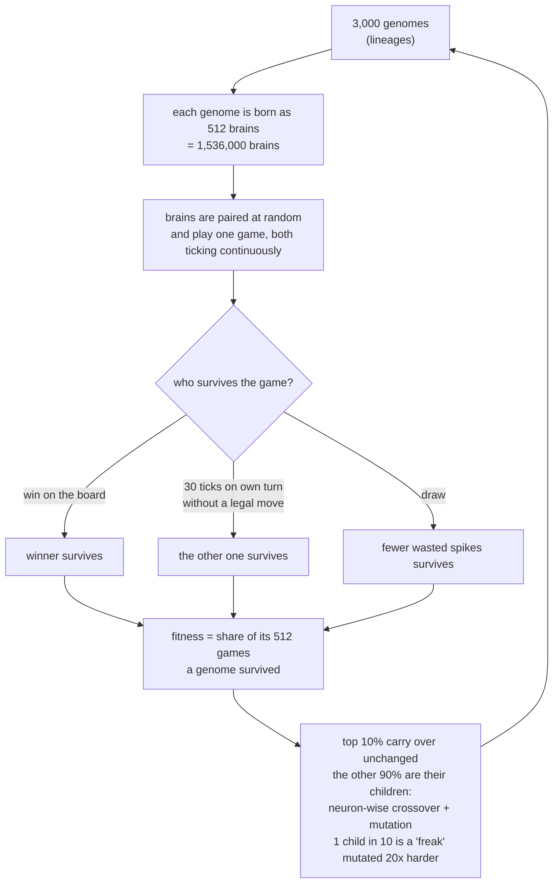

<p align="center">
  
  &nbsp;&nbsp;&nbsp;&nbsp;
  
</p>

<h1 align="center">Alive Tic-Tac-Toe AI</h1>

<p align="center">
  <b>A neural network that never stops running: it watches the board, remembers, waits its turn and acts.<br>
  No human designed its architecture or its learning rule. Evolution did.</b>
</p>

---

## The idea in one paragraph

A normal AI is a function. You call it with an input, it returns an output, and between calls it does not exist.
A brain is different: it runs **all the time**. It sees the world change, keeps an internal state, and decides
*by itself* **when** to act, not only **what** to do. This project tests whether that kind of agent can come out of
pure evolution. The test is tic-tac-toe. It is small enough to simulate **1.5 million brains per generation on one
GPU**, and it has a perfect player to measure against. The brains start as random wiring. After about 1,100
generations of natural selection they sit through the opponent's turn instead of firing into it. They mostly stop
pressing several buttons at once. Against a perfect minimax player they **draw about 85% of games** (up from 5%).
Nobody programmed any of that. And while it happened, evolution switched off **more than half of the hidden neurons**.

---

## Why this is different from a normal tic-tac-toe bot

A classic tic-tac-toe AI (minimax, a Q-table, a trained MLP) gets a perfectly packaged question: *"here is the
board, it is your turn, pick one of 9 cells."* The program handles the rest for it:

- **whose turn it is** (it is only ever called on its own turn),
- **when to answer** (it answers exactly once, instantly),
- **how many moves to make** (exactly one; the argmax picks it),
- **which moves are legal** (illegal moves are usually masked out).

**This brain is given none of that.** It lives in a continuous stream of time:

| | Traditional bot | Alive brain (this project) |
|---|---|---|
| When does it run? | Only when called | **Every tick**, during its turn *and* the opponent's |
| Who says it is my turn? | The program | **Nobody.** It has to see the board change |
| How is a move made? | `argmax` over 9 outputs | An output neuron **spikes** when it crosses a threshold |
| Firing twice / out of turn | Impossible | Possible, and wasteful: it has to *learn* not to |
| Doing nothing | Impossible | Possible: if it waits too long on its own turn, it **times out and loses** |
| Memory | None (or a hand-built buffer) | Every neuron has its own **leak gene**: how much of its value it keeps from tick to tick |
| Architecture | Designed by a human | **Evolved**: neurons and synapses switch on and off by mutation |
| Learning rule | Designed (backprop, TD, ...) | **None.** Only selection: brains that survive have children |

So before it can play well, the brain has to discover by itself that:

1. **The game has turns.** After I move, the world is not mine for a while.
2. **Waiting is part of the game.** Sitting through the opponent's turn (1–30 ticks, random) is correct. Firing
   during it is wasted effort.
3. **One move per turn.** Spiking several outputs, or the same cell again, does nothing useful.
4. **But not too much waiting.** On my own turn I have 30 ticks to act, or I lose.
5. **Then** the actual tactics: blocking, taking the centre, finishing lines.

---

## The brain


Every tick, every neuron updates:

```
x  =  tanh( d0 * x   +   (W0 * conn) · x   +   b   +   noise )
          └ memory ┘   └ evolved wiring  ┘   bias   per-neuron random kick
```

- `d0` (per neuron, 0–1) is the **leak**: 0 = forgets instantly, 1 = holds its value. It is the brain's memory.
  Nothing else stores the past.
- An output **spikes the tick it crosses its threshold from below**, and must fall back under before it can spike
  again. No refractory timer, no move window, no argmax. The spike *is* the move.
- Noise comes from OS entropy every tick, so no two lives are the same.
- The weights **never change during a life**. A brain is exactly its genome from first tick to last.

### Everything is a gene

| Gene | What it is |
|---|---|
| `W0` | strength of every possible synapse (120 x 120) |
| `conn` | **whether each synapse exists at all** (on/off) |
| `alive` | **whether each hidden neuron exists at all** (on/off) |
| `b` | per-neuron bias |
| `d0` | per-neuron leak (memory) |
| `noise` | per-neuron noise level |
| `thr` | firing threshold of the outputs |
| `log_mw` | the mutation step size itself (evolution tunes its own search) |

The only things fixed by hand are physics: the tensor size (at most 82 hidden neurons), `tanh`, the weight clamp
±5, and the rules of the world.

---

## The world and natural selection



- **Brains only ever play each other.** There is no teacher in training. The random mover and the perfect
  minimax player appear only as **exams** (every 5th generation, logged, never selected on).
- **An illegal spike is ignored by the board**: out of turn, or on a taken cell. It costs nothing but a 0.001
  tie-break in a draw, and the clock keeps running. So no rule says "don't do that". Wasted spikes just don't
  help you survive.
- **No reward for a win, a legal move or waiting.** The game decides who survives. That's all.
- The road here was long: five full runs, plus reward schemes that let brains cheat (out-waiting, banking a lead by
  ending the game with an illegal move, seat bias). Each loophole and its fix is written up in
  [docs/DESIGN.md](docs/DESIGN.md).

---

## Results (run 5, the log included in this repo)

1,149 generations, 3,000 genomes x 512 brains, ~12 hours on one RTX A6000 (≈30 s per generation).
Numbers are taken straight from [`train_evo.log`](train_evo.log).

**Exam against the perfect minimax player** (never loses; a draw is the best possible result):

| Generation | Draws vs perfect | Losses vs perfect | Wins vs random mover | Losses vs random mover |
|---:|---:|---:|---:|---:|
| 0 | 4.6% | 93.5% | 44.8% | 38.3% |
| 150 | 10.2% | 79.5% | 53.6% | 22.9% |
| 225 | 39.2% | 60.0% | 54.5% | 20.2% |
| 525 | 43.9% | 40.9% | 48.4% | 15.7% |
| 600 | 73.6% | 13.3% | 47.0% | 11.3% |
| 825 | **88.7%** | 8.6% | 47.3% | 18.1% |
| 1145 | **86.6%** | 10.5% | 39.2% | 19.7% |

**Learning to wait and to press once.** Wasted spikes (out of turn or on a taken cell) per brain per game, across
the *whole* population:

| Generation | 0 | 100 | 300 | 600 | 900 | 1100 |
|---|---:|---:|---:|---:|---:|---:|
| wasted spikes / brain / game | 15.0 | 9.6 | 8.2 | 6.5 | 6.0 | **5.6** |

**Evolution prunes the network.** The best genome's number of **active hidden neurons**:

| Generation | 0 | 75 | 300 | 600 | 900 | 1125 |
|---|---:|---:|---:|---:|---:|---:|
| active hidden neurons (of 82) | 57 | 33 | 27 | 29 | 27 | **22–29** |

Nobody asked for a smaller brain. Selection found that about **half the neurons were unnecessary**, and switching
them off did not hurt play. Connection density among the remaining neurons stayed near 50%.

**What that means for compute, in theory.** A switched-off neuron sends and receives nothing, so every synapse
touching it is effectively severed. Counting only synapses that can carry a signal:

| | Live neurons (29 sensors + hidden + 9 outputs) | Working synapses (≈ live² x 50% density) |
|---|---:|---:|
| Fully connected, all 82 hidden on | 120 | 14,400 (100%) |
| Best genome, generation 0 | 95 | ≈ 4,500 (31%) |
| Best genome, generation ~1100 | ≈ 64 | ≈ **2,000 (14%)** |

So the evolved brain needs about **half the multiply-adds per tick of the generation-0 brain**, and about
**1/7 of a fully connected one**. Executed on sparse or neuromorphic hardware, that should translate into less
energy per decision. Evolution got there with no penalty for size or energy at all.

### Honest limitations

- Against the **random mover** the brains win ~40–50% and still lose 15–20%, so their tactics are far from perfect.
  The perfect-player exam rewards safe, solid play; the random mover rewards punishing mistakes, and that is not
  learned yet.
- About 30% of population games still end in a **timeout**: some brain waited too long on its own turn.
- Wasted spikes fell by ~2/3 but are not zero.
- The compute saving above is **theoretical**. For GPU throughput the simulator still multiplies the full dense
  120 x 120 matrix (masked) every tick, so no energy or speed saving has been measured yet. Running the evolved
  brains as a truly sparse network and timing it is the natural next step.

---

## Watch it: the live dashboard


`dashboard.py` serves a web page that reads the training log live (refreshing every few seconds) and shows:

- **Population play**: games that reach a board result, draws, timeouts, wasted spikes, ticks per game
- **Best lineage**: its outcomes and its genes (threshold, active neurons, connection density, noise, leak)
- **Exams**: draws vs the perfect player, wins vs the random mover
- **Live battle**: the newest saved brain plays itself or the perfect player, tick by tick. Every neuron and
  every strong synapse is drawn (blue = positive, red = negative), along with what each brain sees, what it
  remembers, and which output it wants to fire.

```bash
python dashboard.py --log train_evo.log --port 8766
# open http://localhost:8766
```

It works straight after cloning: the run-5 log and the generation-1149 champion (`best_evo_01149.npz`) are
included. The battle runs on CPU if you have no GPU.

---

## Reproduce it

```bash
git clone https://github.com/kyung01/Alive-TicTacToe-AI.git
cd Alive-TicTacToe-AI
pip install -r requirements.txt      # numpy + PyTorch (install the CUDA build for your GPU)
```

**Full run 5 (the result above; ~40 GB VRAM-class GPU, ~30 s/generation on an RTX A6000):**

```bash
python evo_rule.py --rules 3000 --brains 512 --chunk 300 --life 1 \
  --opponent peer --select pair --elite 0.1 --mutation 2.5 \
  --opp-delay 30 --reward-attempt -0.001
```

**Smaller run for a normal GPU** (same rules, fewer brains, noisier selection):

```bash
python evo_rule.py --rules 512 --brains 128 --chunk 128 --life 1 \
  --opponent peer --select pair --elite 0.1 --mutation 2.5 \
  --opp-delay 30 --reward-attempt -0.001 2>&1 | tee train_evo.log
```

Then, in a second terminal:

```bash
python dashboard.py --log train_evo.log --port 8766
```

- Each generation saves the whole population (`evo_pop_XXXXX.npz`, large, git-ignored) and the best brain
  (`best_evo_XXXXX.npz`). The last 3 of each are kept.
- `--resume latest` continues from the newest population.
- Create a file named `STOP` in the folder to save and exit cleanly.
- `python evo_rule.py --help` lists every option.

---

## Files

| File | Purpose |
|---|---|
| [`evo_rule.py`](evo_rule.py) | **The experiment**: genome, continuous game, pair selection, mutation, crossover, exams |
| [`brain_ttt_gpu.py`](brain_ttt_gpu.py), [`brain_ttt.py`](brain_ttt.py) | Shared game logic and the earlier learning-rule experiments |
| [`perfect.py`](perfect.py) | Perfect minimax player as a lookup table (exam only) |
| [`battle.py`](battle.py) | Replays a saved brain vs itself or vs the perfect player, recording every neuron every tick |
| [`dashboard.py`](dashboard.py) + [`dashboard.html`](dashboard.html) | Live training dashboard and battle viewer |
| [`train_evo.log`](train_evo.log) | Full log of run 5 (generations 0–1149) |
| [`best_evo_01149.npz`](best_evo_01149.npz) | The best evolved brain at generation 1149 |
| [`runs/`](runs) | Logs of runs 1–4, the failed and superseded attempts |
| [`docs/DESIGN.md`](docs/DESIGN.md) | Full lab notebook: every design decision, every loophole, every fix |
| [`docs/`](docs) | The theory behind the project ([theory](docs/theory.md), [approach](docs/approach.md), [experiments](docs/experiments.md), [diary](docs/diary.md)) |

---

## The bigger question

Most of today's AI is a pipeline a human designed: fixed layers, a fixed learning rule, called once per input,
gone in between. Brains are not like that. They loop, they keep state, they choose their own timing, and their
wiring was shaped by selection, not drawn by an engineer.

This project is a small proof of concept for the other path: **provide primitives, never the plan.**
Give evolution neurons, synapses, memory, noise and a world with consequences, and let structure emerge.
Turn-taking, patience, restraint, a compact network, and solid tic-tac-toe all emerged here without being
programmed in.

Tic-tac-toe is tiny. The question it opens is not: what else emerges when we stop designing the mind and let it be
selected?

---

<sub>Author: Kyung (<a href="https://github.com/kyung01">@kyung01</a>). Contributions, replications and critiques welcome: open an issue.</sub>
