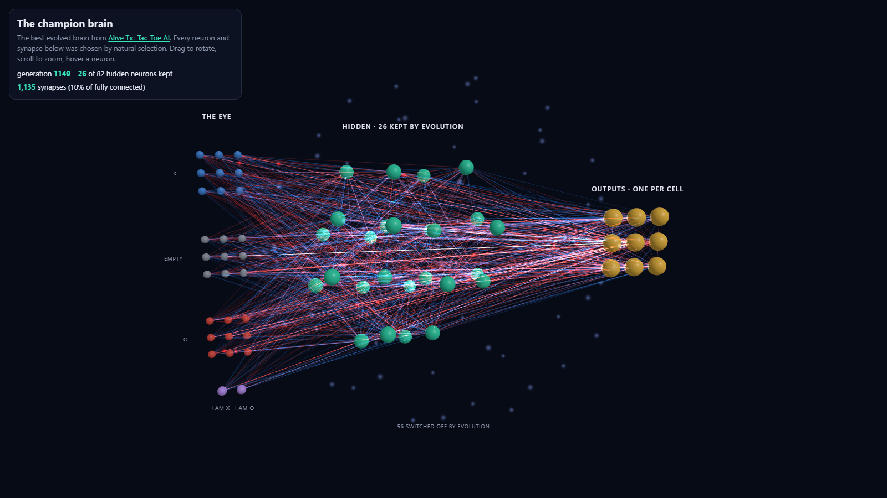
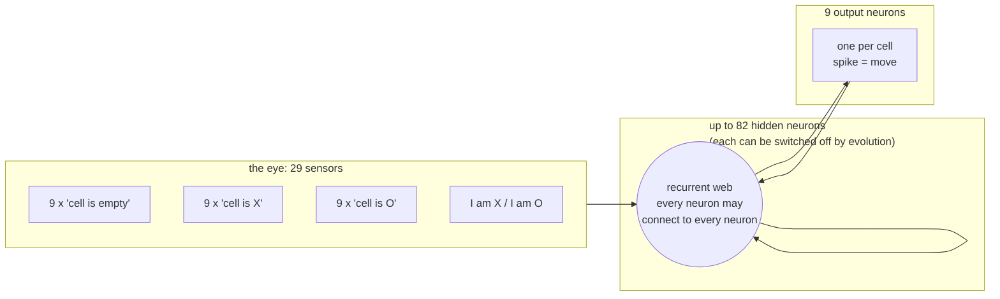
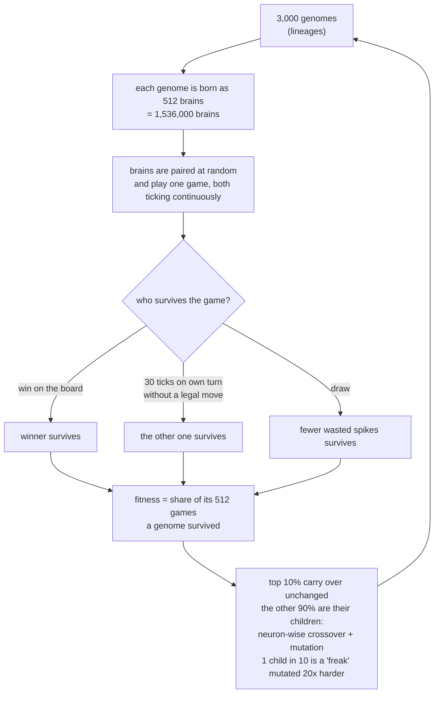

<p align="center">
  
  &nbsp;&nbsp;&nbsp;&nbsp;
  
</p>

<h1 align="center">Alive Tic-Tac-Toe AI</h1>

<p align="center">
  <b>A neural network that never stops running: it watches the board, remembers, waits its turn and acts.<br>
  No human designed its architecture or its learning rule. Evolution did.</b>
</p>

<p align="center">
  <a href="https://kyung01.github.io/Alive-TicTacToe-AI/brain3d/"></a>
  <br>
  <b><a href="https://kyung01.github.io/Alive-TicTacToe-AI/brain3d/">▶ Open the champion brain in 3D</a></b>: rotate it, hover any neuron, watch it think, or play against it.
</p>

---

## The idea in one paragraph

A normal AI is a function. You call it with an input, it returns an output, and between calls it does not exist.
A brain is different: it runs **all the time**. It sees the world change, keeps an internal state, and decides
*by itself* **when** to act, not only **what** to do. This project tests whether that kind of agent can come out of
pure evolution. The test is tic-tac-toe. It is small enough to simulate **1.5 million brains per generation on one
GPU**, and it has a perfect player to measure against. The brains start as random wiring. After about 1,100
generations of natural selection they sit through the opponent's turn instead of firing into it, they stop
pressing several buttons at once, and they go from losing almost every game against a perfect minimax player to
standing up to it. Nobody programmed any of that. And along the way **the network shrank itself**: evolution found more than half
of the neurons unnecessary and switched them off, leaving a brain that uses **a tenth of the connections** of a
fully connected one.

---

## Why this is different from a normal tic-tac-toe bot

A classic tic-tac-toe AI (minimax, a Q-table, a trained MLP) gets a perfectly packaged question: *"here is the
board, it is your turn, pick one of 9 cells."* The program handles the rest for it:

- **whose turn it is** (it is only ever called on its own turn),
- **when to answer** (it answers exactly once, instantly),
- **how many moves to make** (exactly one; the argmax picks it),
- **which moves are legal** (illegal moves are usually masked out).

**This brain is given none of that.** It lives in a continuous stream of time:

| | Traditional bot | Alive brain (this project) |
|---|---|---|
| How does it get the board? | Handed a data structure on its turn | Through an artificial **eye** that streams the board into it every tick |
| When does it run? | Only when called | **Every tick**, during its turn *and* the opponent's |
| Who says it is my turn? | The program | **Nobody.** It has to see the board change |
| How is a move made? | `argmax` over 9 outputs | An output neuron **spikes** when it crosses a threshold |
| Firing twice / out of turn | Impossible | Possible, and wasteful: it has to *learn* not to |
| Doing nothing | Impossible | Possible: if it waits too long on its own turn, it **times out and loses** |
| Memory | None (or a hand-built buffer) | Every neuron has its own **leak gene**: how much of its value it keeps from tick to tick |
| Architecture | Designed by a human | **Evolved**: neurons and synapses switch on and off by mutation |
| Learning rule | Designed (backprop, TD, ...) | **None.** Only selection: brains that survive have children |

So before it can play well, the brain has to discover by itself that:

1. **The game has turns.** After I move, the world is not mine for a while.
2. **Waiting is part of the game.** Sitting through the opponent's turn (1–30 ticks, random) is correct. Firing
   during it is wasted effort.
3. **One move per turn.** Spiking several outputs, or the same cell again, does nothing useful.
4. **But not too much waiting.** On my own turn I have 30 ticks to act, or I lose.
5. **Then** the actual tactics: blocking, taking the centre, finishing lines.

---

## The brain

### The champion, in 3D

Drag to rotate the model below; GitHub draws it right here. Each solid is a live neuron and each rod is one of
the 220 strongest synapses of the generation-1149 champion. The eye is on the left (three 3x3 retinas: X, empty,
O), the outputs on the right (one per cell), and the hidden neurons evolution kept are in between. For colour,
signals flowing through it live, and a game against it, open the [interactive version](https://kyung01.github.io/Alive-TicTacToe-AI/brain3d/).

The hidden neurons are placed by a **rubber-band simulation**. Every live connection is one identical spring, the
same strength whatever its weight: it pulls when stretched and pushes when squeezed. Hidden neurons also push
each other apart to keep their distance. The eye and the outputs are pinned; switched-off neurons and connections
exert no force. Neurons that share many connections pull together, so the picture is the brain's real wiring.
The cloud sits closer to the eye because the hidden neurons are wired far more to the 29 eye receptors than to
the 9 outputs.

<!-- brain-stl:start -->

```stl
solid brain
facet normal 0.58 0.58 0.58
outer loop
vertex -7.39 0.55 0
vertex -7.55 0.71 0
vertex -7.55 0.55 0.16
endloop
endfacet
facet normal -0.58 -0.58 0.58
outer loop
vertex -7.39 0.55 0
vertex -7.55 0.71 0
vertex -7.55 0.55 -0.16
endloop
endfacet
facet normal -0.58 0.58 -0.58
outer loop
vertex -7.39 0.55 0
vertex -7.55 0.39 0
vertex -7.55 0.55 0.16
endloop
endfacet
facet normal 0.58 -0.58 -0.58
outer loop
vertex -7.39 0.55 0
vertex -7.55 0.39 0
vertex -7.55 0.55 -0.16
endloop
endfacet
facet normal 0.58 -0.58 -0.58
outer loop
vertex -7.71 0.55 0
vertex -7.55 0.71 0
vertex -7.55 0.55 0.16
endloop
endfacet
facet normal -0.58 0.58 -0.58
outer loop
vertex -7.71 0.55 0
vertex -7.55 0.71 0
vertex -7.55 0.55 -0.16
endloop
endfacet
facet normal -0.58 -0.58 0.58
outer loop
vertex -7.71 0.55 0
vertex -7.55 0.39 0
vertex -7.55 0.55 0.16
endloop
endfacet
facet normal 0.58 0.58 0.58
outer loop
vertex -7.71 0.55 0
vertex -7.55 0.39 0
vertex -7.55 0.55 -0.16
endloop
endfacet
facet normal 0.58 0.58 0.58
outer loop
vertex -6.84 0.55 0
vertex -7 0.71 0
vertex -7 0.55 0.16
endloop
endfacet
facet normal -0.58 -0.58 0.58
outer loop
vertex -6.84 0.55 0
vertex -7 0.71 0
vertex -7 0.55 -0.16
endloop
endfacet
facet normal -0.58 0.58 -0.58
outer loop
vertex -6.84 0.55 0
vertex -7 0.39 0
vertex -7 0.55 0.16
endloop
endfacet
facet normal 0.58 -0.58 -0.58
outer loop
vertex -6.84 0.55 0
vertex -7 0.39 0
vertex -7 0.55 -0.16
endloop
endfacet
facet normal 0.58 -0.58 -0.58
outer loop
vertex -7.16 0.55 0
vertex -7 0.71 0
vertex -7 0.55 0.16
endloop
endfacet
facet normal -0.58 0.58 -0.58
outer loop
vertex -7.16 0.55 0
vertex -7 0.71 0
vertex -7 0.55 -0.16
endloop
endfacet
facet normal -0.58 -0.58 0.58
outer loop
vertex -7.16 0.55 0
vertex -7 0.39 0
vertex -7 0.55 0.16
endloop
endfacet
facet normal 0.58 0.58 0.58
outer loop
vertex -7.16 0.55 0
vertex -7 0.39 0
vertex -7 0.55 -0.16
endloop
endfacet
facet normal 0.58 0.58 0.58
outer loop
vertex -6.29 0.55 0
vertex -6.45 0.71 0
vertex -6.45 0.55 0.16
endloop
endfacet
facet normal -0.58 -0.58 0.58
outer loop
vertex -6.29 0.55 0
vertex -6.45 0.71 0
vertex -6.45 0.55 -0.16
endloop
endfacet
facet normal -0.58 0.58 -0.58
outer loop
vertex -6.29 0.55 0
vertex -6.45 0.39 0
vertex -6.45 0.55 0.16
endloop
endfacet
facet normal 0.58 -0.58 -0.58
outer loop
vertex -6.29 0.55 0
vertex -6.45 0.39 0
vertex -6.45 0.55 -0.16
endloop
endfacet
facet normal 0.58 -0.58 -0.58
outer loop
vertex -6.61 0.55 0
vertex -6.45 0.71 0
vertex -6.45 0.55 0.16
endloop
endfacet
facet normal -0.58 0.58 -0.58
outer loop
vertex -6.61 0.55 0
vertex -6.45 0.71 0
vertex -6.45 0.55 -0.16
endloop
endfacet
facet normal -0.58 -0.58 0.58
outer loop
vertex -6.61 0.55 0
vertex -6.45 0.39 0
vertex -6.45 0.55 0.16
endloop
endfacet
facet normal 0.58 0.58 0.58
outer loop
vertex -6.61 0.55 0
vertex -6.45 0.39 0
vertex -6.45 0.55 -0.16
endloop
endfacet
facet normal 0.58 0.58 0.58
outer loop
vertex -7.39 0 0
vertex -7.55 0.16 0
vertex -7.55 0 0.16
endloop
endfacet
facet normal -0.58 -0.58 0.58
outer loop
vertex -7.39 0 0
vertex -7.55 0.16 0
vertex -7.55 0 -0.16
endloop
endfacet
facet normal -0.58 0.58 -0.58
outer loop
vertex -7.39 0 0
vertex -7.55 -0.16 0
vertex -7.55 0 0.16
endloop
endfacet
facet normal 0.58 -0.58 -0.58
outer loop
vertex -7.39 0 0
vertex -7.55 -0.16 0
vertex -7.55 0 -0.16
endloop
endfacet
facet normal 0.58 -0.58 -0.58
outer loop
vertex -7.71 0 0
vertex -7.55 0.16 0
vertex -7.55 0 0.16
endloop
endfacet
facet normal -0.58 0.58 -0.58
outer loop
vertex -7.71 0 0
vertex -7.55 0.16 0
vertex -7.55 0 -0.16
endloop
endfacet
facet normal -0.58 -0.58 0.58
outer loop
vertex -7.71 0 0
vertex -7.55 -0.16 0
vertex -7.55 0 0.16
endloop
endfacet
facet normal 0.58 0.58 0.58
outer loop
vertex -7.71 0 0
vertex -7.55 -0.16 0
vertex -7.55 0 -0.16
endloop
endfacet
facet normal 0.58 0.58 0.58
outer loop
vertex -6.84 0 0
vertex -7 0.16 0
vertex -7 0 0.16
endloop
endfacet
facet normal -0.58 -0.58 0.58
outer loop
vertex -6.84 0 0
vertex -7 0.16 0
vertex -7 0 -0.16
endloop
endfacet
facet normal -0.58 0.58 -0.58
outer loop
vertex -6.84 0 0
vertex -7 -0.16 0
vertex -7 0 0.16
endloop
endfacet
facet normal 0.58 -0.58 -0.58
outer loop
vertex -6.84 0 0
vertex -7 -0.16 0
vertex -7 0 -0.16
endloop
endfacet
facet normal 0.58 -0.58 -0.58
outer loop
vertex -7.16 0 0
vertex -7 0.16 0
vertex -7 0 0.16
endloop
endfacet
facet normal -0.58 0.58 -0.58
outer loop
vertex -7.16 0 0
vertex -7 0.16 0
vertex -7 0 -0.16
endloop
endfacet
facet normal -0.58 -0.58 0.58
outer loop
vertex -7.16 0 0
vertex -7 -0.16 0
vertex -7 0 0.16
endloop
endfacet
facet normal 0.58 0.58 0.58
outer loop
vertex -7.16 0 0
vertex -7 -0.16 0
vertex -7 0 -0.16
endloop
endfacet
facet normal 0.58 0.58 0.58
outer loop
vertex -6.29 0 0
vertex -6.45 0.16 0
vertex -6.45 0 0.16
endloop
endfacet
facet normal -0.58 -0.58 0.58
outer loop
vertex -6.29 0 0
vertex -6.45 0.16 0
vertex -6.45 0 -0.16
endloop
endfacet
facet normal -0.58 0.58 -0.58
outer loop
vertex -6.29 0 0
vertex -6.45 -0.16 0
vertex -6.45 0 0.16
endloop
endfacet
facet normal 0.58 -0.58 -0.58
outer loop
vertex -6.29 0 0
vertex -6.45 -0.16 0
vertex -6.45 0 -0.16
endloop
endfacet
facet normal 0.58 -0.58 -0.58
outer loop
vertex -6.61 0 0
vertex -6.45 0.16 0
vertex -6.45 0 0.16
endloop
endfacet
facet normal -0.58 0.58 -0.58
outer loop
vertex -6.61 0 0
vertex -6.45 0.16 0
vertex -6.45 0 -0.16
endloop
endfacet
facet normal -0.58 -0.58 0.58
outer loop
vertex -6.61 0 0
vertex -6.45 -0.16 0
vertex -6.45 0 0.16
endloop
endfacet
facet normal 0.58 0.58 0.58
outer loop
vertex -6.61 0 0
vertex -6.45 -0.16 0
vertex -6.45 0 -0.16
endloop
endfacet
facet normal 0.58 0.58 0.58
outer loop
vertex -7.39 -0.55 0
vertex -7.55 -0.39 0
vertex -7.55 -0.55 0.16
endloop
endfacet
facet normal -0.58 -0.58 0.58
outer loop
vertex -7.39 -0.55 0
vertex -7.55 -0.39 0
vertex -7.55 -0.55 -0.16
endloop
endfacet
facet normal -0.58 0.58 -0.58
outer loop
vertex -7.39 -0.55 0
vertex -7.55 -0.71 0
vertex -7.55 -0.55 0.16
endloop
endfacet
facet normal 0.58 -0.58 -0.58
outer loop
vertex -7.39 -0.55 0
vertex -7.55 -0.71 0
vertex -7.55 -0.55 -0.16
endloop
endfacet
facet normal 0.58 -0.58 -0.58
outer loop
vertex -7.71 -0.55 0
vertex -7.55 -0.39 0
vertex -7.55 -0.55 0.16
endloop
endfacet
facet normal -0.58 0.58 -0.58
outer loop
vertex -7.71 -0.55 0
vertex -7.55 -0.39 0
vertex -7.55 -0.55 -0.16
endloop
endfacet
facet normal -0.58 -0.58 0.58
outer loop
vertex -7.71 -0.55 0
vertex -7.55 -0.71 0
vertex -7.55 -0.55 0.16
endloop
endfacet
facet normal 0.58 0.58 0.58
outer loop
vertex -7.71 -0.55 0
vertex -7.55 -0.71 0
vertex -7.55 -0.55 -0.16
endloop
endfacet
facet normal 0.58 0.58 0.58
outer loop
vertex -6.84 -0.55 0
vertex -7 -0.39 0
vertex -7 -0.55 0.16
endloop
endfacet
facet normal -0.58 -0.58 0.58
outer loop
vertex -6.84 -0.55 0
vertex -7 -0.39 0
vertex -7 -0.55 -0.16
endloop
endfacet
facet normal -0.58 0.58 -0.58
outer loop
vertex -6.84 -0.55 0
vertex -7 -0.71 0
vertex -7 -0.55 0.16
endloop
endfacet
facet normal 0.58 -0.58 -0.58
outer loop
vertex -6.84 -0.55 0
vertex -7 -0.71 0
vertex -7 -0.55 -0.16
endloop
endfacet
facet normal 0.58 -0.58 -0.58
outer loop
vertex -7.16 -0.55 0
vertex -7 -0.39 0
vertex -7 -0.55 0.16
endloop
endfacet
facet normal -0.58 0.58 -0.58
outer loop
vertex -7.16 -0.55 0
vertex -7 -0.39 0
vertex -7 -0.55 -0.16
endloop
endfacet
facet normal -0.58 -0.58 0.58
outer loop
vertex -7.16 -0.55 0
vertex -7 -0.71 0
vertex -7 -0.55 0.16
endloop
endfacet
facet normal 0.58 0.58 0.58
outer loop
vertex -7.16 -0.55 0
vertex -7 -0.71 0
vertex -7 -0.55 -0.16
endloop
endfacet
facet normal 0.58 0.58 0.58
outer loop
vertex -6.29 -0.55 0
vertex -6.45 -0.39 0
vertex -6.45 -0.55 0.16
endloop
endfacet
facet normal -0.58 -0.58 0.58
outer loop
vertex -6.29 -0.55 0
vertex -6.45 -0.39 0
vertex -6.45 -0.55 -0.16
endloop
endfacet
facet normal -0.58 0.58 -0.58
outer loop
vertex -6.29 -0.55 0
vertex -6.45 -0.71 0
vertex -6.45 -0.55 0.16
endloop
endfacet
facet normal 0.58 -0.58 -0.58
outer loop
vertex -6.29 -0.55 0
vertex -6.45 -0.71 0
vertex -6.45 -0.55 -0.16
endloop
endfacet
facet normal 0.58 -0.58 -0.58
outer loop
vertex -6.61 -0.55 0
vertex -6.45 -0.39 0
vertex -6.45 -0.55 0.16
endloop
endfacet
facet normal -0.58 0.58 -0.58
outer loop
vertex -6.61 -0.55 0
vertex -6.45 -0.39 0
vertex -6.45 -0.55 -0.16
endloop
endfacet
facet normal -0.58 -0.58 0.58
outer loop
vertex -6.61 -0.55 0
vertex -6.45 -0.71 0
vertex -6.45 -0.55 0.16
endloop
endfacet
facet normal 0.58 0.58 0.58
outer loop
vertex -6.61 -0.55 0
vertex -6.45 -0.71 0
vertex -6.45 -0.55 -0.16
endloop
endfacet
facet normal 0.58 0.58 0.58
outer loop
vertex -7.39 3.15 0
vertex -7.55 3.31 0
vertex -7.55 3.15 0.16
endloop
endfacet
facet normal -0.58 -0.58 0.58
outer loop
vertex -7.39 3.15 0
vertex -7.55 3.31 0
vertex -7.55 3.15 -0.16
endloop
endfacet
facet normal -0.58 0.58 -0.58
outer loop
vertex -7.39 3.15 0
vertex -7.55 2.99 0
vertex -7.55 3.15 0.16
endloop
endfacet
facet normal 0.58 -0.58 -0.58
outer loop
vertex -7.39 3.15 0
vertex -7.55 2.99 0
vertex -7.55 3.15 -0.16
endloop
endfacet
facet normal 0.58 -0.58 -0.58
outer loop
vertex -7.71 3.15 0
vertex -7.55 3.31 0
vertex -7.55 3.15 0.16
endloop
endfacet
facet normal -0.58 0.58 -0.58
outer loop
vertex -7.71 3.15 0
vertex -7.55 3.31 0
vertex -7.55 3.15 -0.16
endloop
endfacet
facet normal -0.58 -0.58 0.58
outer loop
vertex -7.71 3.15 0
vertex -7.55 2.99 0
vertex -7.55 3.15 0.16
endloop
endfacet
facet normal 0.58 0.58 0.58
outer loop
vertex -7.71 3.15 0
vertex -7.55 2.99 0
vertex -7.55 3.15 -0.16
endloop
endfacet
facet normal 0.58 0.58 0.58
outer loop
vertex -6.84 3.15 0
vertex -7 3.31 0
vertex -7 3.15 0.16
endloop
endfacet
facet normal -0.58 -0.58 0.58
outer loop
vertex -6.84 3.15 0
vertex -7 3.31 0
vertex -7 3.15 -0.16
endloop
endfacet
facet normal -0.58 0.58 -0.58
outer loop
vertex -6.84 3.15 0
vertex -7 2.99 0
vertex -7 3.15 0.16
endloop
endfacet
facet normal 0.58 -0.58 -0.58
outer loop
vertex -6.84 3.15 0
vertex -7 2.99 0
vertex -7 3.15 -0.16
endloop
endfacet
facet normal 0.58 -0.58 -0.58
outer loop
vertex -7.16 3.15 0
vertex -7 3.31 0
vertex -7 3.15 0.16
endloop
endfacet
facet normal -0.58 0.58 -0.58
outer loop
vertex -7.16 3.15 0
vertex -7 3.31 0
vertex -7 3.15 -0.16
endloop
endfacet
facet normal -0.58 -0.58 0.58
outer loop
vertex -7.16 3.15 0
vertex -7 2.99 0
vertex -7 3.15 0.16
endloop
endfacet
facet normal 0.58 0.58 0.58
outer loop
vertex -7.16 3.15 0
vertex -7 2.99 0
vertex -7 3.15 -0.16
endloop
endfacet
facet normal 0.58 0.58 0.58
outer loop
vertex -6.29 3.15 0
vertex -6.45 3.31 0
vertex -6.45 3.15 0.16
endloop
endfacet
facet normal -0.58 -0.58 0.58
outer loop
vertex -6.29 3.15 0
vertex -6.45 3.31 0
vertex -6.45 3.15 -0.16
endloop
endfacet
facet normal -0.58 0.58 -0.58
outer loop
vertex -6.29 3.15 0
vertex -6.45 2.99 0
vertex -6.45 3.15 0.16
endloop
endfacet
facet normal 0.58 -0.58 -0.58
outer loop
vertex -6.29 3.15 0
vertex -6.45 2.99 0
vertex -6.45 3.15 -0.16
endloop
endfacet
facet normal 0.58 -0.58 -0.58
outer loop
vertex -6.61 3.15 0
vertex -6.45 3.31 0
vertex -6.45 3.15 0.16
endloop
endfacet
facet normal -0.58 0.58 -0.58
outer loop
vertex -6.61 3.15 0
vertex -6.45 3.31 0
vertex -6.45 3.15 -0.16
endloop
endfacet
facet normal -0.58 -0.58 0.58
outer loop
vertex -6.61 3.15 0
vertex -6.45 2.99 0
vertex -6.45 3.15 0.16
endloop
endfacet
facet normal 0.58 0.58 0.58
outer loop
vertex -6.61 3.15 0
vertex -6.45 2.99 0
vertex -6.45 3.15 -0.16
endloop
endfacet
facet normal 0.58 0.58 0.58
outer loop
vertex -7.39 2.6 0
vertex -7.55 2.76 0
vertex -7.55 2.6 0.16
endloop
endfacet
facet normal -0.58 -0.58 0.58
outer loop
vertex -7.39 2.6 0
vertex -7.55 2.76 0
vertex -7.55 2.6 -0.16
endloop
endfacet
facet normal -0.58 0.58 -0.58
outer loop
vertex -7.39 2.6 0
vertex -7.55 2.44 0
vertex -7.55 2.6 0.16
endloop
endfacet
facet normal 0.58 -0.58 -0.58
outer loop
vertex -7.39 2.6 0
vertex -7.55 2.44 0
vertex -7.55 2.6 -0.16
endloop
endfacet
facet normal 0.58 -0.58 -0.58
outer loop
vertex -7.71 2.6 0
vertex -7.55 2.76 0
vertex -7.55 2.6 0.16
endloop
endfacet
facet normal -0.58 0.58 -0.58
outer loop
vertex -7.71 2.6 0
vertex -7.55 2.76 0
vertex -7.55 2.6 -0.16
endloop
endfacet
facet normal -0.58 -0.58 0.58
outer loop
vertex -7.71 2.6 0
vertex -7.55 2.44 0
vertex -7.55 2.6 0.16
endloop
endfacet
facet normal 0.58 0.58 0.58
outer loop
vertex -7.71 2.6 0
vertex -7.55 2.44 0
vertex -7.55 2.6 -0.16
endloop
endfacet
facet normal 0.58 0.58 0.58
outer loop
vertex -6.84 2.6 0
vertex -7 2.76 0
vertex -7 2.6 0.16
endloop
endfacet
facet normal -0.58 -0.58 0.58
outer loop
vertex -6.84 2.6 0
vertex -7 2.76 0
vertex -7 2.6 -0.16
endloop
endfacet
facet normal -0.58 0.58 -0.58
outer loop
vertex -6.84 2.6 0
vertex -7 2.44 0
vertex -7 2.6 0.16
endloop
endfacet
facet normal 0.58 -0.58 -0.58
outer loop
vertex -6.84 2.6 0
vertex -7 2.44 0
vertex -7 2.6 -0.16
endloop
endfacet
facet normal 0.58 -0.58 -0.58
outer loop
vertex -7.16 2.6 0
vertex -7 2.76 0
vertex -7 2.6 0.16
endloop
endfacet
facet normal -0.58 0.58 -0.58
outer loop
vertex -7.16 2.6 0
vertex -7 2.76 0
vertex -7 2.6 -0.16
endloop
endfacet
facet normal -0.58 -0.58 0.58
outer loop
vertex -7.16 2.6 0
vertex -7 2.44 0
vertex -7 2.6 0.16
endloop
endfacet
facet normal 0.58 0.58 0.58
outer loop
vertex -7.16 2.6 0
vertex -7 2.44 0
vertex -7 2.6 -0.16
endloop
endfacet
facet normal 0.58 0.58 0.58
outer loop
vertex -6.29 2.6 0
vertex -6.45 2.76 0
vertex -6.45 2.6 0.16
endloop
endfacet
facet normal -0.58 -0.58 0.58
outer loop
vertex -6.29 2.6 0
vertex -6.45 2.76 0
vertex -6.45 2.6 -0.16
endloop
endfacet
facet normal -0.58 0.58 -0.58
outer loop
vertex -6.29 2.6 0
vertex -6.45 2.44 0
vertex -6.45 2.6 0.16
endloop
endfacet
facet normal 0.58 -0.58 -0.58
outer loop
vertex -6.29 2.6 0
vertex -6.45 2.44 0
vertex -6.45 2.6 -0.16
endloop
endfacet
facet normal 0.58 -0.58 -0.58
outer loop
vertex -6.61 2.6 0
vertex -6.45 2.76 0
vertex -6.45 2.6 0.16
endloop
endfacet
facet normal -0.58 0.58 -0.58
outer loop
vertex -6.61 2.6 0
vertex -6.45 2.76 0
vertex -6.45 2.6 -0.16
endloop
endfacet
facet normal -0.58 -0.58 0.58
outer loop
vertex -6.61 2.6 0
vertex -6.45 2.44 0
vertex -6.45 2.6 0.16
endloop
endfacet
facet normal 0.58 0.58 0.58
outer loop
vertex -6.61 2.6 0
vertex -6.45 2.44 0
vertex -6.45 2.6 -0.16
endloop
endfacet
facet normal 0.58 0.58 0.58
outer loop
vertex -7.39 2.05 0
vertex -7.55 2.21 0
vertex -7.55 2.05 0.16
endloop
endfacet
facet normal -0.58 -0.58 0.58
outer loop
vertex -7.39 2.05 0
vertex -7.55 2.21 0
vertex -7.55 2.05 -0.16
endloop
endfacet
facet normal -0.58 0.58 -0.58
outer loop
vertex -7.39 2.05 0
vertex -7.55 1.89 0
vertex -7.55 2.05 0.16
endloop
endfacet
facet normal 0.58 -0.58 -0.58
outer loop
vertex -7.39 2.05 0
vertex -7.55 1.89 0
vertex -7.55 2.05 -0.16
endloop
endfacet
facet normal 0.58 -0.58 -0.58
outer loop
vertex -7.71 2.05 0
vertex -7.55 2.21 0
vertex -7.55 2.05 0.16
endloop
endfacet
facet normal -0.58 0.58 -0.58
outer loop
vertex -7.71 2.05 0
vertex -7.55 2.21 0
vertex -7.55 2.05 -0.16
endloop
endfacet
facet normal -0.58 -0.58 0.58
outer loop
vertex -7.71 2.05 0
vertex -7.55 1.89 0
vertex -7.55 2.05 0.16
endloop
endfacet
facet normal 0.58 0.58 0.58
outer loop
vertex -7.71 2.05 0
vertex -7.55 1.89 0
vertex -7.55 2.05 -0.16
endloop
endfacet
facet normal 0.58 0.58 0.58
outer loop
vertex -6.84 2.05 0
vertex -7 2.21 0
vertex -7 2.05 0.16
endloop
endfacet
facet normal -0.58 -0.58 0.58
outer loop
vertex -6.84 2.05 0
vertex -7 2.21 0
vertex -7 2.05 -0.16
endloop
endfacet
facet normal -0.58 0.58 -0.58
outer loop
vertex -6.84 2.05 0
vertex -7 1.89 0
vertex -7 2.05 0.16
endloop
endfacet
facet normal 0.58 -0.58 -0.58
outer loop
vertex -6.84 2.05 0
vertex -7 1.89 0
vertex -7 2.05 -0.16
endloop
endfacet
facet normal 0.58 -0.58 -0.58
outer loop
vertex -7.16 2.05 0
vertex -7 2.21 0
vertex -7 2.05 0.16
endloop
endfacet
facet normal -0.58 0.58 -0.58
outer loop
vertex -7.16 2.05 0
vertex -7 2.21 0
vertex -7 2.05 -0.16
endloop
endfacet
facet normal -0.58 -0.58 0.58
outer loop
vertex -7.16 2.05 0
vertex -7 1.89 0
vertex -7 2.05 0.16
endloop
endfacet
facet normal 0.58 0.58 0.58
outer loop
vertex -7.16 2.05 0
vertex -7 1.89 0
vertex -7 2.05 -0.16
endloop
endfacet
facet normal 0.58 0.58 0.58
outer loop
vertex -6.29 2.05 0
vertex -6.45 2.21 0
vertex -6.45 2.05 0.16
endloop
endfacet
facet normal -0.58 -0.58 0.58
outer loop
vertex -6.29 2.05 0
vertex -6.45 2.21 0
vertex -6.45 2.05 -0.16
endloop
endfacet
facet normal -0.58 0.58 -0.58
outer loop
vertex -6.29 2.05 0
vertex -6.45 1.89 0
vertex -6.45 2.05 0.16
endloop
endfacet
facet normal 0.58 -0.58 -0.58
outer loop
vertex -6.29 2.05 0
vertex -6.45 1.89 0
vertex -6.45 2.05 -0.16
endloop
endfacet
facet normal 0.58 -0.58 -0.58
outer loop
vertex -6.61 2.05 0
vertex -6.45 2.21 0
vertex -6.45 2.05 0.16
endloop
endfacet
facet normal -0.58 0.58 -0.58
outer loop
vertex -6.61 2.05 0
vertex -6.45 2.21 0
vertex -6.45 2.05 -0.16
endloop
endfacet
facet normal -0.58 -0.58 0.58
outer loop
vertex -6.61 2.05 0
vertex -6.45 1.89 0
vertex -6.45 2.05 0.16
endloop
endfacet
facet normal 0.58 0.58 0.58
outer loop
vertex -6.61 2.05 0
vertex -6.45 1.89 0
vertex -6.45 2.05 -0.16
endloop
endfacet
facet normal 0.58 0.58 0.58
outer loop
vertex -7.39 -2.05 0
vertex -7.55 -1.89 0
vertex -7.55 -2.05 0.16
endloop
endfacet
facet normal -0.58 -0.58 0.58
outer loop
vertex -7.39 -2.05 0
vertex -7.55 -1.89 0
vertex -7.55 -2.05 -0.16
endloop
endfacet
facet normal -0.58 0.58 -0.58
outer loop
vertex -7.39 -2.05 0
vertex -7.55 -2.21 0
vertex -7.55 -2.05 0.16
endloop
endfacet
facet normal 0.58 -0.58 -0.58
outer loop
vertex -7.39 -2.05 0
vertex -7.55 -2.21 0
vertex -7.55 -2.05 -0.16
endloop
endfacet
facet normal 0.58 -0.58 -0.58
outer loop
vertex -7.71 -2.05 0
vertex -7.55 -1.89 0
vertex -7.55 -2.05 0.16
endloop
endfacet
facet normal -0.58 0.58 -0.58
outer loop
vertex -7.71 -2.05 0
vertex -7.55 -1.89 0
vertex -7.55 -2.05 -0.16
endloop
endfacet
facet normal -0.58 -0.58 0.58
outer loop
vertex -7.71 -2.05 0
vertex -7.55 -2.21 0
vertex -7.55 -2.05 0.16
endloop
endfacet
facet normal 0.58 0.58 0.58
outer loop
vertex -7.71 -2.05 0
vertex -7.55 -2.21 0
vertex -7.55 -2.05 -0.16
endloop
endfacet
facet normal 0.58 0.58 0.58
outer loop
vertex -6.84 -2.05 0
vertex -7 -1.89 0
vertex -7 -2.05 0.16
endloop
endfacet
facet normal -0.58 -0.58 0.58
outer loop
vertex -6.84 -2.05 0
vertex -7 -1.89 0
vertex -7 -2.05 -0.16
endloop
endfacet
facet normal -0.58 0.58 -0.58
outer loop
vertex -6.84 -2.05 0
vertex -7 -2.21 0
vertex -7 -2.05 0.16
endloop
endfacet
facet normal 0.58 -0.58 -0.58
outer loop
vertex -6.84 -2.05 0
vertex -7 -2.21 0
vertex -7 -2.05 -0.16
endloop
endfacet
facet normal 0.58 -0.58 -0.58
outer loop
vertex -7.16 -2.05 0
vertex -7 -1.89 0
vertex -7 -2.05 0.16
endloop
endfacet
facet normal -0.58 0.58 -0.58
outer loop
vertex -7.16 -2.05 0
vertex -7 -1.89 0
vertex -7 -2.05 -0.16
endloop
endfacet
facet normal -0.58 -0.58 0.58
outer loop
vertex -7.16 -2.05 0
vertex -7 -2.21 0
vertex -7 -2.05 0.16
endloop
endfacet
facet normal 0.58 0.58 0.58
outer loop
vertex -7.16 -2.05 0
vertex -7 -2.21 0
vertex -7 -2.05 -0.16
endloop
endfacet
facet normal 0.58 0.58 0.58
outer loop
vertex -6.29 -2.05 0
vertex -6.45 -1.89 0
vertex -6.45 -2.05 0.16
endloop
endfacet
facet normal -0.58 -0.58 0.58
outer loop
vertex -6.29 -2.05 0
vertex -6.45 -1.89 0
vertex -6.45 -2.05 -0.16
endloop
endfacet
facet normal -0.58 0.58 -0.58
outer loop
vertex -6.29 -2.05 0
vertex -6.45 -2.21 0
vertex -6.45 -2.05 0.16
endloop
endfacet
facet normal 0.58 -0.58 -0.58
outer loop
vertex -6.29 -2.05 0
vertex -6.45 -2.21 0
vertex -6.45 -2.05 -0.16
endloop
endfacet
facet normal 0.58 -0.58 -0.58
outer loop
vertex -6.61 -2.05 0
vertex -6.45 -1.89 0
vertex -6.45 -2.05 0.16
endloop
endfacet
facet normal -0.58 0.58 -0.58
outer loop
vertex -6.61 -2.05 0
vertex -6.45 -1.89 0
vertex -6.45 -2.05 -0.16
endloop
endfacet
facet normal -0.58 -0.58 0.58
outer loop
vertex -6.61 -2.05 0
vertex -6.45 -2.21 0
vertex -6.45 -2.05 0.16
endloop
endfacet
facet normal 0.58 0.58 0.58
outer loop
vertex -6.61 -2.05 0
vertex -6.45 -2.21 0
vertex -6.45 -2.05 -0.16
endloop
endfacet
facet normal 0.58 0.58 0.58
outer loop
vertex -7.39 -2.6 0
vertex -7.55 -2.44 0
vertex -7.55 -2.6 0.16
endloop
endfacet
facet normal -0.58 -0.58 0.58
outer loop
vertex -7.39 -2.6 0
vertex -7.55 -2.44 0
vertex -7.55 -2.6 -0.16
endloop
endfacet
facet normal -0.58 0.58 -0.58
outer loop
vertex -7.39 -2.6 0
vertex -7.55 -2.76 0
vertex -7.55 -2.6 0.16
endloop
endfacet
facet normal 0.58 -0.58 -0.58
outer loop
vertex -7.39 -2.6 0
vertex -7.55 -2.76 0
vertex -7.55 -2.6 -0.16
endloop
endfacet
facet normal 0.58 -0.58 -0.58
outer loop
vertex -7.71 -2.6 0
vertex -7.55 -2.44 0
vertex -7.55 -2.6 0.16
endloop
endfacet
facet normal -0.58 0.58 -0.58
outer loop
vertex -7.71 -2.6 0
vertex -7.55 -2.44 0
vertex -7.55 -2.6 -0.16
endloop
endfacet
facet normal -0.58 -0.58 0.58
outer loop
vertex -7.71 -2.6 0
vertex -7.55 -2.76 0
vertex -7.55 -2.6 0.16
endloop
endfacet
facet normal 0.58 0.58 0.58
outer loop
vertex -7.71 -2.6 0
vertex -7.55 -2.76 0
vertex -7.55 -2.6 -0.16
endloop
endfacet
facet normal 0.58 0.58 0.58
outer loop
vertex -6.84 -2.6 0
vertex -7 -2.44 0
vertex -7 -2.6 0.16
endloop
endfacet
facet normal -0.58 -0.58 0.58
outer loop
vertex -6.84 -2.6 0
vertex -7 -2.44 0
vertex -7 -2.6 -0.16
endloop
endfacet
facet normal -0.58 0.58 -0.58
outer loop
vertex -6.84 -2.6 0
vertex -7 -2.76 0
vertex -7 -2.6 0.16
endloop
endfacet
facet normal 0.58 -0.58 -0.58
outer loop
vertex -6.84 -2.6 0
vertex -7 -2.76 0
vertex -7 -2.6 -0.16
endloop
endfacet
facet normal 0.58 -0.58 -0.58
outer loop
vertex -7.16 -2.6 0
vertex -7 -2.44 0
vertex -7 -2.6 0.16
endloop
endfacet
facet normal -0.58 0.58 -0.58
outer loop
vertex -7.16 -2.6 0
vertex -7 -2.44 0
vertex -7 -2.6 -0.16
endloop
endfacet
facet normal -0.58 -0.58 0.58
outer loop
vertex -7.16 -2.6 0
vertex -7 -2.76 0
vertex -7 -2.6 0.16
endloop
endfacet
facet normal 0.58 0.58 0.58
outer loop
vertex -7.16 -2.6 0
vertex -7 -2.76 0
vertex -7 -2.6 -0.16
endloop
endfacet
facet normal 0.58 0.58 0.58
outer loop
vertex -6.29 -2.6 0
vertex -6.45 -2.44 0
vertex -6.45 -2.6 0.16
endloop
endfacet
facet normal -0.58 -0.58 0.58
outer loop
vertex -6.29 -2.6 0
vertex -6.45 -2.44 0
vertex -6.45 -2.6 -0.16
endloop
endfacet
facet normal -0.58 0.58 -0.58
outer loop
vertex -6.29 -2.6 0
vertex -6.45 -2.76 0
vertex -6.45 -2.6 0.16
endloop
endfacet
facet normal 0.58 -0.58 -0.58
outer loop
vertex -6.29 -2.6 0
vertex -6.45 -2.76 0
vertex -6.45 -2.6 -0.16
endloop
endfacet
facet normal 0.58 -0.58 -0.58
outer loop
vertex -6.61 -2.6 0
vertex -6.45 -2.44 0
vertex -6.45 -2.6 0.16
endloop
endfacet
facet normal -0.58 0.58 -0.58
outer loop
vertex -6.61 -2.6 0
vertex -6.45 -2.44 0
vertex -6.45 -2.6 -0.16
endloop
endfacet
facet normal -0.58 -0.58 0.58
outer loop
vertex -6.61 -2.6 0
vertex -6.45 -2.76 0
vertex -6.45 -2.6 0.16
endloop
endfacet
facet normal 0.58 0.58 0.58
outer loop
vertex -6.61 -2.6 0
vertex -6.45 -2.76 0
vertex -6.45 -2.6 -0.16
endloop
endfacet
facet normal 0.58 0.58 0.58
outer loop
vertex -7.39 -3.15 0
vertex -7.55 -2.99 0
vertex -7.55 -3.15 0.16
endloop
endfacet
facet normal -0.58 -0.58 0.58
outer loop
vertex -7.39 -3.15 0
vertex -7.55 -2.99 0
vertex -7.55 -3.15 -0.16
endloop
endfacet
facet normal -0.58 0.58 -0.58
outer loop
vertex -7.39 -3.15 0
vertex -7.55 -3.31 0
vertex -7.55 -3.15 0.16
endloop
endfacet
facet normal 0.58 -0.58 -0.58
outer loop
vertex -7.39 -3.15 0
vertex -7.55 -3.31 0
vertex -7.55 -3.15 -0.16
endloop
endfacet
facet normal 0.58 -0.58 -0.58
outer loop
vertex -7.71 -3.15 0
vertex -7.55 -2.99 0
vertex -7.55 -3.15 0.16
endloop
endfacet
facet normal -0.58 0.58 -0.58
outer loop
vertex -7.71 -3.15 0
vertex -7.55 -2.99 0
vertex -7.55 -3.15 -0.16
endloop
endfacet
facet normal -0.58 -0.58 0.58
outer loop
vertex -7.71 -3.15 0
vertex -7.55 -3.31 0
vertex -7.55 -3.15 0.16
endloop
endfacet
facet normal 0.58 0.58 0.58
outer loop
vertex -7.71 -3.15 0
vertex -7.55 -3.31 0
vertex -7.55 -3.15 -0.16
endloop
endfacet
facet normal 0.58 0.58 0.58
outer loop
vertex -6.84 -3.15 0
vertex -7 -2.99 0
vertex -7 -3.15 0.16
endloop
endfacet
facet normal -0.58 -0.58 0.58
outer loop
vertex -6.84 -3.15 0
vertex -7 -2.99 0
vertex -7 -3.15 -0.16
endloop
endfacet
facet normal -0.58 0.58 -0.58
outer loop
vertex -6.84 -3.15 0
vertex -7 -3.31 0
vertex -7 -3.15 0.16
endloop
endfacet
facet normal 0.58 -0.58 -0.58
outer loop
vertex -6.84 -3.15 0
vertex -7 -3.31 0
vertex -7 -3.15 -0.16
endloop
endfacet
facet normal 0.58 -0.58 -0.58
outer loop
vertex -7.16 -3.15 0
vertex -7 -2.99 0
vertex -7 -3.15 0.16
endloop
endfacet
facet normal -0.58 0.58 -0.58
outer loop
vertex -7.16 -3.15 0
vertex -7 -2.99 0
vertex -7 -3.15 -0.16
endloop
endfacet
facet normal -0.58 -0.58 0.58
outer loop
vertex -7.16 -3.15 0
vertex -7 -3.31 0
vertex -7 -3.15 0.16
endloop
endfacet
facet normal 0.58 0.58 0.58
outer loop
vertex -7.16 -3.15 0
vertex -7 -3.31 0
vertex -7 -3.15 -0.16
endloop
endfacet
facet normal 0.58 0.58 0.58
outer loop
vertex -6.29 -3.15 0
vertex -6.45 -2.99 0
vertex -6.45 -3.15 0.16
endloop
endfacet
facet normal -0.58 -0.58 0.58
outer loop
vertex -6.29 -3.15 0
vertex -6.45 -2.99 0
vertex -6.45 -3.15 -0.16
endloop
endfacet
facet normal -0.58 0.58 -0.58
outer loop
vertex -6.29 -3.15 0
vertex -6.45 -3.31 0
vertex -6.45 -3.15 0.16
endloop
endfacet
facet normal 0.58 -0.58 -0.58
outer loop
vertex -6.29 -3.15 0
vertex -6.45 -3.31 0
vertex -6.45 -3.15 -0.16
endloop
endfacet
facet normal 0.58 -0.58 -0.58
outer loop
vertex -6.61 -3.15 0
vertex -6.45 -2.99 0
vertex -6.45 -3.15 0.16
endloop
endfacet
facet normal -0.58 0.58 -0.58
outer loop
vertex -6.61 -3.15 0
vertex -6.45 -2.99 0
vertex -6.45 -3.15 -0.16
endloop
endfacet
facet normal -0.58 -0.58 0.58
outer loop
vertex -6.61 -3.15 0
vertex -6.45 -3.31 0
vertex -6.45 -3.15 0.16
endloop
endfacet
facet normal 0.58 0.58 0.58
outer loop
vertex -6.61 -3.15 0
vertex -6.45 -3.31 0
vertex -6.45 -3.15 -0.16
endloop
endfacet
facet normal 0.58 0.58 0.58
outer loop
vertex -7.14 -4.4 0
vertex -7.3 -4.24 0
vertex -7.3 -4.4 0.16
endloop
endfacet
facet normal -0.58 -0.58 0.58
outer loop
vertex -7.14 -4.4 0
vertex -7.3 -4.24 0
vertex -7.3 -4.4 -0.16
endloop
endfacet
facet normal -0.58 0.58 -0.58
outer loop
vertex -7.14 -4.4 0
vertex -7.3 -4.56 0
vertex -7.3 -4.4 0.16
endloop
endfacet
facet normal 0.58 -0.58 -0.58
outer loop
vertex -7.14 -4.4 0
vertex -7.3 -4.56 0
vertex -7.3 -4.4 -0.16
endloop
endfacet
facet normal 0.58 -0.58 -0.58
outer loop
vertex -7.46 -4.4 0
vertex -7.3 -4.24 0
vertex -7.3 -4.4 0.16
endloop
endfacet
facet normal -0.58 0.58 -0.58
outer loop
vertex -7.46 -4.4 0
vertex -7.3 -4.24 0
vertex -7.3 -4.4 -0.16
endloop
endfacet
facet normal -0.58 -0.58 0.58
outer loop
vertex -7.46 -4.4 0
vertex -7.3 -4.56 0
vertex -7.3 -4.4 0.16
endloop
endfacet
facet normal 0.58 0.58 0.58
outer loop
vertex -7.46 -4.4 0
vertex -7.3 -4.56 0
vertex -7.3 -4.4 -0.16
endloop
endfacet
facet normal 0.58 0.58 0.58
outer loop
vertex -6.54 -4.4 0
vertex -6.7 -4.24 0
vertex -6.7 -4.4 0.16
endloop
endfacet
facet normal -0.58 -0.58 0.58
outer loop
vertex -6.54 -4.4 0
vertex -6.7 -4.24 0
vertex -6.7 -4.4 -0.16
endloop
endfacet
facet normal -0.58 0.58 -0.58
outer loop
vertex -6.54 -4.4 0
vertex -6.7 -4.56 0
vertex -6.7 -4.4 0.16
endloop
endfacet
facet normal 0.58 -0.58 -0.58
outer loop
vertex -6.54 -4.4 0
vertex -6.7 -4.56 0
vertex -6.7 -4.4 -0.16
endloop
endfacet
facet normal 0.58 -0.58 -0.58
outer loop
vertex -6.86 -4.4 0
vertex -6.7 -4.24 0
vertex -6.7 -4.4 0.16
endloop
endfacet
facet normal -0.58 0.58 -0.58
outer loop
vertex -6.86 -4.4 0
vertex -6.7 -4.24 0
vertex -6.7 -4.4 -0.16
endloop
endfacet
facet normal -0.58 -0.58 0.58
outer loop
vertex -6.86 -4.4 0
vertex -6.7 -4.56 0
vertex -6.7 -4.4 0.16
endloop
endfacet
facet normal 0.58 0.58 0.58
outer loop
vertex -6.86 -4.4 0
vertex -6.7 -4.56 0
vertex -6.7 -4.4 -0.16
endloop
endfacet
facet normal 0.58 0.58 0.58
outer loop
vertex 1.83 -1.22 -1.43
vertex 1.57 -0.96 -1.43
vertex 1.57 -1.22 -1.17
endloop
endfacet
facet normal -0.58 -0.58 0.58
outer loop
vertex 1.83 -1.22 -1.43
vertex 1.57 -0.96 -1.43
vertex 1.57 -1.22 -1.69
endloop
endfacet
facet normal -0.58 0.58 -0.58
outer loop
vertex 1.83 -1.22 -1.43
vertex 1.57 -1.48 -1.43
vertex 1.57 -1.22 -1.17
endloop
endfacet
facet normal 0.58 -0.58 -0.58
outer loop
vertex 1.83 -1.22 -1.43
vertex 1.57 -1.48 -1.43
vertex 1.57 -1.22 -1.69
endloop
endfacet
facet normal 0.58 -0.58 -0.58
outer loop
vertex 1.31 -1.22 -1.43
vertex 1.57 -0.96 -1.43
vertex 1.57 -1.22 -1.17
endloop
endfacet
facet normal -0.58 0.58 -0.58
outer loop
vertex 1.31 -1.22 -1.43
vertex 1.57 -0.96 -1.43
vertex 1.57 -1.22 -1.69
endloop
endfacet
facet normal -0.58 -0.58 0.58
outer loop
vertex 1.31 -1.22 -1.43
vertex 1.57 -1.48 -1.43
vertex 1.57 -1.22 -1.17
endloop
endfacet
facet normal 0.58 0.58 0.58
outer loop
vertex 1.31 -1.22 -1.43
vertex 1.57 -1.48 -1.43
vertex 1.57 -1.22 -1.69
endloop
endfacet
facet normal 0.58 0.58 0.58
outer loop
vertex -0.93 -3.25 -0.93
vertex -1.19 -2.99 -0.93
vertex -1.19 -3.25 -0.67
endloop
endfacet
facet normal -0.58 -0.58 0.58
outer loop
vertex -0.93 -3.25 -0.93
vertex -1.19 -2.99 -0.93
vertex -1.19 -3.25 -1.19
endloop
endfacet
facet normal -0.58 0.58 -0.58
outer loop
vertex -0.93 -3.25 -0.93
vertex -1.19 -3.51 -0.93
vertex -1.19 -3.25 -0.67
endloop
endfacet
facet normal 0.58 -0.58 -0.58
outer loop
vertex -0.93 -3.25 -0.93
vertex -1.19 -3.51 -0.93
vertex -1.19 -3.25 -1.19
endloop
endfacet
facet normal 0.58 -0.58 -0.58
outer loop
vertex -1.45 -3.25 -0.93
vertex -1.19 -2.99 -0.93
vertex -1.19 -3.25 -0.67
endloop
endfacet
facet normal -0.58 0.58 -0.58
outer loop
vertex -1.45 -3.25 -0.93
vertex -1.19 -2.99 -0.93
vertex -1.19 -3.25 -1.19
endloop
endfacet
facet normal -0.58 -0.58 0.58
outer loop
vertex -1.45 -3.25 -0.93
vertex -1.19 -3.51 -0.93
vertex -1.19 -3.25 -0.67
endloop
endfacet
facet normal 0.58 0.58 0.58
outer loop
vertex -1.45 -3.25 -0.93
vertex -1.19 -3.51 -0.93
vertex -1.19 -3.25 -1.19
endloop
endfacet
facet normal 0.58 0.58 0.58
outer loop
vertex 1.4 -0.97 0.89
vertex 1.14 -0.71 0.89
vertex 1.14 -0.97 1.15
endloop
endfacet
facet normal -0.58 -0.58 0.58
outer loop
vertex 1.4 -0.97 0.89
vertex 1.14 -0.71 0.89
vertex 1.14 -0.97 0.63
endloop
endfacet
facet normal -0.58 0.58 -0.58
outer loop
vertex 1.4 -0.97 0.89
vertex 1.14 -1.23 0.89
vertex 1.14 -0.97 1.15
endloop
endfacet
facet normal 0.58 -0.58 -0.58
outer loop
vertex 1.4 -0.97 0.89
vertex 1.14 -1.23 0.89
vertex 1.14 -0.97 0.63
endloop
endfacet
facet normal 0.58 -0.58 -0.58
outer loop
vertex 0.88 -0.97 0.89
vertex 1.14 -0.71 0.89
vertex 1.14 -0.97 1.15
endloop
endfacet
facet normal -0.58 0.58 -0.58
outer loop
vertex 0.88 -0.97 0.89
vertex 1.14 -0.71 0.89
vertex 1.14 -0.97 0.63
endloop
endfacet
facet normal -0.58 -0.58 0.58
outer loop
vertex 0.88 -0.97 0.89
vertex 1.14 -1.23 0.89
vertex 1.14 -0.97 1.15
endloop
endfacet
facet normal 0.58 0.58 0.58
outer loop
vertex 0.88 -0.97 0.89
vertex 1.14 -1.23 0.89
vertex 1.14 -0.97 0.63
endloop
endfacet
facet normal 0.58 0.58 0.58
outer loop
vertex -3.65 0.38 -1.61
vertex -3.91 0.64 -1.61
vertex -3.91 0.38 -1.35
endloop
endfacet
facet normal -0.58 -0.58 0.58
outer loop
vertex -3.65 0.38 -1.61
vertex -3.91 0.64 -1.61
vertex -3.91 0.38 -1.87
endloop
endfacet
facet normal -0.58 0.58 -0.58
outer loop
vertex -3.65 0.38 -1.61
vertex -3.91 0.12 -1.61
vertex -3.91 0.38 -1.35
endloop
endfacet
facet normal 0.58 -0.58 -0.58
outer loop
vertex -3.65 0.38 -1.61
vertex -3.91 0.12 -1.61
vertex -3.91 0.38 -1.87
endloop
endfacet
facet normal 0.58 -0.58 -0.58
outer loop
vertex -4.17 0.38 -1.61
vertex -3.91 0.64 -1.61
vertex -3.91 0.38 -1.35
endloop
endfacet
facet normal -0.58 0.58 -0.58
outer loop
vertex -4.17 0.38 -1.61
vertex -3.91 0.64 -1.61
vertex -3.91 0.38 -1.87
endloop
endfacet
facet normal -0.58 -0.58 0.58
outer loop
vertex -4.17 0.38 -1.61
vertex -3.91 0.12 -1.61
vertex -3.91 0.38 -1.35
endloop
endfacet
facet normal 0.58 0.58 0.58
outer loop
vertex -4.17 0.38 -1.61
vertex -3.91 0.12 -1.61
vertex -3.91 0.38 -1.87
endloop
endfacet
facet normal 0.58 0.58 0.58
outer loop
vertex -1.53 0.7 -0.93
vertex -1.79 0.96 -0.93
vertex -1.79 0.7 -0.67
endloop
endfacet
facet normal -0.58 -0.58 0.58
outer loop
vertex -1.53 0.7 -0.93
vertex -1.79 0.96 -0.93
vertex -1.79 0.7 -1.19
endloop
endfacet
facet normal -0.58 0.58 -0.58
outer loop
vertex -1.53 0.7 -0.93
vertex -1.79 0.44 -0.93
vertex -1.79 0.7 -0.67
endloop
endfacet
facet normal 0.58 -0.58 -0.58
outer loop
vertex -1.53 0.7 -0.93
vertex -1.79 0.44 -0.93
vertex -1.79 0.7 -1.19
endloop
endfacet
facet normal 0.58 -0.58 -0.58
outer loop
vertex -2.05 0.7 -0.93
vertex -1.79 0.96 -0.93
vertex -1.79 0.7 -0.67
endloop
endfacet
facet normal -0.58 0.58 -0.58
outer loop
vertex -2.05 0.7 -0.93
vertex -1.79 0.96 -0.93
vertex -1.79 0.7 -1.19
endloop
endfacet
facet normal -0.58 -0.58 0.58
outer loop
vertex -2.05 0.7 -0.93
vertex -1.79 0.44 -0.93
vertex -1.79 0.7 -0.67
endloop
endfacet
facet normal 0.58 0.58 0.58
outer loop
vertex -2.05 0.7 -0.93
vertex -1.79 0.44 -0.93
vertex -1.79 0.7 -1.19
endloop
endfacet
facet normal 0.58 0.58 0.58
outer loop
vertex -1.73 1.14 2.39
vertex -1.99 1.4 2.39
vertex -1.99 1.14 2.65
endloop
endfacet
facet normal -0.58 -0.58 0.58
outer loop
vertex -1.73 1.14 2.39
vertex -1.99 1.4 2.39
vertex -1.99 1.14 2.13
endloop
endfacet
facet normal -0.58 0.58 -0.58
outer loop
vertex -1.73 1.14 2.39
vertex -1.99 0.88 2.39
vertex -1.99 1.14 2.65
endloop
endfacet
facet normal 0.58 -0.58 -0.58
outer loop
vertex -1.73 1.14 2.39
vertex -1.99 0.88 2.39
vertex -1.99 1.14 2.13
endloop
endfacet
facet normal 0.58 -0.58 -0.58
outer loop
vertex -2.25 1.14 2.39
vertex -1.99 1.4 2.39
vertex -1.99 1.14 2.65
endloop
endfacet
facet normal -0.58 0.58 -0.58
outer loop
vertex -2.25 1.14 2.39
vertex -1.99 1.4 2.39
vertex -1.99 1.14 2.13
endloop
endfacet
facet normal -0.58 -0.58 0.58
outer loop
vertex -2.25 1.14 2.39
vertex -1.99 0.88 2.39
vertex -1.99 1.14 2.65
endloop
endfacet
facet normal 0.58 0.58 0.58
outer loop
vertex -2.25 1.14 2.39
vertex -1.99 0.88 2.39
vertex -1.99 1.14 2.13
endloop
endfacet
facet normal 0.58 0.58 0.58
outer loop
vertex -3.53 -0.31 2.39
vertex -3.79 -0.05 2.39
vertex -3.79 -0.31 2.65
endloop
endfacet
facet normal -0.58 -0.58 0.58
outer loop
vertex -3.53 -0.31 2.39
vertex -3.79 -0.05 2.39
vertex -3.79 -0.31 2.13
endloop
endfacet
facet normal -0.58 0.58 -0.58
outer loop
vertex -3.53 -0.31 2.39
vertex -3.79 -0.57 2.39
vertex -3.79 -0.31 2.65
endloop
endfacet
facet normal 0.58 -0.58 -0.58
outer loop
vertex -3.53 -0.31 2.39
vertex -3.79 -0.57 2.39
vertex -3.79 -0.31 2.13
endloop
endfacet
facet normal 0.58 -0.58 -0.58
outer loop
vertex -4.05 -0.31 2.39
vertex -3.79 -0.05 2.39
vertex -3.79 -0.31 2.65
endloop
endfacet
facet normal -0.58 0.58 -0.58
outer loop
vertex -4.05 -0.31 2.39
vertex -3.79 -0.05 2.39
vertex -3.79 -0.31 2.13
endloop
endfacet
facet normal -0.58 -0.58 0.58
outer loop
vertex -4.05 -0.31 2.39
vertex -3.79 -0.57 2.39
vertex -3.79 -0.31 2.65
endloop
endfacet
facet normal 0.58 0.58 0.58
outer loop
vertex -4.05 -0.31 2.39
vertex -3.79 -0.57 2.39
vertex -3.79 -0.31 2.13
endloop
endfacet
facet normal 0.58 0.58 0.58
outer loop
vertex -1.46 2.61 0.58
vertex -1.72 2.87 0.58
vertex -1.72 2.61 0.84
endloop
endfacet
facet normal -0.58 -0.58 0.58
outer loop
vertex -1.46 2.61 0.58
vertex -1.72 2.87 0.58
vertex -1.72 2.61 0.32
endloop
endfacet
facet normal -0.58 0.58 -0.58
outer loop
vertex -1.46 2.61 0.58
vertex -1.72 2.35 0.58
vertex -1.72 2.61 0.84
endloop
endfacet
facet normal 0.58 -0.58 -0.58
outer loop
vertex -1.46 2.61 0.58
vertex -1.72 2.35 0.58
vertex -1.72 2.61 0.32
endloop
endfacet
facet normal 0.58 -0.58 -0.58
outer loop
vertex -1.98 2.61 0.58
vertex -1.72 2.87 0.58
vertex -1.72 2.61 0.84
endloop
endfacet
facet normal -0.58 0.58 -0.58
outer loop
vertex -1.98 2.61 0.58
vertex -1.72 2.87 0.58
vertex -1.72 2.61 0.32
endloop
endfacet
facet normal -0.58 -0.58 0.58
outer loop
vertex -1.98 2.61 0.58
vertex -1.72 2.35 0.58
vertex -1.72 2.61 0.84
endloop
endfacet
facet normal 0.58 0.58 0.58
outer loop
vertex -1.98 2.61 0.58
vertex -1.72 2.35 0.58
vertex -1.72 2.61 0.32
endloop
endfacet
facet normal 0.58 0.58 0.58
outer loop
vertex -0.24 -1.1 -0.59
vertex -0.5 -0.84 -0.59
vertex -0.5 -1.1 -0.33
endloop
endfacet
facet normal -0.58 -0.58 0.58
outer loop
vertex -0.24 -1.1 -0.59
vertex -0.5 -0.84 -0.59
vertex -0.5 -1.1 -0.85
endloop
endfacet
facet normal -0.58 0.58 -0.58
outer loop
vertex -0.24 -1.1 -0.59
vertex -0.5 -1.36 -0.59
vertex -0.5 -1.1 -0.33
endloop
endfacet
facet normal 0.58 -0.58 -0.58
outer loop
vertex -0.24 -1.1 -0.59
vertex -0.5 -1.36 -0.59
vertex -0.5 -1.1 -0.85
endloop
endfacet
facet normal 0.58 -0.58 -0.58
outer loop
vertex -0.76 -1.1 -0.59
vertex -0.5 -0.84 -0.59
vertex -0.5 -1.1 -0.33
endloop
endfacet
facet normal -0.58 0.58 -0.58
outer loop
vertex -0.76 -1.1 -0.59
vertex -0.5 -0.84 -0.59
vertex -0.5 -1.1 -0.85
endloop
endfacet
facet normal -0.58 -0.58 0.58
outer loop
vertex -0.76 -1.1 -0.59
vertex -0.5 -1.36 -0.59
vertex -0.5 -1.1 -0.33
endloop
endfacet
facet normal 0.58 0.58 0.58
outer loop
vertex -0.76 -1.1 -0.59
vertex -0.5 -1.36 -0.59
vertex -0.5 -1.1 -0.85
endloop
endfacet
facet normal 0.58 0.58 0.58
outer loop
vertex -1.98 -2.03 2.73
vertex -2.24 -1.77 2.73
vertex -2.24 -2.03 2.99
endloop
endfacet
facet normal -0.58 -0.58 0.58
outer loop
vertex -1.98 -2.03 2.73
vertex -2.24 -1.77 2.73
vertex -2.24 -2.03 2.47
endloop
endfacet
facet normal -0.58 0.58 -0.58
outer loop
vertex -1.98 -2.03 2.73
vertex -2.24 -2.29 2.73
vertex -2.24 -2.03 2.99
endloop
endfacet
facet normal 0.58 -0.58 -0.58
outer loop
vertex -1.98 -2.03 2.73
vertex -2.24 -2.29 2.73
vertex -2.24 -2.03 2.47
endloop
endfacet
facet normal 0.58 -0.58 -0.58
outer loop
vertex -2.5 -2.03 2.73
vertex -2.24 -1.77 2.73
vertex -2.24 -2.03 2.99
endloop
endfacet
facet normal -0.58 0.58 -0.58
outer loop
vertex -2.5 -2.03 2.73
vertex -2.24 -1.77 2.73
vertex -2.24 -2.03 2.47
endloop
endfacet
facet normal -0.58 -0.58 0.58
outer loop
vertex -2.5 -2.03 2.73
vertex -2.24 -2.29 2.73
vertex -2.24 -2.03 2.99
endloop
endfacet
facet normal 0.58 0.58 0.58
outer loop
vertex -2.5 -2.03 2.73
vertex -2.24 -2.29 2.73
vertex -2.24 -2.03 2.47
endloop
endfacet
facet normal 0.58 0.58 0.58
outer loop
vertex -3.98 -1.01 0.21
vertex -4.24 -0.75 0.21
vertex -4.24 -1.01 0.47
endloop
endfacet
facet normal -0.58 -0.58 0.58
outer loop
vertex -3.98 -1.01 0.21
vertex -4.24 -0.75 0.21
vertex -4.24 -1.01 -0.05
endloop
endfacet
facet normal -0.58 0.58 -0.58
outer loop
vertex -3.98 -1.01 0.21
vertex -4.24 -1.27 0.21
vertex -4.24 -1.01 0.47
endloop
endfacet
facet normal 0.58 -0.58 -0.58
outer loop
vertex -3.98 -1.01 0.21
vertex -4.24 -1.27 0.21
vertex -4.24 -1.01 -0.05
endloop
endfacet
facet normal 0.58 -0.58 -0.58
outer loop
vertex -4.5 -1.01 0.21
vertex -4.24 -0.75 0.21
vertex -4.24 -1.01 0.47
endloop
endfacet
facet normal -0.58 0.58 -0.58
outer loop
vertex -4.5 -1.01 0.21
vertex -4.24 -0.75 0.21
vertex -4.24 -1.01 -0.05
endloop
endfacet
facet normal -0.58 -0.58 0.58
outer loop
vertex -4.5 -1.01 0.21
vertex -4.24 -1.27 0.21
vertex -4.24 -1.01 0.47
endloop
endfacet
facet normal 0.58 0.58 0.58
outer loop
vertex -4.5 -1.01 0.21
vertex -4.24 -1.27 0.21
vertex -4.24 -1.01 -0.05
endloop
endfacet
facet normal 0.58 0.58 0.58
outer loop
vertex -0.16 2.38 -1.33
vertex -0.42 2.64 -1.33
vertex -0.42 2.38 -1.07
endloop
endfacet
facet normal -0.58 -0.58 0.58
outer loop
vertex -0.16 2.38 -1.33
vertex -0.42 2.64 -1.33
vertex -0.42 2.38 -1.59
endloop
endfacet
facet normal -0.58 0.58 -0.58
outer loop
vertex -0.16 2.38 -1.33
vertex -0.42 2.12 -1.33
vertex -0.42 2.38 -1.07
endloop
endfacet
facet normal 0.58 -0.58 -0.58
outer loop
vertex -0.16 2.38 -1.33
vertex -0.42 2.12 -1.33
vertex -0.42 2.38 -1.59
endloop
endfacet
facet normal 0.58 -0.58 -0.58
outer loop
vertex -0.68 2.38 -1.33
vertex -0.42 2.64 -1.33
vertex -0.42 2.38 -1.07
endloop
endfacet
facet normal -0.58 0.58 -0.58
outer loop
vertex -0.68 2.38 -1.33
vertex -0.42 2.64 -1.33
vertex -0.42 2.38 -1.59
endloop
endfacet
facet normal -0.58 -0.58 0.58
outer loop
vertex -0.68 2.38 -1.33
vertex -0.42 2.12 -1.33
vertex -0.42 2.38 -1.07
endloop
endfacet
facet normal 0.58 0.58 0.58
outer loop
vertex -0.68 2.38 -1.33
vertex -0.42 2.12 -1.33
vertex -0.42 2.38 -1.59
endloop
endfacet
facet normal 0.58 0.58 0.58
outer loop
vertex 0.84 2.74 0.77
vertex 0.58 3 0.77
vertex 0.58 2.74 1.03
endloop
endfacet
facet normal -0.58 -0.58 0.58
outer loop
vertex 0.84 2.74 0.77
vertex 0.58 3 0.77
vertex 0.58 2.74 0.51
endloop
endfacet
facet normal -0.58 0.58 -0.58
outer loop
vertex 0.84 2.74 0.77
vertex 0.58 2.48 0.77
vertex 0.58 2.74 1.03
endloop
endfacet
facet normal 0.58 -0.58 -0.58
outer loop
vertex 0.84 2.74 0.77
vertex 0.58 2.48 0.77
vertex 0.58 2.74 0.51
endloop
endfacet
facet normal 0.58 -0.58 -0.58
outer loop
vertex 0.32 2.74 0.77
vertex 0.58 3 0.77
vertex 0.58 2.74 1.03
endloop
endfacet
facet normal -0.58 0.58 -0.58
outer loop
vertex 0.32 2.74 0.77
vertex 0.58 3 0.77
vertex 0.58 2.74 0.51
endloop
endfacet
facet normal -0.58 -0.58 0.58
outer loop
vertex 0.32 2.74 0.77
vertex 0.58 2.48 0.77
vertex 0.58 2.74 1.03
endloop
endfacet
facet normal 0.58 0.58 0.58
outer loop
vertex 0.32 2.74 0.77
vertex 0.58 2.48 0.77
vertex 0.58 2.74 0.51
endloop
endfacet
facet normal 0.58 0.58 0.58
outer loop
vertex -0.35 -2.53 1.19
vertex -0.61 -2.27 1.19
vertex -0.61 -2.53 1.45
endloop
endfacet
facet normal -0.58 -0.58 0.58
outer loop
vertex -0.35 -2.53 1.19
vertex -0.61 -2.27 1.19
vertex -0.61 -2.53 0.93
endloop
endfacet
facet normal -0.58 0.58 -0.58
outer loop
vertex -0.35 -2.53 1.19
vertex -0.61 -2.79 1.19
vertex -0.61 -2.53 1.45
endloop
endfacet
facet normal 0.58 -0.58 -0.58
outer loop
vertex -0.35 -2.53 1.19
vertex -0.61 -2.79 1.19
vertex -0.61 -2.53 0.93
endloop
endfacet
facet normal 0.58 -0.58 -0.58
outer loop
vertex -0.87 -2.53 1.19
vertex -0.61 -2.27 1.19
vertex -0.61 -2.53 1.45
endloop
endfacet
facet normal -0.58 0.58 -0.58
outer loop
vertex -0.87 -2.53 1.19
vertex -0.61 -2.27 1.19
vertex -0.61 -2.53 0.93
endloop
endfacet
facet normal -0.58 -0.58 0.58
outer loop
vertex -0.87 -2.53 1.19
vertex -0.61 -2.79 1.19
vertex -0.61 -2.53 1.45
endloop
endfacet
facet normal 0.58 0.58 0.58
outer loop
vertex -0.87 -2.53 1.19
vertex -0.61 -2.79 1.19
vertex -0.61 -2.53 0.93
endloop
endfacet
facet normal 0.58 0.58 0.58
outer loop
vertex -1.84 -0.69 0.89
vertex -2.1 -0.43 0.89
vertex -2.1 -0.69 1.15
endloop
endfacet
facet normal -0.58 -0.58 0.58
outer loop
vertex -1.84 -0.69 0.89
vertex -2.1 -0.43 0.89
vertex -2.1 -0.69 0.63
endloop
endfacet
facet normal -0.58 0.58 -0.58
outer loop
vertex -1.84 -0.69 0.89
vertex -2.1 -0.95 0.89
vertex -2.1 -0.69 1.15
endloop
endfacet
facet normal 0.58 -0.58 -0.58
outer loop
vertex -1.84 -0.69 0.89
vertex -2.1 -0.95 0.89
vertex -2.1 -0.69 0.63
endloop
endfacet
facet normal 0.58 -0.58 -0.58
outer loop
vertex -2.36 -0.69 0.89
vertex -2.1 -0.43 0.89
vertex -2.1 -0.69 1.15
endloop
endfacet
facet normal -0.58 0.58 -0.58
outer loop
vertex -2.36 -0.69 0.89
vertex -2.1 -0.43 0.89
vertex -2.1 -0.69 0.63
endloop
endfacet
facet normal -0.58 -0.58 0.58
outer loop
vertex -2.36 -0.69 0.89
vertex -2.1 -0.95 0.89
vertex -2.1 -0.69 1.15
endloop
endfacet
facet normal 0.58 0.58 0.58
outer loop
vertex -2.36 -0.69 0.89
vertex -2.1 -0.95 0.89
vertex -2.1 -0.69 0.63
endloop
endfacet
facet normal 0.58 0.58 0.58
outer loop
vertex 0.27 0.33 -2.33
vertex 0.01 0.59 -2.33
vertex 0.01 0.33 -2.07
endloop
endfacet
facet normal -0.58 -0.58 0.58
outer loop
vertex 0.27 0.33 -2.33
vertex 0.01 0.59 -2.33
vertex 0.01 0.33 -2.59
endloop
endfacet
facet normal -0.58 0.58 -0.58
outer loop
vertex 0.27 0.33 -2.33
vertex 0.01 0.07 -2.33
vertex 0.01 0.33 -2.07
endloop
endfacet
facet normal 0.58 -0.58 -0.58
outer loop
vertex 0.27 0.33 -2.33
vertex 0.01 0.07 -2.33
vertex 0.01 0.33 -2.59
endloop
endfacet
facet normal 0.58 -0.58 -0.58
outer loop
vertex -0.25 0.33 -2.33
vertex 0.01 0.59 -2.33
vertex 0.01 0.33 -2.07
endloop
endfacet
facet normal -0.58 0.58 -0.58
outer loop
vertex -0.25 0.33 -2.33
vertex 0.01 0.59 -2.33
vertex 0.01 0.33 -2.59
endloop
endfacet
facet normal -0.58 -0.58 0.58
outer loop
vertex -0.25 0.33 -2.33
vertex 0.01 0.07 -2.33
vertex 0.01 0.33 -2.07
endloop
endfacet
facet normal 0.58 0.58 0.58
outer loop
vertex -0.25 0.33 -2.33
vertex 0.01 0.07 -2.33
vertex 0.01 0.33 -2.59
endloop
endfacet
facet normal 0.58 0.58 0.58
outer loop
vertex -0.17 -0.64 2.55
vertex -0.43 -0.38 2.55
vertex -0.43 -0.64 2.81
endloop
endfacet
facet normal -0.58 -0.58 0.58
outer loop
vertex -0.17 -0.64 2.55
vertex -0.43 -0.38 2.55
vertex -0.43 -0.64 2.29
endloop
endfacet
facet normal -0.58 0.58 -0.58
outer loop
vertex -0.17 -0.64 2.55
vertex -0.43 -0.9 2.55
vertex -0.43 -0.64 2.81
endloop
endfacet
facet normal 0.58 -0.58 -0.58
outer loop
vertex -0.17 -0.64 2.55
vertex -0.43 -0.9 2.55
vertex -0.43 -0.64 2.29
endloop
endfacet
facet normal 0.58 -0.58 -0.58
outer loop
vertex -0.69 -0.64 2.55
vertex -0.43 -0.38 2.55
vertex -0.43 -0.64 2.81
endloop
endfacet
facet normal -0.58 0.58 -0.58
outer loop
vertex -0.69 -0.64 2.55
vertex -0.43 -0.38 2.55
vertex -0.43 -0.64 2.29
endloop
endfacet
facet normal -0.58 -0.58 0.58
outer loop
vertex -0.69 -0.64 2.55
vertex -0.43 -0.9 2.55
vertex -0.43 -0.64 2.81
endloop
endfacet
facet normal 0.58 0.58 0.58
outer loop
vertex -0.69 -0.64 2.55
vertex -0.43 -0.9 2.55
vertex -0.43 -0.64 2.29
endloop
endfacet
facet normal 0.58 0.58 0.58
outer loop
vertex -3.23 1.16 0.58
vertex -3.49 1.42 0.58
vertex -3.49 1.16 0.84
endloop
endfacet
facet normal -0.58 -0.58 0.58
outer loop
vertex -3.23 1.16 0.58
vertex -3.49 1.42 0.58
vertex -3.49 1.16 0.32
endloop
endfacet
facet normal -0.58 0.58 -0.58
outer loop
vertex -3.23 1.16 0.58
vertex -3.49 0.9 0.58
vertex -3.49 1.16 0.84
endloop
endfacet
facet normal 0.58 -0.58 -0.58
outer loop
vertex -3.23 1.16 0.58
vertex -3.49 0.9 0.58
vertex -3.49 1.16 0.32
endloop
endfacet
facet normal 0.58 -0.58 -0.58
outer loop
vertex -3.75 1.16 0.58
vertex -3.49 1.42 0.58
vertex -3.49 1.16 0.84
endloop
endfacet
facet normal -0.58 0.58 -0.58
outer loop
vertex -3.75 1.16 0.58
vertex -3.49 1.42 0.58
vertex -3.49 1.16 0.32
endloop
endfacet
facet normal -0.58 -0.58 0.58
outer loop
vertex -3.75 1.16 0.58
vertex -3.49 0.9 0.58
vertex -3.49 1.16 0.84
endloop
endfacet
facet normal 0.58 0.58 0.58
outer loop
vertex -3.75 1.16 0.58
vertex -3.49 0.9 0.58
vertex -3.49 1.16 0.32
endloop
endfacet
facet normal 0.58 0.58 0.58
outer loop
vertex -2.81 2.54 -1.3
vertex -3.07 2.8 -1.3
vertex -3.07 2.54 -1.04
endloop
endfacet
facet normal -0.58 -0.58 0.58
outer loop
vertex -2.81 2.54 -1.3
vertex -3.07 2.8 -1.3
vertex -3.07 2.54 -1.56
endloop
endfacet
facet normal -0.58 0.58 -0.58
outer loop
vertex -2.81 2.54 -1.3
vertex -3.07 2.28 -1.3
vertex -3.07 2.54 -1.04
endloop
endfacet
facet normal 0.58 -0.58 -0.58
outer loop
vertex -2.81 2.54 -1.3
vertex -3.07 2.28 -1.3
vertex -3.07 2.54 -1.56
endloop
endfacet
facet normal 0.58 -0.58 -0.58
outer loop
vertex -3.33 2.54 -1.3
vertex -3.07 2.8 -1.3
vertex -3.07 2.54 -1.04
endloop
endfacet
facet normal -0.58 0.58 -0.58
outer loop
vertex -3.33 2.54 -1.3
vertex -3.07 2.8 -1.3
vertex -3.07 2.54 -1.56
endloop
endfacet
facet normal -0.58 -0.58 0.58
outer loop
vertex -3.33 2.54 -1.3
vertex -3.07 2.28 -1.3
vertex -3.07 2.54 -1.04
endloop
endfacet
facet normal 0.58 0.58 0.58
outer loop
vertex -3.33 2.54 -1.3
vertex -3.07 2.28 -1.3
vertex -3.07 2.54 -1.56
endloop
endfacet
facet normal 0.58 0.58 0.58
outer loop
vertex -2.59 -2.83 0.6
vertex -2.85 -2.57 0.6
vertex -2.85 -2.83 0.86
endloop
endfacet
facet normal -0.58 -0.58 0.58
outer loop
vertex -2.59 -2.83 0.6
vertex -2.85 -2.57 0.6
vertex -2.85 -2.83 0.34
endloop
endfacet
facet normal -0.58 0.58 -0.58
outer loop
vertex -2.59 -2.83 0.6
vertex -2.85 -3.09 0.6
vertex -2.85 -2.83 0.86
endloop
endfacet
facet normal 0.58 -0.58 -0.58
outer loop
vertex -2.59 -2.83 0.6
vertex -2.85 -3.09 0.6
vertex -2.85 -2.83 0.34
endloop
endfacet
facet normal 0.58 -0.58 -0.58
outer loop
vertex -3.11 -2.83 0.6
vertex -2.85 -2.57 0.6
vertex -2.85 -2.83 0.86
endloop
endfacet
facet normal -0.58 0.58 -0.58
outer loop
vertex -3.11 -2.83 0.6
vertex -2.85 -2.57 0.6
vertex -2.85 -2.83 0.34
endloop
endfacet
facet normal -0.58 -0.58 0.58
outer loop
vertex -3.11 -2.83 0.6
vertex -2.85 -3.09 0.6
vertex -2.85 -2.83 0.86
endloop
endfacet
facet normal 0.58 0.58 0.58
outer loop
vertex -3.11 -2.83 0.6
vertex -2.85 -3.09 0.6
vertex -2.85 -2.83 0.34
endloop
endfacet
facet normal 0.58 0.58 0.58
outer loop
vertex -2.34 -1.48 -1.31
vertex -2.6 -1.22 -1.31
vertex -2.6 -1.48 -1.05
endloop
endfacet
facet normal -0.58 -0.58 0.58
outer loop
vertex -2.34 -1.48 -1.31
vertex -2.6 -1.22 -1.31
vertex -2.6 -1.48 -1.57
endloop
endfacet
facet normal -0.58 0.58 -0.58
outer loop
vertex -2.34 -1.48 -1.31
vertex -2.6 -1.74 -1.31
vertex -2.6 -1.48 -1.05
endloop
endfacet
facet normal 0.58 -0.58 -0.58
outer loop
vertex -2.34 -1.48 -1.31
vertex -2.6 -1.74 -1.31
vertex -2.6 -1.48 -1.57
endloop
endfacet
facet normal 0.58 -0.58 -0.58
outer loop
vertex -2.86 -1.48 -1.31
vertex -2.6 -1.22 -1.31
vertex -2.6 -1.48 -1.05
endloop
endfacet
facet normal -0.58 0.58 -0.58
outer loop
vertex -2.86 -1.48 -1.31
vertex -2.6 -1.22 -1.31
vertex -2.6 -1.48 -1.57
endloop
endfacet
facet normal -0.58 -0.58 0.58
outer loop
vertex -2.86 -1.48 -1.31
vertex -2.6 -1.74 -1.31
vertex -2.6 -1.48 -1.05
endloop
endfacet
facet normal 0.58 0.58 0.58
outer loop
vertex -2.86 -1.48 -1.31
vertex -2.6 -1.74 -1.31
vertex -2.6 -1.48 -1.57
endloop
endfacet
facet normal 0.58 0.58 0.58
outer loop
vertex -0.47 -1.83 -2.72
vertex -0.73 -1.57 -2.72
vertex -0.73 -1.83 -2.46
endloop
endfacet
facet normal -0.58 -0.58 0.58
outer loop
vertex -0.47 -1.83 -2.72
vertex -0.73 -1.57 -2.72
vertex -0.73 -1.83 -2.98
endloop
endfacet
facet normal -0.58 0.58 -0.58
outer loop
vertex -0.47 -1.83 -2.72
vertex -0.73 -2.09 -2.72
vertex -0.73 -1.83 -2.46
endloop
endfacet
facet normal 0.58 -0.58 -0.58
outer loop
vertex -0.47 -1.83 -2.72
vertex -0.73 -2.09 -2.72
vertex -0.73 -1.83 -2.98
endloop
endfacet
facet normal 0.58 -0.58 -0.58
outer loop
vertex -0.99 -1.83 -2.72
vertex -0.73 -1.57 -2.72
vertex -0.73 -1.83 -2.46
endloop
endfacet
facet normal -0.58 0.58 -0.58
outer loop
vertex -0.99 -1.83 -2.72
vertex -0.73 -1.57 -2.72
vertex -0.73 -1.83 -2.98
endloop
endfacet
facet normal -0.58 -0.58 0.58
outer loop
vertex -0.99 -1.83 -2.72
vertex -0.73 -2.09 -2.72
vertex -0.73 -1.83 -2.46
endloop
endfacet
facet normal 0.58 0.58 0.58
outer loop
vertex -0.99 -1.83 -2.72
vertex -0.73 -2.09 -2.72
vertex -0.73 -1.83 -2.98
endloop
endfacet
facet normal 0.58 0.58 0.58
outer loop
vertex 1.46 0.96 2.17
vertex 1.2 1.22 2.17
vertex 1.2 0.96 2.43
endloop
endfacet
facet normal -0.58 -0.58 0.58
outer loop
vertex 1.46 0.96 2.17
vertex 1.2 1.22 2.17
vertex 1.2 0.96 1.91
endloop
endfacet
facet normal -0.58 0.58 -0.58
outer loop
vertex 1.46 0.96 2.17
vertex 1.2 0.7 2.17
vertex 1.2 0.96 2.43
endloop
endfacet
facet normal 0.58 -0.58 -0.58
outer loop
vertex 1.46 0.96 2.17
vertex 1.2 0.7 2.17
vertex 1.2 0.96 1.91
endloop
endfacet
facet normal 0.58 -0.58 -0.58
outer loop
vertex 0.94 0.96 2.17
vertex 1.2 1.22 2.17
vertex 1.2 0.96 2.43
endloop
endfacet
facet normal -0.58 0.58 -0.58
outer loop
vertex 0.94 0.96 2.17
vertex 1.2 1.22 2.17
vertex 1.2 0.96 1.91
endloop
endfacet
facet normal -0.58 -0.58 0.58
outer loop
vertex 0.94 0.96 2.17
vertex 1.2 0.7 2.17
vertex 1.2 0.96 2.43
endloop
endfacet
facet normal 0.58 0.58 0.58
outer loop
vertex 0.94 0.96 2.17
vertex 1.2 0.7 2.17
vertex 1.2 0.96 1.91
endloop
endfacet
facet normal 0.58 0.58 0.58
outer loop
vertex -0.21 0.74 0.76
vertex -0.47 1 0.76
vertex -0.47 0.74 1.02
endloop
endfacet
facet normal -0.58 -0.58 0.58
outer loop
vertex -0.21 0.74 0.76
vertex -0.47 1 0.76
vertex -0.47 0.74 0.5
endloop
endfacet
facet normal -0.58 0.58 -0.58
outer loop
vertex -0.21 0.74 0.76
vertex -0.47 0.48 0.76
vertex -0.47 0.74 1.02
endloop
endfacet
facet normal 0.58 -0.58 -0.58
outer loop
vertex -0.21 0.74 0.76
vertex -0.47 0.48 0.76
vertex -0.47 0.74 0.5
endloop
endfacet
facet normal 0.58 -0.58 -0.58
outer loop
vertex -0.73 0.74 0.76
vertex -0.47 1 0.76
vertex -0.47 0.74 1.02
endloop
endfacet
facet normal -0.58 0.58 -0.58
outer loop
vertex -0.73 0.74 0.76
vertex -0.47 1 0.76
vertex -0.47 0.74 0.5
endloop
endfacet
facet normal -0.58 -0.58 0.58
outer loop
vertex -0.73 0.74 0.76
vertex -0.47 0.48 0.76
vertex -0.47 0.74 1.02
endloop
endfacet
facet normal 0.58 0.58 0.58
outer loop
vertex -0.73 0.74 0.76
vertex -0.47 0.48 0.76
vertex -0.47 0.74 0.5
endloop
endfacet
facet normal 0.58 0.58 0.58
outer loop
vertex -1.87 0.01 -3.06
vertex -2.13 0.27 -3.06
vertex -2.13 0.01 -2.8
endloop
endfacet
facet normal -0.58 -0.58 0.58
outer loop
vertex -1.87 0.01 -3.06
vertex -2.13 0.27 -3.06
vertex -2.13 0.01 -3.32
endloop
endfacet
facet normal -0.58 0.58 -0.58
outer loop
vertex -1.87 0.01 -3.06
vertex -2.13 -0.25 -3.06
vertex -2.13 0.01 -2.8
endloop
endfacet
facet normal 0.58 -0.58 -0.58
outer loop
vertex -1.87 0.01 -3.06
vertex -2.13 -0.25 -3.06
vertex -2.13 0.01 -3.32
endloop
endfacet
facet normal 0.58 -0.58 -0.58
outer loop
vertex -2.39 0.01 -3.06
vertex -2.13 0.27 -3.06
vertex -2.13 0.01 -2.8
endloop
endfacet
facet normal -0.58 0.58 -0.58
outer loop
vertex -2.39 0.01 -3.06
vertex -2.13 0.27 -3.06
vertex -2.13 0.01 -3.32
endloop
endfacet
facet normal -0.58 -0.58 0.58
outer loop
vertex -2.39 0.01 -3.06
vertex -2.13 -0.25 -3.06
vertex -2.13 0.01 -2.8
endloop
endfacet
facet normal 0.58 0.58 0.58
outer loop
vertex -2.39 0.01 -3.06
vertex -2.13 -0.25 -3.06
vertex -2.13 0.01 -3.32
endloop
endfacet
facet normal 0.58 0.58 0.58
outer loop
vertex 1.57 0.92 -0.54
vertex 1.31 1.18 -0.54
vertex 1.31 0.92 -0.28
endloop
endfacet
facet normal -0.58 -0.58 0.58
outer loop
vertex 1.57 0.92 -0.54
vertex 1.31 1.18 -0.54
vertex 1.31 0.92 -0.8
endloop
endfacet
facet normal -0.58 0.58 -0.58
outer loop
vertex 1.57 0.92 -0.54
vertex 1.31 0.66 -0.54
vertex 1.31 0.92 -0.28
endloop
endfacet
facet normal 0.58 -0.58 -0.58
outer loop
vertex 1.57 0.92 -0.54
vertex 1.31 0.66 -0.54
vertex 1.31 0.92 -0.8
endloop
endfacet
facet normal 0.58 -0.58 -0.58
outer loop
vertex 1.05 0.92 -0.54
vertex 1.31 1.18 -0.54
vertex 1.31 0.92 -0.28
endloop
endfacet
facet normal -0.58 0.58 -0.58
outer loop
vertex 1.05 0.92 -0.54
vertex 1.31 1.18 -0.54
vertex 1.31 0.92 -0.8
endloop
endfacet
facet normal -0.58 -0.58 0.58
outer loop
vertex 1.05 0.92 -0.54
vertex 1.31 0.66 -0.54
vertex 1.31 0.92 -0.28
endloop
endfacet
facet normal 0.58 0.58 0.58
outer loop
vertex 1.05 0.92 -0.54
vertex 1.31 0.66 -0.54
vertex 1.31 0.92 -0.8
endloop
endfacet
facet normal 0.58 0.58 0.58
outer loop
vertex 6.44 0.9 0
vertex 6.1 1.24 0
vertex 6.1 0.9 0.34
endloop
endfacet
facet normal -0.58 -0.58 0.58
outer loop
vertex 6.44 0.9 0
vertex 6.1 1.24 0
vertex 6.1 0.9 -0.34
endloop
endfacet
facet normal -0.58 0.58 -0.58
outer loop
vertex 6.44 0.9 0
vertex 6.1 0.56 0
vertex 6.1 0.9 0.34
endloop
endfacet
facet normal 0.58 -0.58 -0.58
outer loop
vertex 6.44 0.9 0
vertex 6.1 0.56 0
vertex 6.1 0.9 -0.34
endloop
endfacet
facet normal 0.58 -0.58 -0.58
outer loop
vertex 5.76 0.9 0
vertex 6.1 1.24 0
vertex 6.1 0.9 0.34
endloop
endfacet
facet normal -0.58 0.58 -0.58
outer loop
vertex 5.76 0.9 0
vertex 6.1 1.24 0
vertex 6.1 0.9 -0.34
endloop
endfacet
facet normal -0.58 -0.58 0.58
outer loop
vertex 5.76 0.9 0
vertex 6.1 0.56 0
vertex 6.1 0.9 0.34
endloop
endfacet
facet normal 0.58 0.58 0.58
outer loop
vertex 5.76 0.9 0
vertex 6.1 0.56 0
vertex 6.1 0.9 -0.34
endloop
endfacet
facet normal 0.58 0.58 0.58
outer loop
vertex 7.34 0.9 0
vertex 7 1.24 0
vertex 7 0.9 0.34
endloop
endfacet
facet normal -0.58 -0.58 0.58
outer loop
vertex 7.34 0.9 0
vertex 7 1.24 0
vertex 7 0.9 -0.34
endloop
endfacet
facet normal -0.58 0.58 -0.58
outer loop
vertex 7.34 0.9 0
vertex 7 0.56 0
vertex 7 0.9 0.34
endloop
endfacet
facet normal 0.58 -0.58 -0.58
outer loop
vertex 7.34 0.9 0
vertex 7 0.56 0
vertex 7 0.9 -0.34
endloop
endfacet
facet normal 0.58 -0.58 -0.58
outer loop
vertex 6.66 0.9 0
vertex 7 1.24 0
vertex 7 0.9 0.34
endloop
endfacet
facet normal -0.58 0.58 -0.58
outer loop
vertex 6.66 0.9 0
vertex 7 1.24 0
vertex 7 0.9 -0.34
endloop
endfacet
facet normal -0.58 -0.58 0.58
outer loop
vertex 6.66 0.9 0
vertex 7 0.56 0
vertex 7 0.9 0.34
endloop
endfacet
facet normal 0.58 0.58 0.58
outer loop
vertex 6.66 0.9 0
vertex 7 0.56 0
vertex 7 0.9 -0.34
endloop
endfacet
facet normal 0.58 0.58 0.58
outer loop
vertex 8.24 0.9 0
vertex 7.9 1.24 0
vertex 7.9 0.9 0.34
endloop
endfacet
facet normal -0.58 -0.58 0.58
outer loop
vertex 8.24 0.9 0
vertex 7.9 1.24 0
vertex 7.9 0.9 -0.34
endloop
endfacet
facet normal -0.58 0.58 -0.58
outer loop
vertex 8.24 0.9 0
vertex 7.9 0.56 0
vertex 7.9 0.9 0.34
endloop
endfacet
facet normal 0.58 -0.58 -0.58
outer loop
vertex 8.24 0.9 0
vertex 7.9 0.56 0
vertex 7.9 0.9 -0.34
endloop
endfacet
facet normal 0.58 -0.58 -0.58
outer loop
vertex 7.56 0.9 0
vertex 7.9 1.24 0
vertex 7.9 0.9 0.34
endloop
endfacet
facet normal -0.58 0.58 -0.58
outer loop
vertex 7.56 0.9 0
vertex 7.9 1.24 0
vertex 7.9 0.9 -0.34
endloop
endfacet
facet normal -0.58 -0.58 0.58
outer loop
vertex 7.56 0.9 0
vertex 7.9 0.56 0
vertex 7.9 0.9 0.34
endloop
endfacet
facet normal 0.58 0.58 0.58
outer loop
vertex 7.56 0.9 0
vertex 7.9 0.56 0
vertex 7.9 0.9 -0.34
endloop
endfacet
facet normal 0.58 0.58 0.58
outer loop
vertex 6.44 0 0
vertex 6.1 0.34 0
vertex 6.1 0 0.34
endloop
endfacet
facet normal -0.58 -0.58 0.58
outer loop
vertex 6.44 0 0
vertex 6.1 0.34 0
vertex 6.1 0 -0.34
endloop
endfacet
facet normal -0.58 0.58 -0.58
outer loop
vertex 6.44 0 0
vertex 6.1 -0.34 0
vertex 6.1 0 0.34
endloop
endfacet
facet normal 0.58 -0.58 -0.58
outer loop
vertex 6.44 0 0
vertex 6.1 -0.34 0
vertex 6.1 0 -0.34
endloop
endfacet
facet normal 0.58 -0.58 -0.58
outer loop
vertex 5.76 0 0
vertex 6.1 0.34 0
vertex 6.1 0 0.34
endloop
endfacet
facet normal -0.58 0.58 -0.58
outer loop
vertex 5.76 0 0
vertex 6.1 0.34 0
vertex 6.1 0 -0.34
endloop
endfacet
facet normal -0.58 -0.58 0.58
outer loop
vertex 5.76 0 0
vertex 6.1 -0.34 0
vertex 6.1 0 0.34
endloop
endfacet
facet normal 0.58 0.58 0.58
outer loop
vertex 5.76 0 0
vertex 6.1 -0.34 0
vertex 6.1 0 -0.34
endloop
endfacet
facet normal 0.58 0.58 0.58
outer loop
vertex 7.34 0 0
vertex 7 0.34 0
vertex 7 0 0.34
endloop
endfacet
facet normal -0.58 -0.58 0.58
outer loop
vertex 7.34 0 0
vertex 7 0.34 0
vertex 7 0 -0.34
endloop
endfacet
facet normal -0.58 0.58 -0.58
outer loop
vertex 7.34 0 0
vertex 7 -0.34 0
vertex 7 0 0.34
endloop
endfacet
facet normal 0.58 -0.58 -0.58
outer loop
vertex 7.34 0 0
vertex 7 -0.34 0
vertex 7 0 -0.34
endloop
endfacet
facet normal 0.58 -0.58 -0.58
outer loop
vertex 6.66 0 0
vertex 7 0.34 0
vertex 7 0 0.34
endloop
endfacet
facet normal -0.58 0.58 -0.58
outer loop
vertex 6.66 0 0
vertex 7 0.34 0
vertex 7 0 -0.34
endloop
endfacet
facet normal -0.58 -0.58 0.58
outer loop
vertex 6.66 0 0
vertex 7 -0.34 0
vertex 7 0 0.34
endloop
endfacet
facet normal 0.58 0.58 0.58
outer loop
vertex 6.66 0 0
vertex 7 -0.34 0
vertex 7 0 -0.34
endloop
endfacet
facet normal 0.58 0.58 0.58
outer loop
vertex 8.24 0 0
vertex 7.9 0.34 0
vertex 7.9 0 0.34
endloop
endfacet
facet normal -0.58 -0.58 0.58
outer loop
vertex 8.24 0 0
vertex 7.9 0.34 0
vertex 7.9 0 -0.34
endloop
endfacet
facet normal -0.58 0.58 -0.58
outer loop
vertex 8.24 0 0
vertex 7.9 -0.34 0
vertex 7.9 0 0.34
endloop
endfacet
facet normal 0.58 -0.58 -0.58
outer loop
vertex 8.24 0 0
vertex 7.9 -0.34 0
vertex 7.9 0 -0.34
endloop
endfacet
facet normal 0.58 -0.58 -0.58
outer loop
vertex 7.56 0 0
vertex 7.9 0.34 0
vertex 7.9 0 0.34
endloop
endfacet
facet normal -0.58 0.58 -0.58
outer loop
vertex 7.56 0 0
vertex 7.9 0.34 0
vertex 7.9 0 -0.34
endloop
endfacet
facet normal -0.58 -0.58 0.58
outer loop
vertex 7.56 0 0
vertex 7.9 -0.34 0
vertex 7.9 0 0.34
endloop
endfacet
facet normal 0.58 0.58 0.58
outer loop
vertex 7.56 0 0
vertex 7.9 -0.34 0
vertex 7.9 0 -0.34
endloop
endfacet
facet normal 0.58 0.58 0.58
outer loop
vertex 6.44 -0.9 0
vertex 6.1 -0.56 0
vertex 6.1 -0.9 0.34
endloop
endfacet
facet normal -0.58 -0.58 0.58
outer loop
vertex 6.44 -0.9 0
vertex 6.1 -0.56 0
vertex 6.1 -0.9 -0.34
endloop
endfacet
facet normal -0.58 0.58 -0.58
outer loop
vertex 6.44 -0.9 0
vertex 6.1 -1.24 0
vertex 6.1 -0.9 0.34
endloop
endfacet
facet normal 0.58 -0.58 -0.58
outer loop
vertex 6.44 -0.9 0
vertex 6.1 -1.24 0
vertex 6.1 -0.9 -0.34
endloop
endfacet
facet normal 0.58 -0.58 -0.58
outer loop
vertex 5.76 -0.9 0
vertex 6.1 -0.56 0
vertex 6.1 -0.9 0.34
endloop
endfacet
facet normal -0.58 0.58 -0.58
outer loop
vertex 5.76 -0.9 0
vertex 6.1 -0.56 0
vertex 6.1 -0.9 -0.34
endloop
endfacet
facet normal -0.58 -0.58 0.58
outer loop
vertex 5.76 -0.9 0
vertex 6.1 -1.24 0
vertex 6.1 -0.9 0.34
endloop
endfacet
facet normal 0.58 0.58 0.58
outer loop
vertex 5.76 -0.9 0
vertex 6.1 -1.24 0
vertex 6.1 -0.9 -0.34
endloop
endfacet
facet normal 0.58 0.58 0.58
outer loop
vertex 7.34 -0.9 0
vertex 7 -0.56 0
vertex 7 -0.9 0.34
endloop
endfacet
facet normal -0.58 -0.58 0.58
outer loop
vertex 7.34 -0.9 0
vertex 7 -0.56 0
vertex 7 -0.9 -0.34
endloop
endfacet
facet normal -0.58 0.58 -0.58
outer loop
vertex 7.34 -0.9 0
vertex 7 -1.24 0
vertex 7 -0.9 0.34
endloop
endfacet
facet normal 0.58 -0.58 -0.58
outer loop
vertex 7.34 -0.9 0
vertex 7 -1.24 0
vertex 7 -0.9 -0.34
endloop
endfacet
facet normal 0.58 -0.58 -0.58
outer loop
vertex 6.66 -0.9 0
vertex 7 -0.56 0
vertex 7 -0.9 0.34
endloop
endfacet
facet normal -0.58 0.58 -0.58
outer loop
vertex 6.66 -0.9 0
vertex 7 -0.56 0
vertex 7 -0.9 -0.34
endloop
endfacet
facet normal -0.58 -0.58 0.58
outer loop
vertex 6.66 -0.9 0
vertex 7 -1.24 0
vertex 7 -0.9 0.34
endloop
endfacet
facet normal 0.58 0.58 0.58
outer loop
vertex 6.66 -0.9 0
vertex 7 -1.24 0
vertex 7 -0.9 -0.34
endloop
endfacet
facet normal 0.58 0.58 0.58
outer loop
vertex 8.24 -0.9 0
vertex 7.9 -0.56 0
vertex 7.9 -0.9 0.34
endloop
endfacet
facet normal -0.58 -0.58 0.58
outer loop
vertex 8.24 -0.9 0
vertex 7.9 -0.56 0
vertex 7.9 -0.9 -0.34
endloop
endfacet
facet normal -0.58 0.58 -0.58
outer loop
vertex 8.24 -0.9 0
vertex 7.9 -1.24 0
vertex 7.9 -0.9 0.34
endloop
endfacet
facet normal 0.58 -0.58 -0.58
outer loop
vertex 8.24 -0.9 0
vertex 7.9 -1.24 0
vertex 7.9 -0.9 -0.34
endloop
endfacet
facet normal 0.58 -0.58 -0.58
outer loop
vertex 7.56 -0.9 0
vertex 7.9 -0.56 0
vertex 7.9 -0.9 0.34
endloop
endfacet
facet normal -0.58 0.58 -0.58
outer loop
vertex 7.56 -0.9 0
vertex 7.9 -0.56 0
vertex 7.9 -0.9 -0.34
endloop
endfacet
facet normal -0.58 -0.58 0.58
outer loop
vertex 7.56 -0.9 0
vertex 7.9 -1.24 0
vertex 7.9 -0.9 0.34
endloop
endfacet
facet normal 0.58 0.58 0.58
outer loop
vertex 7.56 -0.9 0
vertex 7.9 -1.24 0
vertex 7.9 -0.9 -0.34
endloop
endfacet
facet normal -0.07 0.5 0.87
outer loop
vertex -7.54 -2.12 0
vertex 7.01 -0.07 0
vertex 6.99 0.04 -0.06
endloop
endfacet
facet normal -0.07 0.5 0.87
outer loop
vertex -7.54 -2.12 0
vertex 6.99 0.04 -0.06
vertex -7.56 -2.01 -0.06
endloop
endfacet
facet normal 0.14 -0.99 0
outer loop
vertex -7.56 -2.01 -0.06
vertex 6.99 0.04 -0.06
vertex 6.99 0.04 0.06
endloop
endfacet
facet normal 0.14 -0.99 0
outer loop
vertex -7.56 -2.01 -0.06
vertex 6.99 0.04 0.06
vertex -7.56 -2.01 0.06
endloop
endfacet
facet normal -0.07 0.5 -0.87
outer loop
vertex -7.56 -2.01 0.06
vertex 6.99 0.04 0.06
vertex 7.01 -0.07 0
endloop
endfacet
facet normal -0.07 0.5 -0.87
outer loop
vertex -7.56 -2.01 0.06
vertex 7.01 -0.07 0
vertex -7.54 -2.12 0
endloop
endfacet
facet normal -0.02 0.5 0.87
outer loop
vertex -6.45 -0.62 0
vertex 7 -0.07 0
vertex 7 0.04 -0.06
endloop
endfacet
facet normal -0.02 0.5 0.87
outer loop
vertex -6.45 -0.62 0
vertex 7 0.04 -0.06
vertex -6.45 -0.51 -0.06
endloop
endfacet
facet normal 0.04 -1 0
outer loop
vertex -6.45 -0.51 -0.06
vertex 7 0.04 -0.06
vertex 7 0.04 0.06
endloop
endfacet
facet normal 0.04 -1 0
outer loop
vertex -6.45 -0.51 -0.06
vertex 7 0.04 0.06
vertex -6.45 -0.51 0.06
endloop
endfacet
facet normal -0.02 0.5 -0.87
outer loop
vertex -6.45 -0.51 0.06
vertex 7 0.04 0.06
vertex 7 -0.07 0
endloop
endfacet
facet normal -0.02 0.5 -0.87
outer loop
vertex -6.45 -0.51 0.06
vertex 7 -0.07 0
vertex -6.45 -0.62 0
endloop
endfacet
facet normal -0.09 0.49 0.87
outer loop
vertex -7.54 -2.67 0
vertex 7.01 -0.07 0
vertex 6.99 0.04 -0.06
endloop
endfacet
facet normal -0.09 0.49 0.87
outer loop
vertex -7.54 -2.67 0
vertex 6.99 0.04 -0.06
vertex -7.56 -2.56 -0.06
endloop
endfacet
facet normal 0.18 -0.98 0
outer loop
vertex -7.56 -2.56 -0.06
vertex 6.99 0.04 -0.06
vertex 6.99 0.04 0.06
endloop
endfacet
facet normal 0.18 -0.98 0
outer loop
vertex -7.56 -2.56 -0.06
vertex 6.99 0.04 0.06
vertex -7.56 -2.56 0.06
endloop
endfacet
facet normal -0.09 0.49 -0.87
outer loop
vertex -7.56 -2.56 0.06
vertex 6.99 0.04 0.06
vertex 7.01 -0.07 0
endloop
endfacet
facet normal -0.09 0.49 -0.87
outer loop
vertex -7.56 -2.56 0.06
vertex 7.01 -0.07 0
vertex -7.54 -2.67 0
endloop
endfacet
facet normal 0.1 0.49 0.86
outer loop
vertex -3.5 1.09 0.58
vertex 6.99 -0.07 0
vertex 7 0.04 -0.06
endloop
endfacet
facet normal 0.1 0.49 0.86
outer loop
vertex -3.5 1.09 0.58
vertex 7 0.04 -0.06
vertex -3.49 1.2 0.52
endloop
endfacet
facet normal -0.11 -0.99 0
outer loop
vertex -3.49 1.2 0.52
vertex 7 0.04 -0.06
vertex 7.01 0.04 0.06
endloop
endfacet
facet normal -0.11 -0.99 0
outer loop
vertex -3.49 1.2 0.52
vertex 7.01 0.04 0.06
vertex -3.49 1.2 0.65
endloop
endfacet
facet normal 0.01 0.5 -0.86
outer loop
vertex -3.49 1.2 0.65
vertex 7.01 0.04 0.06
vertex 6.99 -0.07 0
endloop
endfacet
facet normal 0.01 0.5 -0.86
outer loop
vertex -3.49 1.2 0.65
vertex 6.99 -0.07 0
vertex -3.5 1.09 0.58
endloop
endfacet
facet normal -0.11 0.49 0.87
outer loop
vertex -7.53 -3.22 0
vertex 7.02 -0.07 0
vertex 6.99 0.04 -0.06
endloop
endfacet
facet normal -0.11 0.49 0.87
outer loop
vertex -7.53 -3.22 0
vertex 6.99 0.04 -0.06
vertex -7.56 -3.11 -0.06
endloop
endfacet
facet normal 0.21 -0.98 0
outer loop
vertex -7.56 -3.11 -0.06
vertex 6.99 0.04 -0.06
vertex 6.99 0.04 0.06
endloop
endfacet
facet normal 0.21 -0.98 0
outer loop
vertex -7.56 -3.11 -0.06
vertex 6.99 0.04 0.06
vertex -7.56 -3.11 0.06
endloop
endfacet
facet normal -0.11 0.49 -0.87
outer loop
vertex -7.56 -3.11 0.06
vertex 6.99 0.04 0.06
vertex 7.02 -0.07 0
endloop
endfacet
facet normal -0.11 0.49 -0.87
outer loop
vertex -7.56 -3.11 0.06
vertex 7.02 -0.07 0
vertex -7.53 -3.22 0
endloop
endfacet
facet normal 0.11 0.49 0.87
outer loop
vertex -6.47 3.08 0
vertex 6.98 -0.07 0
vertex 7.01 0.04 -0.06
endloop
endfacet
facet normal 0.11 0.49 0.87
outer loop
vertex -6.47 3.08 0
vertex 7.01 0.04 -0.06
vertex -6.44 3.19 -0.06
endloop
endfacet
facet normal -0.23 -0.97 0
outer loop
vertex -6.44 3.19 -0.06
vertex 7.01 0.04 -0.06
vertex 7.01 0.04 0.06
endloop
endfacet
facet normal -0.23 -0.97 0
outer loop
vertex -6.44 3.19 -0.06
vertex 7.01 0.04 0.06
vertex -6.44 3.19 0.06
endloop
endfacet
facet normal 0.11 0.49 -0.87
outer loop
vertex -6.44 3.19 0.06
vertex 7.01 0.04 0.06
vertex 6.98 -0.07 0
endloop
endfacet
facet normal 0.11 0.49 -0.87
outer loop
vertex -6.44 3.19 0.06
vertex 6.98 -0.07 0
vertex -6.47 3.08 0
endloop
endfacet
facet normal 0.2 0.46 0.86
outer loop
vertex -1.74 2.53 0.58
vertex 6.98 -0.07 0
vertex 7.01 0.04 -0.06
endloop
endfacet
facet normal 0.2 0.46 0.86
outer loop
vertex -1.74 2.53 0.58
vertex 7.01 0.04 -0.06
vertex -1.71 2.64 0.52
endloop
endfacet
facet normal -0.29 -0.96 0
outer loop
vertex -1.71 2.64 0.52
vertex 7.01 0.04 -0.06
vertex 7.01 0.03 0.06
endloop
endfacet
facet normal -0.29 -0.96 0
outer loop
vertex -1.71 2.64 0.52
vertex 7.01 0.03 0.06
vertex -1.71 2.64 0.65
endloop
endfacet
facet normal 0.09 0.49 -0.86
outer loop
vertex -1.71 2.64 0.65
vertex 7.01 0.03 0.06
vertex 6.98 -0.07 0
endloop
endfacet
facet normal 0.09 0.49 -0.86
outer loop
vertex -1.71 2.64 0.65
vertex 6.98 -0.07 0
vertex -1.74 2.53 0.58
endloop
endfacet
facet normal -0.15 0.48 0.87
outer loop
vertex -7.28 -4.47 0
vertex 7.02 -0.07 0
vertex 6.99 0.04 -0.06
endloop
endfacet
facet normal -0.15 0.48 0.87
outer loop
vertex -7.28 -4.47 0
vertex 6.99 0.04 -0.06
vertex -7.31 -4.36 -0.06
endloop
endfacet
facet normal 0.29 -0.96 0
outer loop
vertex -7.31 -4.36 -0.06
vertex 6.99 0.04 -0.06
vertex 6.99 0.04 0.06
endloop
endfacet
facet normal 0.29 -0.96 0
outer loop
vertex -7.31 -4.36 -0.06
vertex 6.99 0.04 0.06
vertex -7.31 -4.36 0.06
endloop
endfacet
facet normal -0.15 0.48 -0.87
outer loop
vertex -7.31 -4.36 0.06
vertex 6.99 0.04 0.06
vertex 7.02 -0.07 0
endloop
endfacet
facet normal -0.15 0.48 -0.87
outer loop
vertex -7.31 -4.36 0.06
vertex 7.02 -0.07 0
vertex -7.28 -4.47 0
endloop
endfacet
facet normal 0.24 0.52 0.82
outer loop
vertex -0.42 -0.72 2.55
vertex 7.01 -0.07 0
vertex 6.98 0.04 -0.06
endloop
endfacet
facet normal 0.24 0.52 0.82
outer loop
vertex -0.42 -0.72 2.55
vertex 6.98 0.04 -0.06
vertex -0.45 -0.6 2.49
endloop
endfacet
facet normal 0.09 -1 0
outer loop
vertex -0.45 -0.6 2.49
vertex 6.98 0.04 -0.06
vertex 7.02 0.04 0.06
endloop
endfacet
facet normal 0.09 -1 0
outer loop
vertex -0.45 -0.6 2.49
vertex 7.02 0.04 0.06
vertex -0.41 -0.6 2.61
endloop
endfacet
facet normal -0.32 0.47 -0.82
outer loop
vertex -0.41 -0.6 2.61
vertex 7.02 0.04 0.06
vertex 7.01 -0.07 0
endloop
endfacet
facet normal -0.32 0.47 -0.82
outer loop
vertex -0.41 -0.6 2.61
vertex 7.01 -0.07 0
vertex -0.42 -0.72 2.55
endloop
endfacet
facet normal 0 -0.5 0.87
outer loop
vertex 7.9 0.08 0
vertex 7 0.08 0
vertex 7 -0.04 -0.06
endloop
endfacet
facet normal 0 -0.5 0.87
outer loop
vertex 7.9 0.08 0
vertex 7 -0.04 -0.06
vertex 7.9 -0.04 -0.06
endloop
endfacet
facet normal 0 1 0
outer loop
vertex 7.9 -0.04 -0.06
vertex 7 -0.04 -0.06
vertex 7 -0.04 0.06
endloop
endfacet
facet normal 0 1 0
outer loop
vertex 7.9 -0.04 -0.06
vertex 7 -0.04 0.06
vertex 7.9 -0.04 0.06
endloop
endfacet
facet normal -0 -0.5 -0.87
outer loop
vertex 7.9 -0.04 0.06
vertex 7 -0.04 0.06
vertex 7 0.08 0
endloop
endfacet
facet normal 0 -0.5 -0.87
outer loop
vertex 7.9 -0.04 0.06
vertex 7 0.08 0
vertex 7.9 0.08 0
endloop
endfacet
facet normal -0.02 0.5 0.87
outer loop
vertex -7 -0.62 0
vertex 7 -0.07 0
vertex 7 0.04 -0.06
endloop
endfacet
facet normal -0.02 0.5 0.87
outer loop
vertex -7 -0.62 0
vertex 7 0.04 -0.06
vertex -7 -0.51 -0.06
endloop
endfacet
facet normal 0.04 -1 0
outer loop
vertex -7 -0.51 -0.06
vertex 7 0.04 -0.06
vertex 7 0.04 0.06
endloop
endfacet
facet normal 0.04 -1 0
outer loop
vertex -7 -0.51 -0.06
vertex 7 0.04 0.06
vertex -7 -0.51 0.06
endloop
endfacet
facet normal -0.02 0.5 -0.87
outer loop
vertex -7 -0.51 0.06
vertex 7 0.04 0.06
vertex 7 -0.07 0
endloop
endfacet
facet normal -0.02 0.5 -0.87
outer loop
vertex -7 -0.51 0.06
vertex 7 -0.07 0
vertex -7 -0.62 0
endloop
endfacet
facet normal -0 0.5 0.87
outer loop
vertex -6.45 -0.08 0
vertex 7 -0.08 0
vertex 7 0.04 -0.06
endloop
endfacet
facet normal 0 0.5 0.87
outer loop
vertex -6.45 -0.08 0
vertex 7 0.04 -0.06
vertex -6.45 0.04 -0.06
endloop
endfacet
facet normal 0 -1 0
outer loop
vertex -6.45 0.04 -0.06
vertex 7 0.04 -0.06
vertex 7 0.04 0.06
endloop
endfacet
facet normal 0 -1 0
outer loop
vertex -6.45 0.04 -0.06
vertex 7 0.04 0.06
vertex -6.45 0.04 0.06
endloop
endfacet
facet normal 0 0.5 -0.87
outer loop
vertex -6.45 0.04 0.06
vertex 7 0.04 0.06
vertex 7 -0.08 0
endloop
endfacet
facet normal 0 0.5 -0.87
outer loop
vertex -6.45 0.04 0.06
vertex 7 -0.08 0
vertex -6.45 -0.08 0
endloop
endfacet
facet normal -0.39 0.42 0.82
outer loop
vertex -0.71 -1.91 -2.72
vertex 7.02 -0.07 0
vertex 7.01 0.04 -0.06
endloop
endfacet
facet normal -0.39 0.42 0.82
outer loop
vertex -0.71 -1.91 -2.72
vertex 7.01 0.04 -0.06
vertex -0.72 -1.79 -2.78
endloop
endfacet
facet normal 0.23 -0.97 0
outer loop
vertex -0.72 -1.79 -2.78
vertex 7.01 0.04 -0.06
vertex 6.97 0.03 0.06
endloop
endfacet
facet normal 0.23 -0.97 0
outer loop
vertex -0.72 -1.79 -2.78
vertex 6.97 0.03 0.06
vertex -0.76 -1.8 -2.66
endloop
endfacet
facet normal 0.16 0.55 -0.82
outer loop
vertex -0.76 -1.8 -2.66
vertex 6.97 0.03 0.06
vertex 7.02 -0.07 0
endloop
endfacet
facet normal 0.16 0.55 -0.82
outer loop
vertex -0.76 -1.8 -2.66
vertex 7.02 -0.07 0
vertex -0.71 -1.91 -2.72
endloop
endfacet
facet normal -0.27 0.5 0.82
outer loop
vertex -2.13 -0.06 -3.06
vertex 7 -0.07 0
vertex 7.02 0.04 -0.06
endloop
endfacet
facet normal -0.27 0.5 0.82
outer loop
vertex -2.13 -0.06 -3.06
vertex 7.02 0.04 -0.06
vertex -2.1 0.05 -3.12
endloop
endfacet
facet normal -0 -1 0
outer loop
vertex -2.1 0.05 -3.12
vertex 7.02 0.04 -0.06
vertex 6.98 0.04 0.06
endloop
endfacet
facet normal -0 -1 0
outer loop
vertex -2.1 0.05 -3.12
vertex 6.98 0.04 0.06
vertex -2.15 0.05 -3
endloop
endfacet
facet normal 0.28 0.5 -0.82
outer loop
vertex -2.15 0.05 -3
vertex 6.98 0.04 0.06
vertex 7 -0.07 0
endloop
endfacet
facet normal 0.28 0.5 -0.82
outer loop
vertex -2.15 0.05 -3
vertex 7 -0.07 0
vertex -2.13 -0.06 -3.06
endloop
endfacet
facet normal -0.11 0.5 0.86
outer loop
vertex -3.91 0.31 -1.61
vertex 7 -0.07 0
vertex 7.01 0.04 -0.06
endloop
endfacet
facet normal -0.11 0.5 0.86
outer loop
vertex -3.91 0.31 -1.61
vertex 7.01 0.04 -0.06
vertex -3.9 0.42 -1.67
endloop
endfacet
facet normal -0.03 -1 0
outer loop
vertex -3.9 0.42 -1.67
vertex 7.01 0.04 -0.06
vertex 6.99 0.04 0.06
endloop
endfacet
facet normal -0.03 -1 0
outer loop
vertex -3.9 0.42 -1.67
vertex 6.99 0.04 0.06
vertex -3.92 0.42 -1.54
endloop
endfacet
facet normal 0.14 0.5 -0.86
outer loop
vertex -3.92 0.42 -1.54
vertex 6.99 0.04 0.06
vertex 7 -0.07 0
endloop
endfacet
facet normal 0.14 0.5 -0.86
outer loop
vertex -3.92 0.42 -1.54
vertex 7 -0.07 0
vertex -3.91 0.31 -1.61
endloop
endfacet
facet normal -0.05 0.51 0.86
outer loop
vertex -1.79 0.62 -0.93
vertex 6.99 -0.07 0
vertex 7.01 0.04 -0.06
endloop
endfacet
facet normal -0.05 0.51 0.86
outer loop
vertex -1.79 0.62 -0.93
vertex 7.01 0.04 -0.06
vertex -1.78 0.73 -0.99
endloop
endfacet
facet normal -0.08 -1 0
outer loop
vertex -1.78 0.73 -0.99
vertex 7.01 0.04 -0.06
vertex 7 0.04 0.06
endloop
endfacet
facet normal -0.08 -1 0
outer loop
vertex -1.78 0.73 -0.99
vertex 7 0.04 0.06
vertex -1.79 0.73 -0.86
endloop
endfacet
facet normal 0.13 0.49 -0.86
outer loop
vertex -1.79 0.73 -0.86
vertex 7 0.04 0.06
vertex 6.99 -0.07 0
endloop
endfacet
facet normal 0.13 0.49 -0.86
outer loop
vertex -1.79 0.73 -0.86
vertex 6.99 -0.07 0
vertex -1.79 0.62 -0.93
endloop
endfacet
facet normal 0 0.51 0.86
outer loop
vertex 1.3 0.85 -0.54
vertex 6.99 -0.07 0
vertex 7.01 0.04 -0.06
endloop
endfacet
facet normal 0 0.51 0.86
outer loop
vertex 1.3 0.85 -0.54
vertex 7.01 0.04 -0.06
vertex 1.32 0.96 -0.6
endloop
endfacet
facet normal -0.16 -0.99 0
outer loop
vertex 1.32 0.96 -0.6
vertex 7.01 0.04 -0.06
vertex 7 0.04 0.06
endloop
endfacet
facet normal -0.16 -0.99 0
outer loop
vertex 1.32 0.96 -0.6
vertex 7 0.04 0.06
vertex 1.31 0.96 -0.47
endloop
endfacet
facet normal 0.16 0.48 -0.86
outer loop
vertex 1.31 0.96 -0.47
vertex 7 0.04 0.06
vertex 6.99 -0.07 0
endloop
endfacet
facet normal 0.16 0.48 -0.86
outer loop
vertex 1.31 0.96 -0.47
vertex 6.99 -0.07 0
vertex 1.3 0.85 -0.54
endloop
endfacet
facet normal 0.11 0.49 0.87
outer loop
vertex -7.57 3.08 0
vertex 6.98 -0.07 0
vertex 7.01 0.04 -0.06
endloop
endfacet
facet normal 0.11 0.49 0.87
outer loop
vertex -7.57 3.08 0
vertex 7.01 0.04 -0.06
vertex -7.54 3.19 -0.06
endloop
endfacet
facet normal -0.21 -0.98 0
outer loop
vertex -7.54 3.19 -0.06
vertex 7.01 0.04 -0.06
vertex 7.01 0.04 0.06
endloop
endfacet
facet normal -0.21 -0.98 0
outer loop
vertex -7.54 3.19 -0.06
vertex 7.01 0.04 0.06
vertex -7.54 3.19 0.06
endloop
endfacet
facet normal 0.11 0.49 -0.87
outer loop
vertex -7.54 3.19 0.06
vertex 7.01 0.04 0.06
vertex 6.98 -0.07 0
endloop
endfacet
facet normal 0.11 0.49 -0.87
outer loop
vertex -7.54 3.19 0.06
vertex 6.98 -0.07 0
vertex -7.57 3.08 0
endloop
endfacet
facet normal -0.09 0.49 0.87
outer loop
vertex -6.99 -2.67 0
vertex 7.01 -0.07 0
vertex 6.99 0.04 -0.06
endloop
endfacet
facet normal -0.09 0.49 0.87
outer loop
vertex -6.99 -2.67 0
vertex 6.99 0.04 -0.06
vertex -7.01 -2.56 -0.06
endloop
endfacet
facet normal 0.18 -0.98 0
outer loop
vertex -7.01 -2.56 -0.06
vertex 6.99 0.04 -0.06
vertex 6.99 0.04 0.06
endloop
endfacet
facet normal 0.18 -0.98 0
outer loop
vertex -7.01 -2.56 -0.06
vertex 6.99 0.04 0.06
vertex -7.01 -2.56 0.06
endloop
endfacet
facet normal -0.09 0.49 -0.87
outer loop
vertex -7.01 -2.56 0.06
vertex 6.99 0.04 0.06
vertex 7.01 -0.07 0
endloop
endfacet
facet normal -0.09 0.49 -0.87
outer loop
vertex -7.01 -2.56 0.06
vertex 7.01 -0.07 0
vertex -6.99 -2.67 0
endloop
endfacet
facet normal -0 0.5 0.87
outer loop
vertex -7.55 -0.08 0
vertex 7 -0.08 0
vertex 7 0.04 -0.06
endloop
endfacet
facet normal 0 0.5 0.87
outer loop
vertex -7.55 -0.08 0
vertex 7 0.04 -0.06
vertex -7.55 0.04 -0.06
endloop
endfacet
facet normal 0 -1 0
outer loop
vertex -7.55 0.04 -0.06
vertex 7 0.04 -0.06
vertex 7 0.04 0.06
endloop
endfacet
facet normal 0 -1 0
outer loop
vertex -7.55 0.04 -0.06
vertex 7 0.04 0.06
vertex -7.55 0.04 0.06
endloop
endfacet
facet normal 0 0.5 -0.87
outer loop
vertex -7.55 0.04 0.06
vertex 7 0.04 0.06
vertex 7 -0.08 0
endloop
endfacet
facet normal 0 0.5 -0.87
outer loop
vertex -7.55 0.04 0.06
vertex 7 -0.08 0
vertex -7.55 -0.08 0
endloop
endfacet
facet normal -0 0.5 0.87
outer loop
vertex -7 -0.08 0
vertex 7 -0.08 0
vertex 7 0.04 -0.06
endloop
endfacet
facet normal 0 0.5 0.87
outer loop
vertex -7 -0.08 0
vertex 7 0.04 -0.06
vertex -7 0.04 -0.06
endloop
endfacet
facet normal 0 -1 0
outer loop
vertex -7 0.04 -0.06
vertex 7 0.04 -0.06
vertex 7 0.04 0.06
endloop
endfacet
facet normal 0 -1 0
outer loop
vertex -7 0.04 -0.06
vertex 7 0.04 0.06
vertex -7 0.04 0.06
endloop
endfacet
facet normal 0 0.5 -0.87
outer loop
vertex -7 0.04 0.06
vertex 7 0.04 0.06
vertex 7 -0.08 0
endloop
endfacet
facet normal 0 0.5 -0.87
outer loop
vertex -7 0.04 0.06
vertex 7 -0.08 0
vertex -7 -0.08 0
endloop
endfacet
facet normal -0.32 0.44 0.84
outer loop
vertex 1.58 -1.3 -1.43
vertex 7.02 -0.07 0
vertex 7.01 0.04 -0.06
endloop
endfacet
facet normal -0.32 0.44 0.84
outer loop
vertex 1.58 -1.3 -1.43
vertex 7.01 0.04 -0.06
vertex 1.58 -1.18 -1.49
endloop
endfacet
facet normal 0.22 -0.98 0
outer loop
vertex 1.58 -1.18 -1.49
vertex 7.01 0.04 -0.06
vertex 6.98 0.03 0.06
endloop
endfacet
facet normal 0.22 -0.98 0
outer loop
vertex 1.58 -1.18 -1.49
vertex 6.98 0.03 0.06
vertex 1.54 -1.19 -1.37
endloop
endfacet
facet normal 0.1 0.54 -0.84
outer loop
vertex 1.54 -1.19 -1.37
vertex 6.98 0.03 0.06
vertex 7.02 -0.07 0
endloop
endfacet
facet normal 0.1 0.54 -0.84
outer loop
vertex 1.54 -1.19 -1.37
vertex 7.02 -0.07 0
vertex 1.58 -1.3 -1.43
endloop
endfacet
facet normal -0.11 0.49 0.87
outer loop
vertex -6.98 -3.22 0
vertex 7.02 -0.07 0
vertex 6.99 0.04 -0.06
endloop
endfacet
facet normal -0.11 0.49 0.87
outer loop
vertex -6.98 -3.22 0
vertex 6.99 0.04 -0.06
vertex -7.01 -3.11 -0.06
endloop
endfacet
facet normal 0.22 -0.98 0
outer loop
vertex -7.01 -3.11 -0.06
vertex 6.99 0.04 -0.06
vertex 6.99 0.04 0.06
endloop
endfacet
facet normal 0.22 -0.98 0
outer loop
vertex -7.01 -3.11 -0.06
vertex 6.99 0.04 0.06
vertex -7.01 -3.11 0.06
endloop
endfacet
facet normal -0.11 0.49 -0.87
outer loop
vertex -7.01 -3.11 0.06
vertex 6.99 0.04 0.06
vertex 7.02 -0.07 0
endloop
endfacet
facet normal -0.11 0.49 -0.87
outer loop
vertex -7.01 -3.11 0.06
vertex 7.02 -0.07 0
vertex -6.98 -3.22 0
endloop
endfacet
facet normal 0.14 0.49 0.86
outer loop
vertex -0.47 0.67 0.76
vertex 6.99 -0.07 0
vertex 7 0.03 -0.06
endloop
endfacet
facet normal 0.14 0.49 0.86
outer loop
vertex -0.47 0.67 0.76
vertex 7 0.03 -0.06
vertex -0.47 0.77 0.7
endloop
endfacet
facet normal -0.1 -1 0
outer loop
vertex -0.47 0.77 0.7
vertex 7 0.03 -0.06
vertex 7.01 0.03 0.06
endloop
endfacet
facet normal -0.1 -1 0
outer loop
vertex -0.47 0.77 0.7
vertex 7.01 0.03 0.06
vertex -0.46 0.77 0.82
endloop
endfacet
facet normal -0.04 0.51 -0.86
outer loop
vertex -0.46 0.77 0.82
vertex 7.01 0.03 0.06
vertex 6.99 -0.07 0
endloop
endfacet
facet normal -0.04 0.51 -0.86
outer loop
vertex -0.46 0.77 0.82
vertex 6.99 -0.07 0
vertex -0.47 0.67 0.76
endloop
endfacet
facet normal -0.15 0.48 0.87
outer loop
vertex -6.68 -4.46 0
vertex 7.02 -0.06 0
vertex 6.99 0.03 -0.05
endloop
endfacet
facet normal -0.15 0.48 0.87
outer loop
vertex -6.68 -4.46 0
vertex 6.99 0.03 -0.05
vertex -6.71 -4.37 -0.05
endloop
endfacet
facet normal 0.31 -0.95 0
outer loop
vertex -6.71 -4.37 -0.05
vertex 6.99 0.03 -0.05
vertex 6.99 0.03 0.05
endloop
endfacet
facet normal 0.31 -0.95 0
outer loop
vertex -6.71 -4.37 -0.05
vertex 6.99 0.03 0.05
vertex -6.71 -4.37 0.05
endloop
endfacet
facet normal -0.15 0.48 -0.87
outer loop
vertex -6.71 -4.37 0.05
vertex 6.99 0.03 0.05
vertex 7.02 -0.06 0
endloop
endfacet
facet normal -0.15 0.48 -0.87
outer loop
vertex -6.71 -4.37 0.05
vertex 7.02 -0.06 0
vertex -6.68 -4.46 0
endloop
endfacet
facet normal -0.04 0.51 0.86
outer loop
vertex -0.6 -2.57 1.19
vertex 7.02 -0.05 0
vertex 6.99 0.02 -0.04
endloop
endfacet
facet normal -0.04 0.51 0.86
outer loop
vertex -0.6 -2.57 1.19
vertex 6.99 0.02 -0.04
vertex -0.63 -2.51 1.14
endloop
endfacet
facet normal 0.32 -0.95 0
outer loop
vertex -0.63 -2.51 1.14
vertex 6.99 0.02 -0.04
vertex 7 0.03 0.04
endloop
endfacet
facet normal 0.32 -0.95 0
outer loop
vertex -0.63 -2.51 1.14
vertex 7 0.03 0.04
vertex -0.61 -2.5 1.23
endloop
endfacet
facet normal -0.28 0.43 -0.86
outer loop
vertex -0.61 -2.5 1.23
vertex 7 0.03 0.04
vertex 7.02 -0.05 0
endloop
endfacet
facet normal -0.28 0.43 -0.86
outer loop
vertex -0.61 -2.5 1.23
vertex 7.02 -0.05 0
vertex -0.6 -2.57 1.19
endloop
endfacet
facet normal -0.02 0.52 0.85
outer loop
vertex -7.01 0.51 0
vertex -2.11 -0.73 0.89
vertex -2.09 -0.67 0.86
endloop
endfacet
facet normal -0.02 0.52 0.85
outer loop
vertex -7.01 0.51 0
vertex -2.09 -0.67 0.86
vertex -6.99 0.57 -0.03
endloop
endfacet
facet normal -0.24 -0.97 0
outer loop
vertex -6.99 0.57 -0.03
vertex -2.09 -0.67 0.86
vertex -2.1 -0.67 0.92
endloop
endfacet
facet normal -0.24 -0.97 0
outer loop
vertex -6.99 0.57 -0.03
vertex -2.1 -0.67 0.92
vertex -7 0.57 0.03
endloop
endfacet
facet normal 0.27 0.45 -0.85
outer loop
vertex -7 0.57 0.03
vertex -2.1 -0.67 0.92
vertex -2.11 -0.73 0.89
endloop
endfacet
facet normal 0.27 0.45 -0.85
outer loop
vertex -7 0.57 0.03
vertex -2.11 -0.73 0.89
vertex -7.01 0.51 0
endloop
endfacet
facet normal -0.42 0.38 0.82
outer loop
vertex -0.72 -1.87 -2.72
vertex 7.01 0.86 0
vertex 7 0.92 -0.03
endloop
endfacet
facet normal -0.42 0.38 0.82
outer loop
vertex -0.72 -1.87 -2.72
vertex 7 0.92 -0.03
vertex -0.72 -1.81 -2.75
endloop
endfacet
facet normal 0.33 -0.94 0
outer loop
vertex -0.72 -1.81 -2.75
vertex 7 0.92 -0.03
vertex 6.98 0.91 0.03
endloop
endfacet
facet normal 0.33 -0.94 0
outer loop
vertex -0.72 -1.81 -2.75
vertex 6.98 0.91 0.03
vertex -0.74 -1.82 -2.69
endloop
endfacet
facet normal 0.09 0.56 -0.82
outer loop
vertex -0.74 -1.82 -2.69
vertex 6.98 0.91 0.03
vertex 7.01 0.86 0
endloop
endfacet
facet normal 0.09 0.56 -0.82
outer loop
vertex -0.74 -1.82 -2.69
vertex 7.01 0.86 0
vertex -0.72 -1.87 -2.72
endloop
endfacet
facet normal 0.01 0.5 0.87
outer loop
vertex -6.45 -0.59 0
vertex 7 -0.94 0
vertex 7 -0.88 -0.03
endloop
endfacet
facet normal 0.01 0.5 0.87
outer loop
vertex -6.45 -0.59 0
vertex 7 -0.88 -0.03
vertex -6.45 -0.53 -0.03
endloop
endfacet
facet normal -0.03 -1 0
outer loop
vertex -6.45 -0.53 -0.03
vertex 7 -0.88 -0.03
vertex 7 -0.88 0.03
endloop
endfacet
facet normal -0.03 -1 0
outer loop
vertex -6.45 -0.53 -0.03
vertex 7 -0.88 0.03
vertex -6.45 -0.53 0.03
endloop
endfacet
facet normal 0.01 0.5 -0.87
outer loop
vertex -6.45 -0.53 0.03
vertex 7 -0.88 0.03
vertex 7 -0.94 0
endloop
endfacet
facet normal 0.01 0.5 -0.87
outer loop
vertex -6.45 -0.53 0.03
vertex 7 -0.94 0
vertex -6.45 -0.59 0
endloop
endfacet
facet normal 0.15 0.48 0.87
outer loop
vertex -6.46 3.12 0
vertex 6.09 -0.93 0
vertex 6.11 -0.88 -0.03
endloop
endfacet
facet normal 0.15 0.48 0.87
outer loop
vertex -6.46 3.12 0
vertex 6.11 -0.88 -0.03
vertex -6.44 3.17 -0.03
endloop
endfacet
facet normal -0.31 -0.95 0
outer loop
vertex -6.44 3.17 -0.03
vertex 6.11 -0.88 -0.03
vertex 6.11 -0.88 0.03
endloop
endfacet
facet normal -0.31 -0.95 0
outer loop
vertex -6.44 3.17 -0.03
vertex 6.11 -0.88 0.03
vertex -6.44 3.17 0.03
endloop
endfacet
facet normal 0.15 0.48 -0.87
outer loop
vertex -6.44 3.17 0.03
vertex 6.11 -0.88 0.03
vertex 6.09 -0.93 0
endloop
endfacet
facet normal 0.15 0.48 -0.87
outer loop
vertex -6.44 3.17 0.03
vertex 6.09 -0.93 0
vertex -6.46 3.12 0
endloop
endfacet
facet normal -0.02 0.53 0.85
outer loop
vertex -6.46 0.52 0
vertex -2.11 -0.72 0.89
vertex -2.09 -0.67 0.86
endloop
endfacet
facet normal -0.02 0.53 0.85
outer loop
vertex -6.46 0.52 0
vertex -2.09 -0.67 0.86
vertex -6.44 0.57 -0.03
endloop
endfacet
facet normal -0.27 -0.96 0
outer loop
vertex -6.44 0.57 -0.03
vertex -2.09 -0.67 0.86
vertex -2.1 -0.67 0.92
endloop
endfacet
facet normal -0.27 -0.96 0
outer loop
vertex -6.44 0.57 -0.03
vertex -2.1 -0.67 0.92
vertex -6.45 0.57 0.03
endloop
endfacet
facet normal 0.3 0.44 -0.85
outer loop
vertex -6.45 0.57 0.03
vertex -2.1 -0.67 0.92
vertex -2.11 -0.72 0.89
endloop
endfacet
facet normal 0.3 0.44 -0.85
outer loop
vertex -6.45 0.57 0.03
vertex -2.11 -0.72 0.89
vertex -6.46 0.52 0
endloop
endfacet
facet normal -0.1 0.49 0.87
outer loop
vertex -6.99 -2.08 0
vertex 7.01 0.87 0
vertex 7 0.92 -0.03
endloop
endfacet
facet normal -0.1 0.49 0.87
outer loop
vertex -6.99 -2.08 0
vertex 7 0.92 -0.03
vertex -7 -2.03 -0.03
endloop
endfacet
facet normal 0.21 -0.98 0
outer loop
vertex -7 -2.03 -0.03
vertex 7 0.92 -0.03
vertex 7 0.92 0.03
endloop
endfacet
facet normal 0.21 -0.98 0
outer loop
vertex -7 -2.03 -0.03
vertex 7 0.92 0.03
vertex -7 -2.03 0.03
endloop
endfacet
facet normal -0.1 0.49 -0.87
outer loop
vertex -7 -2.03 0.03
vertex 7 0.92 0.03
vertex 7.01 0.87 0
endloop
endfacet
facet normal -0.1 0.49 -0.87
outer loop
vertex -7 -2.03 0.03
vertex 7.01 0.87 0
vertex -6.99 -2.08 0
endloop
endfacet
facet normal 0.45 -0.26 0.85
outer loop
vertex 1.18 0.99 2.17
vertex -0.45 -0.62 2.55
vertex -0.42 -0.66 2.52
endloop
endfacet
facet normal 0.45 -0.26 0.85
outer loop
vertex 1.18 0.99 2.17
vertex -0.42 -0.66 2.52
vertex 1.21 0.95 2.14
endloop
endfacet
facet normal -0.7 0.71 0
outer loop
vertex 1.21 0.95 2.14
vertex -0.42 -0.66 2.52
vertex -0.41 -0.65 2.58
endloop
endfacet
facet normal -0.7 0.71 0
outer loop
vertex 1.21 0.95 2.14
vertex -0.41 -0.65 2.58
vertex 1.22 0.95 2.2
endloop
endfacet
facet normal 0.25 -0.46 -0.85
outer loop
vertex 1.22 0.95 2.2
vertex -0.41 -0.65 2.58
vertex -0.45 -0.62 2.55
endloop
endfacet
facet normal 0.25 -0.46 -0.85
outer loop
vertex 1.22 0.95 2.2
vertex -0.45 -0.62 2.55
vertex 1.18 0.99 2.17
endloop
endfacet
facet normal 0.13 0.5 0.86
outer loop
vertex -7.02 2.02 0
vertex -2.11 -0.72 0.89
vertex -2.08 -0.67 0.86
endloop
endfacet
facet normal 0.13 0.5 0.86
outer loop
vertex -7.02 2.02 0
vertex -2.08 -0.67 0.86
vertex -6.99 2.06 -0.03
endloop
endfacet
facet normal -0.49 -0.87 0
outer loop
vertex -6.99 2.06 -0.03
vertex -2.08 -0.67 0.86
vertex -2.09 -0.67 0.92
endloop
endfacet
facet normal -0.49 -0.87 0
outer loop
vertex -6.99 2.06 -0.03
vertex -2.09 -0.67 0.92
vertex -7 2.07 0.03
endloop
endfacet
facet normal 0.36 0.37 -0.86
outer loop
vertex -7 2.07 0.03
vertex -2.09 -0.67 0.92
vertex -2.11 -0.72 0.89
endloop
endfacet
facet normal 0.36 0.37 -0.86
outer loop
vertex -7 2.07 0.03
vertex -2.11 -0.72 0.89
vertex -7.02 2.02 0
endloop
endfacet
facet normal 0.8 0.57 0.18
outer loop
vertex -0.02 0.35 -2.33
vertex -0.46 -0.63 2.55
vertex -0.42 -0.67 2.55
endloop
endfacet
facet normal 0.8 0.57 0.18
outer loop
vertex -0.02 0.35 -2.33
vertex -0.42 -0.67 2.55
vertex 0.02 0.3 -2.33
endloop
endfacet
facet normal -0.91 0.41 0
outer loop
vertex 0.02 0.3 -2.33
vertex -0.42 -0.67 2.55
vertex -0.4 -0.62 2.56
endloop
endfacet
facet normal -0.91 0.41 0
outer loop
vertex 0.02 0.3 -2.33
vertex -0.4 -0.62 2.56
vertex 0.04 0.35 -2.32
endloop
endfacet
facet normal 0.11 -0.98 -0.18
outer loop
vertex 0.04 0.35 -2.32
vertex -0.4 -0.62 2.56
vertex -0.46 -0.63 2.55
endloop
endfacet
facet normal 0.11 -0.98 -0.18
outer loop
vertex 0.04 0.35 -2.32
vertex -0.46 -0.63 2.55
vertex -0.02 0.35 -2.33
endloop
endfacet
facet normal -0.25 0.45 0.86
outer loop
vertex -7.54 -0.03 0
vertex -3.48 1.13 0.58
vertex -3.49 1.18 0.55
endloop
endfacet
facet normal -0.25 0.45 0.86
outer loop
vertex -7.54 -0.03 0
vertex -3.49 1.18 0.55
vertex -7.55 0.02 -0.03
endloop
endfacet
facet normal 0.28 -0.96 0
outer loop
vertex -7.55 0.02 -0.03
vertex -3.49 1.18 0.55
vertex -3.5 1.18 0.61
endloop
endfacet
facet normal 0.28 -0.96 0
outer loop
vertex -7.55 0.02 -0.03
vertex -3.5 1.18 0.61
vertex -7.56 0.02 0.03
endloop
endfacet
facet normal -0.02 0.51 -0.86
outer loop
vertex -7.56 0.02 0.03
vertex -3.5 1.18 0.61
vertex -3.48 1.13 0.58
endloop
endfacet
facet normal -0.02 0.51 -0.86
outer loop
vertex -7.56 0.02 0.03
vertex -3.48 1.13 0.58
vertex -7.54 -0.03 0
endloop
endfacet
facet normal -0.28 0.44 0.85
outer loop
vertex -6.99 -2.08 0
vertex -2.09 -0.72 0.89
vertex -2.1 -0.67 0.86
endloop
endfacet
facet normal -0.28 0.44 0.85
outer loop
vertex -6.99 -2.08 0
vertex -2.1 -0.67 0.86
vertex -7 -2.03 -0.03
endloop
endfacet
facet normal 0.27 -0.96 0
outer loop
vertex -7 -2.03 -0.03
vertex -2.1 -0.67 0.86
vertex -2.11 -0.67 0.92
endloop
endfacet
facet normal 0.27 -0.96 0
outer loop
vertex -7 -2.03 -0.03
vertex -2.11 -0.67 0.92
vertex -7.01 -2.03 0.03
endloop
endfacet
facet normal 0.01 0.52 -0.85
outer loop
vertex -7.01 -2.03 0.03
vertex -2.11 -0.67 0.92
vertex -2.09 -0.72 0.89
endloop
endfacet
facet normal 0.01 0.52 -0.85
outer loop
vertex -7.01 -2.03 0.03
vertex -2.09 -0.72 0.89
vertex -6.99 -2.08 0
endloop
endfacet
facet normal 0.07 0.51 0.85
outer loop
vertex -0.44 2.35 -1.33
vertex 6.99 -0.93 0
vertex 7.01 -0.89 -0.03
endloop
endfacet
facet normal 0.07 0.51 0.85
outer loop
vertex -0.44 2.35 -1.33
vertex 7.01 -0.89 -0.03
vertex -0.41 2.4 -1.36
endloop
endfacet
facet normal -0.4 -0.91 0
outer loop
vertex -0.41 2.4 -1.36
vertex 7.01 -0.89 -0.03
vertex 7 -0.88 0.03
endloop
endfacet
facet normal -0.4 -0.91 0
outer loop
vertex -0.41 2.4 -1.36
vertex 7 -0.88 0.03
vertex -0.42 2.4 -1.3
endloop
endfacet
facet normal 0.33 0.4 -0.85
outer loop
vertex -0.42 2.4 -1.3
vertex 7 -0.88 0.03
vertex 6.99 -0.93 0
endloop
endfacet
facet normal 0.33 0.4 -0.85
outer loop
vertex -0.42 2.4 -1.3
vertex 6.99 -0.93 0
vertex -0.44 2.35 -1.33
endloop
endfacet
facet normal 0.01 0.5 0.87
outer loop
vertex -4.24 -1.05 0.21
vertex 6.1 -0.93 0
vertex 6.1 -0.88 -0.03
endloop
endfacet
facet normal 0.01 0.5 0.87
outer loop
vertex -4.24 -1.05 0.21
vertex 6.1 -0.88 -0.03
vertex -4.24 -1 0.18
endloop
endfacet
facet normal 0.01 -1 0
outer loop
vertex -4.24 -1 0.18
vertex 6.1 -0.88 -0.03
vertex 6.1 -0.88 0.03
endloop
endfacet
facet normal 0.01 -1 0
outer loop
vertex -4.24 -1 0.18
vertex 6.1 -0.88 0.03
vertex -4.24 -1 0.24
endloop
endfacet
facet normal -0.02 0.5 -0.87
outer loop
vertex -4.24 -1 0.24
vertex 6.1 -0.88 0.03
vertex 6.1 -0.93 0
endloop
endfacet
facet normal -0.02 0.5 -0.87
outer loop
vertex -4.24 -1 0.24
vertex 6.1 -0.93 0
vertex -4.24 -1.05 0.21
endloop
endfacet
facet normal 0.08 0.51 0.86
outer loop
vertex -7.55 -0.03 0
vertex -1.78 0.66 -0.93
vertex -1.79 0.71 -0.95
endloop
endfacet
facet normal 0.08 0.51 0.86
outer loop
vertex -7.55 -0.03 0
vertex -1.79 0.71 -0.95
vertex -7.56 0.02 -0.03
endloop
endfacet
facet normal 0.12 -0.99 0
outer loop
vertex -7.56 0.02 -0.03
vertex -1.79 0.71 -0.95
vertex -1.78 0.71 -0.9
endloop
endfacet
facet normal 0.12 -0.99 0
outer loop
vertex -7.56 0.02 -0.03
vertex -1.78 0.71 -0.9
vertex -7.55 0.02 0.03
endloop
endfacet
facet normal -0.2 0.48 -0.86
outer loop
vertex -7.55 0.02 0.03
vertex -1.78 0.71 -0.9
vertex -1.78 0.66 -0.93
endloop
endfacet
facet normal -0.2 0.48 -0.86
outer loop
vertex -7.55 0.02 0.03
vertex -1.78 0.66 -0.93
vertex -7.55 -0.03 0
endloop
endfacet
facet normal -0.85 -0.41 0.34
outer loop
vertex -2.57 -1.5 -1.31
vertex -2.07 -0.71 0.89
vertex -2.1 -0.66 0.88
endloop
endfacet
facet normal -0.85 -0.41 0.34
outer loop
vertex -2.57 -1.5 -1.31
vertex -2.1 -0.66 0.88
vertex -2.6 -1.44 -1.32
endloop
endfacet
facet normal 0.84 -0.53 0
outer loop
vertex -2.6 -1.44 -1.32
vertex -2.1 -0.66 0.88
vertex -2.13 -0.7 0.9
endloop
endfacet
facet normal 0.84 -0.53 0
outer loop
vertex -2.6 -1.44 -1.32
vertex -2.13 -0.7 0.9
vertex -2.63 -1.49 -1.3
endloop
endfacet
facet normal 0 0.94 -0.34
outer loop
vertex -2.63 -1.49 -1.3
vertex -2.13 -0.7 0.9
vertex -2.07 -0.71 0.89
endloop
endfacet
facet normal 0 0.94 -0.34
outer loop
vertex -2.63 -1.49 -1.3
vertex -2.07 -0.71 0.89
vertex -2.57 -1.5 -1.31
endloop
endfacet
facet normal 0.17 -0.48 0.86
outer loop
vertex 6.99 0.93 0
vertex -2.1 -0.65 0.89
vertex -2.1 -0.7 0.86
endloop
endfacet
facet normal 0.17 -0.48 0.86
outer loop
vertex 6.99 0.93 0
vertex -2.1 -0.7 0.86
vertex 7 0.88 -0.03
endloop
endfacet
facet normal -0.17 0.99 0
outer loop
vertex 7 0.88 -0.03
vertex -2.1 -0.7 0.86
vertex -2.09 -0.7 0.92
endloop
endfacet
facet normal -0.17 0.99 0
outer loop
vertex 7 0.88 -0.03
vertex -2.09 -0.7 0.92
vertex 7.01 0.88 0.03
endloop
endfacet
facet normal 0 -0.51 -0.86
outer loop
vertex 7.01 0.88 0.03
vertex -2.09 -0.7 0.92
vertex -2.1 -0.65 0.89
endloop
endfacet
facet normal 0 -0.51 -0.86
outer loop
vertex 7.01 0.88 0.03
vertex -2.1 -0.65 0.89
vertex 6.99 0.93 0
endloop
endfacet
facet normal 0.08 0.49 0.87
outer loop
vertex -6.46 2.02 0
vertex 6.99 -0.03 0
vertex 7 0.02 -0.03
endloop
endfacet
facet normal 0.08 0.49 0.87
outer loop
vertex -6.46 2.02 0
vertex 7 0.02 -0.03
vertex -6.45 2.07 -0.03
endloop
endfacet
facet normal -0.15 -0.99 0
outer loop
vertex -6.45 2.07 -0.03
vertex 7 0.02 -0.03
vertex 7 0.02 0.03
endloop
endfacet
facet normal -0.15 -0.99 0
outer loop
vertex -6.45 2.07 -0.03
vertex 7 0.02 0.03
vertex -6.45 2.07 0.03
endloop
endfacet
facet normal 0.08 0.49 -0.87
outer loop
vertex -6.45 2.07 0.03
vertex 7 0.02 0.03
vertex 6.99 -0.03 0
endloop
endfacet
facet normal 0.08 0.49 -0.87
outer loop
vertex -6.45 2.07 0.03
vertex 6.99 -0.03 0
vertex -6.46 2.02 0
endloop
endfacet
facet normal 0.04 0.52 0.85
outer loop
vertex -6.69 -4.43 0
vertex -1.18 -3.28 -0.93
vertex -1.19 -3.24 -0.96
endloop
endfacet
facet normal 0.04 0.52 0.85
outer loop
vertex -6.69 -4.43 0
vertex -1.19 -3.24 -0.96
vertex -6.71 -4.38 -0.03
endloop
endfacet
facet normal 0.2 -0.98 0
outer loop
vertex -6.71 -4.38 -0.03
vertex -1.19 -3.24 -0.96
vertex -1.18 -3.23 -0.9
endloop
endfacet
facet normal 0.2 -0.98 0
outer loop
vertex -6.71 -4.38 -0.03
vertex -1.18 -3.23 -0.9
vertex -6.7 -4.38 0.03
endloop
endfacet
facet normal -0.24 0.46 -0.85
outer loop
vertex -6.7 -4.38 0.03
vertex -1.18 -3.23 -0.9
vertex -1.18 -3.28 -0.93
endloop
endfacet
facet normal -0.24 0.46 -0.85
outer loop
vertex -6.7 -4.38 0.03
vertex -1.18 -3.28 -0.93
vertex -6.69 -4.43 0
endloop
endfacet
facet normal -0.41 0.41 0.82
outer loop
vertex -7.54 -2.63 0
vertex -0.42 -0.67 2.55
vertex -0.42 -0.62 2.53
endloop
endfacet
facet normal -0.41 0.41 0.82
outer loop
vertex -7.54 -2.63 0
vertex -0.42 -0.62 2.53
vertex -7.55 -2.58 -0.03
endloop
endfacet
facet normal 0.27 -0.96 0
outer loop
vertex -7.55 -2.58 -0.03
vertex -0.42 -0.62 2.53
vertex -0.44 -0.63 2.58
endloop
endfacet
facet normal 0.27 -0.96 0
outer loop
vertex -7.55 -2.58 -0.03
vertex -0.44 -0.63 2.58
vertex -7.56 -2.59 0.03
endloop
endfacet
facet normal 0.14 0.56 -0.82
outer loop
vertex -7.56 -2.59 0.03
vertex -0.44 -0.63 2.58
vertex -0.42 -0.67 2.55
endloop
endfacet
facet normal 0.14 0.56 -0.82
outer loop
vertex -7.56 -2.59 0.03
vertex -0.42 -0.67 2.55
vertex -7.54 -2.63 0
endloop
endfacet
facet normal -0.33 0.39 0.86
outer loop
vertex -1.17 -3.28 -0.93
vertex 6.12 0.87 0
vertex 6.09 0.92 -0.03
endloop
endfacet
facet normal -0.33 0.39 0.86
outer loop
vertex -1.17 -3.28 -0.93
vertex 6.09 0.92 -0.03
vertex -1.19 -3.24 -0.96
endloop
endfacet
facet normal 0.5 -0.87 0
outer loop
vertex -1.19 -3.24 -0.96
vertex 6.09 0.92 -0.03
vertex 6.09 0.91 0.03
endloop
endfacet
facet normal 0.5 -0.87 0
outer loop
vertex -1.19 -3.24 -0.96
vertex 6.09 0.91 0.03
vertex -1.2 -3.24 -0.9
endloop
endfacet
facet normal -0.16 0.48 -0.86
outer loop
vertex -1.2 -3.24 -0.9
vertex 6.09 0.91 0.03
vertex 6.12 0.87 0
endloop
endfacet
facet normal -0.16 0.48 -0.86
outer loop
vertex -1.2 -3.24 -0.9
vertex 6.12 0.87 0
vertex -1.17 -3.28 -0.93
endloop
endfacet
facet normal 0.5 0 0.87
outer loop
vertex 7.87 0.9 0
vertex 7.87 0 0
vertex 7.92 0 -0.03
endloop
endfacet
facet normal 0.5 0 0.87
outer loop
vertex 7.87 0.9 0
vertex 7.92 0 -0.03
vertex 7.92 0.9 -0.03
endloop
endfacet
facet normal -1 0 0
outer loop
vertex 7.92 0.9 -0.03
vertex 7.92 0 -0.03
vertex 7.92 0 0.03
endloop
endfacet
facet normal -1 0 0
outer loop
vertex 7.92 0.9 -0.03
vertex 7.92 0 0.03
vertex 7.92 0.9 0.03
endloop
endfacet
facet normal 0.5 0 -0.87
outer loop
vertex 7.92 0.9 0.03
vertex 7.92 0 0.03
vertex 7.87 0 0
endloop
endfacet
facet normal 0.5 0 -0.87
outer loop
vertex 7.92 0.9 0.03
vertex 7.87 0 0
vertex 7.87 0.9 0
endloop
endfacet
facet normal -0.28 0.42 0.86
outer loop
vertex -6.99 -2.08 0
vertex -0.45 0.71 0.76
vertex -0.47 0.75 0.73
endloop
endfacet
facet normal -0.28 0.42 0.86
outer loop
vertex -6.99 -2.08 0
vertex -0.47 0.75 0.73
vertex -7 -2.03 -0.03
endloop
endfacet
facet normal 0.39 -0.92 0
outer loop
vertex -7 -2.03 -0.03
vertex -0.47 0.75 0.73
vertex -0.48 0.75 0.79
endloop
endfacet
facet normal 0.39 -0.92 0
outer loop
vertex -7 -2.03 -0.03
vertex -0.48 0.75 0.79
vertex -7.01 -2.04 0.03
endloop
endfacet
facet normal -0.11 0.5 -0.86
outer loop
vertex -7.01 -2.04 0.03
vertex -0.48 0.75 0.79
vertex -0.45 0.71 0.76
endloop
endfacet
facet normal -0.11 0.5 -0.86
outer loop
vertex -7.01 -2.04 0.03
vertex -0.45 0.71 0.76
vertex -6.99 -2.08 0
endloop
endfacet
facet normal -0.14 0.52 0.84
outer loop
vertex -7.55 2.02 0
vertex 1.2 0.93 2.17
vertex 1.21 0.98 2.14
endloop
endfacet
facet normal -0.14 0.52 0.84
outer loop
vertex -7.55 2.02 0
vertex 1.21 0.98 2.14
vertex -7.54 2.07 -0.03
endloop
endfacet
facet normal -0.12 -0.99 0
outer loop
vertex -7.54 2.07 -0.03
vertex 1.21 0.98 2.14
vertex 1.2 0.98 2.2
endloop
endfacet
facet normal -0.12 -0.99 0
outer loop
vertex -7.54 2.07 -0.03
vertex 1.2 0.98 2.2
vertex -7.55 2.07 0.03
endloop
endfacet
facet normal 0.27 0.47 -0.84
outer loop
vertex -7.55 2.07 0.03
vertex 1.2 0.98 2.2
vertex 1.2 0.93 2.17
endloop
endfacet
facet normal 0.27 0.47 -0.84
outer loop
vertex -7.55 2.07 0.03
vertex 1.2 0.93 2.17
vertex -7.55 2.02 0
endloop
endfacet
facet normal 0.33 0.4 0.86
outer loop
vertex -3.1 2.52 -1.3
vertex -0.53 -1.12 -0.59
vertex -0.49 -1.09 -0.62
endloop
endfacet
facet normal 0.33 0.4 0.86
outer loop
vertex -3.1 2.52 -1.3
vertex -0.49 -1.09 -0.62
vertex -3.06 2.55 -1.33
endloop
endfacet
facet normal -0.82 -0.58 0
outer loop
vertex -3.06 2.55 -1.33
vertex -0.49 -1.09 -0.62
vertex -0.49 -1.09 -0.56
endloop
endfacet
facet normal -0.82 -0.58 0
outer loop
vertex -3.06 2.55 -1.33
vertex -0.49 -1.09 -0.56
vertex -3.06 2.55 -1.27
endloop
endfacet
facet normal 0.49 0.18 -0.86
outer loop
vertex -3.06 2.55 -1.27
vertex -0.49 -1.09 -0.56
vertex -0.53 -1.12 -0.59
endloop
endfacet
facet normal 0.49 0.18 -0.86
outer loop
vertex -3.06 2.55 -1.27
vertex -0.53 -1.12 -0.59
vertex -3.1 2.52 -1.3
endloop
endfacet
facet normal 0.23 0.45 0.86
outer loop
vertex -6.47 0.52 0
vertex -4.26 -1.04 0.21
vertex -4.23 -1 0.18
endloop
endfacet
facet normal 0.23 0.45 0.86
outer loop
vertex -6.47 0.52 0
vertex -4.23 -1 0.18
vertex -6.44 0.56 -0.03
endloop
endfacet
facet normal -0.58 -0.82 0
outer loop
vertex -6.44 0.56 -0.03
vertex -4.23 -1 0.18
vertex -4.23 -1 0.24
endloop
endfacet
facet normal -0.58 -0.82 0
outer loop
vertex -6.44 0.56 -0.03
vertex -4.23 -1 0.24
vertex -6.44 0.56 0.03
endloop
endfacet
facet normal 0.34 0.37 -0.86
outer loop
vertex -6.44 0.56 0.03
vertex -4.23 -1 0.24
vertex -4.26 -1.04 0.21
endloop
endfacet
facet normal 0.34 0.37 -0.86
outer loop
vertex -6.44 0.56 0.03
vertex -4.26 -1.04 0.21
vertex -6.47 0.52 0
endloop
endfacet
facet normal -0.5 0 0.87
outer loop
vertex 7.93 -0.9 0
vertex 7.93 0 0
vertex 7.88 0 -0.03
endloop
endfacet
facet normal -0.5 0 0.87
outer loop
vertex 7.93 -0.9 0
vertex 7.88 0 -0.03
vertex 7.88 -0.9 -0.03
endloop
endfacet
facet normal 1 -0 0
outer loop
vertex 7.88 -0.9 -0.03
vertex 7.88 0 -0.03
vertex 7.88 0 0.03
endloop
endfacet
facet normal 1 0 0
outer loop
vertex 7.88 -0.9 -0.03
vertex 7.88 0 0.03
vertex 7.88 -0.9 0.03
endloop
endfacet
facet normal -0.5 0 -0.87
outer loop
vertex 7.88 -0.9 0.03
vertex 7.88 0 0.03
vertex 7.93 0 0
endloop
endfacet
facet normal -0.5 0 -0.87
outer loop
vertex 7.88 -0.9 0.03
vertex 7.93 0 0
vertex 7.93 -0.9 0
endloop
endfacet
facet normal 0 0.51 0.86
outer loop
vertex -7.55 -2.08 0
vertex -0.5 -1.13 -0.59
vertex -0.51 -1.08 -0.62
endloop
endfacet
facet normal 0 0.51 0.86
outer loop
vertex -7.55 -2.08 0
vertex -0.51 -1.08 -0.62
vertex -7.55 -2.03 -0.03
endloop
endfacet
facet normal 0.13 -0.99 0
outer loop
vertex -7.55 -2.03 -0.03
vertex -0.51 -1.08 -0.62
vertex -0.5 -1.08 -0.56
endloop
endfacet
facet normal 0.13 -0.99 0
outer loop
vertex -7.55 -2.03 -0.03
vertex -0.5 -1.08 -0.56
vertex -7.55 -2.03 0.03
endloop
endfacet
facet normal -0.14 0.49 -0.86
outer loop
vertex -7.55 -2.03 0.03
vertex -0.5 -1.08 -0.56
vertex -0.5 -1.13 -0.59
endloop
endfacet
facet normal -0.14 0.49 -0.86
outer loop
vertex -7.55 -2.03 0.03
vertex -0.5 -1.13 -0.59
vertex -7.55 -2.08 0
endloop
endfacet
facet normal -0.14 -0.49 0.86
outer loop
vertex 6.1 0.03 0
vertex -1.78 0.73 -0.93
vertex -1.78 0.68 -0.95
endloop
endfacet
facet normal -0.14 -0.49 0.86
outer loop
vertex 6.1 0.03 0
vertex -1.78 0.68 -0.95
vertex 6.1 -0.02 -0.03
endloop
endfacet
facet normal 0.09 1 0
outer loop
vertex 6.1 -0.02 -0.03
vertex -1.78 0.68 -0.95
vertex -1.79 0.68 -0.9
endloop
endfacet
facet normal 0.09 1 0
outer loop
vertex 6.1 -0.02 -0.03
vertex -1.79 0.68 -0.9
vertex 6.1 -0.02 0.03
endloop
endfacet
facet normal 0.06 -0.51 -0.86
outer loop
vertex 6.1 -0.02 0.03
vertex -1.79 0.68 -0.9
vertex -1.78 0.73 -0.93
endloop
endfacet
facet normal 0.06 -0.51 -0.86
outer loop
vertex 6.1 -0.02 0.03
vertex -1.78 0.73 -0.93
vertex 6.1 0.03 0
endloop
endfacet
facet normal -0.04 0.5 0.87
outer loop
vertex -7 -2.08 0
vertex 7.9 -0.93 0
vertex 7.9 -0.88 -0.03
endloop
endfacet
facet normal -0.04 0.5 0.87
outer loop
vertex -7 -2.08 0
vertex 7.9 -0.88 -0.03
vertex -7 -2.03 -0.03
endloop
endfacet
facet normal 0.08 -1 0
outer loop
vertex -7 -2.03 -0.03
vertex 7.9 -0.88 -0.03
vertex 7.9 -0.88 0.03
endloop
endfacet
facet normal 0.08 -1 0
outer loop
vertex -7 -2.03 -0.03
vertex 7.9 -0.88 0.03
vertex -7 -2.03 0.03
endloop
endfacet
facet normal -0.04 0.5 -0.87
outer loop
vertex -7 -2.03 0.03
vertex 7.9 -0.88 0.03
vertex 7.9 -0.93 0
endloop
endfacet
facet normal -0.04 0.5 -0.87
outer loop
vertex -7 -2.03 0.03
vertex 7.9 -0.93 0
vertex -7 -2.08 0
endloop
endfacet
facet normal -0.27 0.79 0.55
outer loop
vertex -1.15 -3.26 -0.93
vertex -0.7 -1.84 -2.72
vertex -0.75 -1.85 -2.74
endloop
endfacet
facet normal -0.27 0.79 0.55
outer loop
vertex -1.15 -3.26 -0.93
vertex -0.75 -1.85 -2.74
vertex -1.21 -3.27 -0.95
endloop
endfacet
facet normal 0.95 -0.31 0
outer loop
vertex -1.21 -3.27 -0.95
vertex -0.75 -1.85 -2.74
vertex -0.74 -1.81 -2.7
endloop
endfacet
facet normal 0.95 -0.31 0
outer loop
vertex -1.21 -3.27 -0.95
vertex -0.74 -1.81 -2.7
vertex -1.19 -3.23 -0.91
endloop
endfacet
facet normal -0.68 -0.48 -0.55
outer loop
vertex -1.19 -3.23 -0.91
vertex -0.74 -1.81 -2.7
vertex -0.7 -1.84 -2.72
endloop
endfacet
facet normal -0.68 -0.48 -0.55
outer loop
vertex -1.19 -3.23 -0.91
vertex -0.7 -1.84 -2.72
vertex -1.15 -3.26 -0.93
endloop
endfacet
facet normal 0.92 0.17 0.36
outer loop
vertex -2.01 1.11 2.39
vertex 0 0.3 -2.33
vertex -0.01 0.36 -2.34
endloop
endfacet
facet normal 0.92 0.17 0.36
outer loop
vertex -2.01 1.11 2.39
vertex -0.01 0.36 -2.34
vertex -2.01 1.16 2.38
endloop
endfacet
facet normal -0.37 -0.93 0
outer loop
vertex -2.01 1.16 2.38
vertex -0.01 0.36 -2.34
vertex 0.04 0.34 -2.32
endloop
endfacet
facet normal -0.37 -0.93 0
outer loop
vertex -2.01 1.16 2.38
vertex 0.04 0.34 -2.32
vertex -1.96 1.15 2.4
endloop
endfacet
facet normal -0.54 0.76 -0.36
outer loop
vertex -1.96 1.15 2.4
vertex 0.04 0.34 -2.32
vertex 0 0.3 -2.33
endloop
endfacet
facet normal -0.54 0.76 -0.36
outer loop
vertex -1.96 1.15 2.4
vertex 0 0.3 -2.33
vertex -2.01 1.11 2.39
endloop
endfacet
facet normal 0.32 -0.47 0.82
outer loop
vertex 7 0.03 0
vertex -0.43 -0.61 2.55
vertex -0.43 -0.66 2.53
endloop
endfacet
facet normal 0.32 -0.47 0.82
outer loop
vertex 7 0.03 0
vertex -0.43 -0.66 2.53
vertex 6.99 -0.02 -0.03
endloop
endfacet
facet normal -0.09 1 0
outer loop
vertex 6.99 -0.02 -0.03
vertex -0.43 -0.66 2.53
vertex -0.42 -0.66 2.58
endloop
endfacet
facet normal -0.09 1 0
outer loop
vertex 6.99 -0.02 -0.03
vertex -0.42 -0.66 2.58
vertex 7.01 -0.02 0.03
endloop
endfacet
facet normal -0.24 -0.52 -0.82
outer loop
vertex 7.01 -0.02 0.03
vertex -0.42 -0.66 2.58
vertex -0.43 -0.61 2.55
endloop
endfacet
facet normal -0.24 -0.52 -0.82
outer loop
vertex 7.01 -0.02 0.03
vertex -0.43 -0.61 2.55
vertex 7 0.03 0
endloop
endfacet
facet normal -0.02 0.5 0.87
outer loop
vertex -7 -0.58 0
vertex 7.9 -0.03 0
vertex 7.9 0.02 -0.03
endloop
endfacet
facet normal -0.02 0.5 0.87
outer loop
vertex -7 -0.58 0
vertex 7.9 0.02 -0.03
vertex -7 -0.53 -0.03
endloop
endfacet
facet normal 0.04 -1 0
outer loop
vertex -7 -0.53 -0.03
vertex 7.9 0.02 -0.03
vertex 7.9 0.02 0.03
endloop
endfacet
facet normal 0.04 -1 0
outer loop
vertex -7 -0.53 -0.03
vertex 7.9 0.02 0.03
vertex -7 -0.53 0.03
endloop
endfacet
facet normal -0.02 0.5 -0.87
outer loop
vertex -7 -0.53 0.03
vertex 7.9 0.02 0.03
vertex 7.9 -0.03 0
endloop
endfacet
facet normal -0.02 0.5 -0.87
outer loop
vertex -7 -0.53 0.03
vertex 7.9 -0.03 0
vertex -7 -0.58 0
endloop
endfacet
facet normal -0.04 -0.5 0.87
outer loop
vertex 1.15 -0.94 0.89
vertex -2.09 -0.65 0.89
vertex -2.1 -0.7 0.86
endloop
endfacet
facet normal -0.04 -0.5 0.87
outer loop
vertex 1.15 -0.94 0.89
vertex -2.1 -0.7 0.86
vertex 1.14 -0.99 0.86
endloop
endfacet
facet normal 0.09 1 0
outer loop
vertex 1.14 -0.99 0.86
vertex -2.1 -0.7 0.86
vertex -2.1 -0.7 0.92
endloop
endfacet
facet normal 0.09 1 0
outer loop
vertex 1.14 -0.99 0.86
vertex -2.1 -0.7 0.92
vertex 1.14 -0.99 0.91
endloop
endfacet
facet normal -0.05 -0.5 -0.87
outer loop
vertex 1.14 -0.99 0.91
vertex -2.1 -0.7 0.92
vertex -2.09 -0.65 0.89
endloop
endfacet
facet normal -0.05 -0.5 -0.87
outer loop
vertex 1.14 -0.99 0.91
vertex -2.09 -0.65 0.89
vertex 1.15 -0.94 0.89
endloop
endfacet
facet normal -0.14 0.61 0.78
outer loop
vertex -6.46 3.12 0
vertex -2.01 1.11 2.39
vertex -1.98 1.15 2.37
endloop
endfacet
facet normal -0.14 0.61 0.78
outer loop
vertex -6.46 3.12 0
vertex -1.98 1.15 2.37
vertex -6.43 3.16 -0.03
endloop
endfacet
facet normal -0.41 -0.91 0
outer loop
vertex -6.43 3.16 -0.03
vertex -1.98 1.15 2.37
vertex -2 1.16 2.42
endloop
endfacet
facet normal -0.41 -0.91 0
outer loop
vertex -6.43 3.16 -0.03
vertex -2 1.16 2.42
vertex -6.45 3.17 0.03
endloop
endfacet
facet normal 0.55 0.3 -0.78
outer loop
vertex -6.45 3.17 0.03
vertex -2 1.16 2.42
vertex -2.01 1.11 2.39
endloop
endfacet
facet normal 0.55 0.3 -0.78
outer loop
vertex -6.45 3.17 0.03
vertex -2.01 1.11 2.39
vertex -6.46 3.12 0
endloop
endfacet
facet normal 0.21 0.47 0.86
outer loop
vertex -7.02 3.12 0
vertex -2.12 -0.71 0.89
vertex -2.08 -0.68 0.86
endloop
endfacet
facet normal 0.21 0.47 0.86
outer loop
vertex -7.02 3.12 0
vertex -2.08 -0.68 0.86
vertex -6.99 3.16 -0.03
endloop
endfacet
facet normal -0.62 -0.79 0
outer loop
vertex -6.99 3.16 -0.03
vertex -2.08 -0.68 0.86
vertex -2.09 -0.67 0.92
endloop
endfacet
facet normal -0.62 -0.79 0
outer loop
vertex -6.99 3.16 -0.03
vertex -2.09 -0.67 0.92
vertex -6.99 3.17 0.03
endloop
endfacet
facet normal 0.4 0.32 -0.86
outer loop
vertex -6.99 3.17 0.03
vertex -2.09 -0.67 0.92
vertex -2.12 -0.71 0.89
endloop
endfacet
facet normal 0.4 0.32 -0.86
outer loop
vertex -6.99 3.17 0.03
vertex -2.12 -0.71 0.89
vertex -7.02 3.12 0
endloop
endfacet
facet normal 0.61 0.2 0.77
outer loop
vertex -7.02 3.12 0
vertex -2.14 -0.01 -3.06
vertex -2.13 0.03 -3.09
endloop
endfacet
facet normal 0.61 0.2 0.77
outer loop
vertex -7.02 3.12 0
vertex -2.13 0.03 -3.09
vertex -7 3.17 -0.03
endloop
endfacet
facet normal -0.54 -0.84 0
outer loop
vertex -7 3.17 -0.03
vertex -2.13 0.03 -3.09
vertex -2.11 0.02 -3.04
endloop
endfacet
facet normal -0.54 -0.84 0
outer loop
vertex -7 3.17 -0.03
vertex -2.11 0.02 -3.04
vertex -6.98 3.16 0.02
endloop
endfacet
facet normal -0.07 0.64 -0.77
outer loop
vertex -6.98 3.16 0.02
vertex -2.11 0.02 -3.04
vertex -2.14 -0.01 -3.06
endloop
endfacet
facet normal -0.07 0.64 -0.77
outer loop
vertex -6.98 3.16 0.02
vertex -2.14 -0.01 -3.06
vertex -7.02 3.12 0
endloop
endfacet
facet normal 0.01 0.5 0.87
outer loop
vertex -6.45 -0.58 0
vertex 7.9 -0.93 0
vertex 7.9 -0.88 -0.03
endloop
endfacet
facet normal 0.01 0.5 0.87
outer loop
vertex -6.45 -0.58 0
vertex 7.9 -0.88 -0.03
vertex -6.45 -0.53 -0.03
endloop
endfacet
facet normal -0.02 -1 0
outer loop
vertex -6.45 -0.53 -0.03
vertex 7.9 -0.88 -0.03
vertex 7.9 -0.88 0.03
endloop
endfacet
facet normal -0.02 -1 0
outer loop
vertex -6.45 -0.53 -0.03
vertex 7.9 -0.88 0.03
vertex -6.45 -0.53 0.03
endloop
endfacet
facet normal 0.01 0.5 -0.87
outer loop
vertex -6.45 -0.53 0.03
vertex 7.9 -0.88 0.03
vertex 7.9 -0.93 0
endloop
endfacet
facet normal 0.01 0.5 -0.87
outer loop
vertex -6.45 -0.53 0.03
vertex 7.9 -0.93 0
vertex -6.45 -0.58 0
endloop
endfacet
facet normal 0.07 -0.5 0.86
outer loop
vertex 7 -0.87 0
vertex -2.1 -0.65 0.89
vertex -2.1 -0.7 0.86
endloop
endfacet
facet normal 0.07 -0.5 0.86
outer loop
vertex 7 -0.87 0
vertex -2.1 -0.7 0.86
vertex 7 -0.92 -0.03
endloop
endfacet
facet normal 0.02 1 0
outer loop
vertex 7 -0.92 -0.03
vertex -2.1 -0.7 0.86
vertex -2.09 -0.7 0.92
endloop
endfacet
facet normal 0.02 1 0
outer loop
vertex 7 -0.92 -0.03
vertex -2.09 -0.7 0.92
vertex 7 -0.92 0.03
endloop
endfacet
facet normal -0.1 -0.5 -0.86
outer loop
vertex 7 -0.92 0.03
vertex -2.09 -0.7 0.92
vertex -2.1 -0.65 0.89
endloop
endfacet
facet normal -0.1 -0.5 -0.86
outer loop
vertex 7 -0.92 0.03
vertex -2.1 -0.65 0.89
vertex 7 -0.87 0
endloop
endfacet
facet normal -0.52 -0.52 0.68
outer loop
vertex -1.75 0.69 -0.93
vertex -1.69 2.61 0.58
vertex -1.74 2.62 0.56
endloop
endfacet
facet normal -0.52 -0.52 0.68
outer loop
vertex -1.75 0.69 -0.93
vertex -1.74 2.62 0.56
vertex -1.8 0.71 -0.95
endloop
endfacet
facet normal 1 -0.03 0
outer loop
vertex -1.8 0.71 -0.95
vertex -1.74 2.62 0.56
vertex -1.74 2.59 0.61
endloop
endfacet
facet normal 1 -0.03 0
outer loop
vertex -1.8 0.71 -0.95
vertex -1.74 2.59 0.61
vertex -1.8 0.68 -0.9
endloop
endfacet
facet normal -0.48 0.55 -0.68
outer loop
vertex -1.8 0.68 -0.9
vertex -1.74 2.59 0.61
vertex -1.69 2.61 0.58
endloop
endfacet
facet normal -0.48 0.55 -0.68
outer loop
vertex -1.8 0.68 -0.9
vertex -1.69 2.61 0.58
vertex -1.75 0.69 -0.93
endloop
endfacet
facet normal -0.38 0.36 0.85
outer loop
vertex -6.43 -3.18 0
vertex -2.08 -0.72 0.89
vertex -2.1 -0.67 0.86
endloop
endfacet
facet normal -0.38 0.36 0.85
outer loop
vertex -6.43 -3.18 0
vertex -2.1 -0.67 0.86
vertex -6.45 -3.13 -0.03
endloop
endfacet
facet normal 0.49 -0.87 0
outer loop
vertex -6.45 -3.13 -0.03
vertex -2.1 -0.67 0.86
vertex -2.11 -0.68 0.92
endloop
endfacet
facet normal 0.49 -0.87 0
outer loop
vertex -6.45 -3.13 -0.03
vertex -2.11 -0.68 0.92
vertex -6.46 -3.14 0.03
endloop
endfacet
facet normal -0.11 0.51 -0.85
outer loop
vertex -6.46 -3.14 0.03
vertex -2.11 -0.68 0.92
vertex -2.08 -0.72 0.89
endloop
endfacet
facet normal -0.11 0.51 -0.85
outer loop
vertex -6.46 -3.14 0.03
vertex -2.08 -0.72 0.89
vertex -6.43 -3.18 0
endloop
endfacet
facet normal -0 0.55 0.84
outer loop
vertex -7.54 0.52 0
vertex -3.06 2.51 -1.3
vertex -3.09 2.55 -1.33
endloop
endfacet
facet normal -0 0.55 0.84
outer loop
vertex -7.54 0.52 0
vertex -3.09 2.55 -1.33
vertex -7.56 0.56 -0.03
endloop
endfacet
facet normal 0.41 -0.91 0
outer loop
vertex -7.56 0.56 -0.03
vertex -3.09 2.55 -1.33
vertex -3.07 2.56 -1.27
endloop
endfacet
facet normal 0.41 -0.91 0
outer loop
vertex -7.56 0.56 -0.03
vertex -3.07 2.56 -1.27
vertex -7.55 0.57 0.03
endloop
endfacet
facet normal -0.41 0.37 -0.84
outer loop
vertex -7.55 0.57 0.03
vertex -3.07 2.56 -1.27
vertex -3.06 2.51 -1.3
endloop
endfacet
facet normal -0.41 0.37 -0.84
outer loop
vertex -7.55 0.57 0.03
vertex -3.06 2.51 -1.3
vertex -7.54 0.52 0
endloop
endfacet
facet normal 0.11 -0.5 0.86
outer loop
vertex -0.48 0.77 0.76
vertex -4.25 -0.98 0.21
vertex -4.23 -1.03 0.18
endloop
endfacet
facet normal 0.11 -0.5 0.86
outer loop
vertex -0.48 0.77 0.76
vertex -4.23 -1.03 0.18
vertex -0.46 0.72 0.73
endloop
endfacet
facet normal -0.42 0.91 0
outer loop
vertex -0.46 0.72 0.73
vertex -4.23 -1.03 0.18
vertex -4.24 -1.03 0.24
endloop
endfacet
facet normal -0.42 0.91 0
outer loop
vertex -0.46 0.72 0.73
vertex -4.24 -1.03 0.24
vertex -0.46 0.72 0.79
endloop
endfacet
facet normal 0.31 -0.41 -0.86
outer loop
vertex -0.46 0.72 0.79
vertex -4.24 -1.03 0.24
vertex -4.25 -0.98 0.21
endloop
endfacet
facet normal 0.31 -0.41 -0.86
outer loop
vertex -0.46 0.72 0.79
vertex -4.25 -0.98 0.21
vertex -0.48 0.77 0.76
endloop
endfacet
facet normal -0.03 0.5 0.87
outer loop
vertex -6.45 -0.03 0
vertex 7 0.87 0
vertex 7 0.92 -0.03
endloop
endfacet
facet normal -0.03 0.5 0.87
outer loop
vertex -6.45 -0.03 0
vertex 7 0.92 -0.03
vertex -6.45 0.02 -0.03
endloop
endfacet
facet normal 0.07 -1 0
outer loop
vertex -6.45 0.02 -0.03
vertex 7 0.92 -0.03
vertex 7 0.92 0.03
endloop
endfacet
facet normal 0.07 -1 0
outer loop
vertex -6.45 0.02 -0.03
vertex 7 0.92 0.03
vertex -6.45 0.02 0.03
endloop
endfacet
facet normal -0.03 0.5 -0.87
outer loop
vertex -6.45 0.02 0.03
vertex 7 0.92 0.03
vertex 7 0.87 0
endloop
endfacet
facet normal -0.03 0.5 -0.87
outer loop
vertex -6.45 0.02 0.03
vertex 7 0.87 0
vertex -6.45 -0.03 0
endloop
endfacet
facet normal -0.4 0.31 0.86
outer loop
vertex -7.28 -4.42 0
vertex -4.22 -1.03 0.21
vertex -4.25 -1 0.18
endloop
endfacet
facet normal -0.4 0.31 0.86
outer loop
vertex -7.28 -4.42 0
vertex -4.25 -1 0.18
vertex -7.31 -4.39 -0.03
endloop
endfacet
facet normal 0.74 -0.67 0
outer loop
vertex -7.31 -4.39 -0.03
vertex -4.25 -1 0.18
vertex -4.25 -1 0.24
endloop
endfacet
facet normal 0.74 -0.67 0
outer loop
vertex -7.31 -4.39 -0.03
vertex -4.25 -1 0.24
vertex -7.31 -4.39 0.03
endloop
endfacet
facet normal -0.34 0.36 -0.87
outer loop
vertex -7.31 -4.39 0.03
vertex -4.25 -1 0.24
vertex -4.22 -1.03 0.21
endloop
endfacet
facet normal -0.34 0.36 -0.87
outer loop
vertex -7.31 -4.39 0.03
vertex -4.22 -1.03 0.21
vertex -7.28 -4.42 0
endloop
endfacet
facet normal 0.39 -0.32 0.86
outer loop
vertex 1.28 0.94 -0.54
vertex -1.21 -3.23 -0.93
vertex -1.17 -3.26 -0.96
endloop
endfacet
facet normal 0.39 -0.32 0.86
outer loop
vertex 1.28 0.94 -0.54
vertex -1.17 -3.26 -0.96
vertex 1.32 0.92 -0.57
endloop
endfacet
facet normal -0.86 0.51 0
outer loop
vertex 1.32 0.92 -0.57
vertex -1.17 -3.26 -0.96
vertex -1.17 -3.26 -0.91
endloop
endfacet
facet normal -0.86 0.51 0
outer loop
vertex 1.32 0.92 -0.57
vertex -1.17 -3.26 -0.91
vertex 1.32 0.91 -0.51
endloop
endfacet
facet normal 0.47 -0.2 -0.86
outer loop
vertex 1.32 0.91 -0.51
vertex -1.17 -3.26 -0.91
vertex -1.21 -3.23 -0.93
endloop
endfacet
facet normal 0.47 -0.2 -0.86
outer loop
vertex 1.32 0.91 -0.51
vertex -1.21 -3.23 -0.93
vertex 1.28 0.94 -0.54
endloop
endfacet
facet normal 0.3 0.42 0.86
outer loop
vertex -7.56 -0.58 0
vertex -1.2 -3.28 -0.93
vertex -1.18 -3.23 -0.96
endloop
endfacet
facet normal 0.3 0.42 0.86
outer loop
vertex -7.56 -0.58 0
vertex -1.18 -3.23 -0.96
vertex -7.55 -0.53 -0.03
endloop
endfacet
facet normal -0.39 -0.92 0
outer loop
vertex -7.55 -0.53 -0.03
vertex -1.18 -3.23 -0.96
vertex -1.18 -3.24 -0.91
endloop
endfacet
facet normal -0.39 -0.92 0
outer loop
vertex -7.55 -0.53 -0.03
vertex -1.18 -3.24 -0.91
vertex -7.54 -0.54 0.03
endloop
endfacet
facet normal 0.09 0.51 -0.86
outer loop
vertex -7.54 -0.54 0.03
vertex -1.18 -3.24 -0.91
vertex -1.2 -3.28 -0.93
endloop
endfacet
facet normal 0.09 0.51 -0.86
outer loop
vertex -7.54 -0.54 0.03
vertex -1.2 -3.28 -0.93
vertex -7.56 -0.58 0
endloop
endfacet
facet normal 0.35 0.37 0.86
outer loop
vertex -6.48 2.03 0
vertex -2.87 -2.85 0.6
vertex -2.83 -2.82 0.58
endloop
endfacet
facet normal 0.35 0.37 0.86
outer loop
vertex -6.48 2.03 0
vertex -2.83 -2.82 0.58
vertex -6.44 2.06 -0.03
endloop
endfacet
facet normal -0.8 -0.59 0
outer loop
vertex -6.44 2.06 -0.03
vertex -2.83 -2.82 0.58
vertex -2.84 -2.82 0.63
endloop
endfacet
facet normal -0.8 -0.59 0
outer loop
vertex -6.44 2.06 -0.03
vertex -2.84 -2.82 0.63
vertex -6.44 2.06 0.03
endloop
endfacet
facet normal 0.45 0.23 -0.86
outer loop
vertex -6.44 2.06 0.03
vertex -2.84 -2.82 0.63
vertex -2.87 -2.85 0.6
endloop
endfacet
facet normal 0.45 0.23 -0.86
outer loop
vertex -6.44 2.06 0.03
vertex -2.87 -2.85 0.6
vertex -6.48 2.03 0
endloop
endfacet
facet normal -0.08 0.49 0.87
outer loop
vertex -6.45 -3.18 0
vertex 7.9 -0.93 0
vertex 7.9 -0.88 -0.03
endloop
endfacet
facet normal -0.08 0.49 0.87
outer loop
vertex -6.45 -3.18 0
vertex 7.9 -0.88 -0.03
vertex -6.45 -3.13 -0.03
endloop
endfacet
facet normal 0.15 -0.99 0
outer loop
vertex -6.45 -3.13 -0.03
vertex 7.9 -0.88 -0.03
vertex 7.9 -0.88 0.03
endloop
endfacet
facet normal 0.15 -0.99 0
outer loop
vertex -6.45 -3.13 -0.03
vertex 7.9 -0.88 0.03
vertex -6.45 -3.13 0.03
endloop
endfacet
facet normal -0.08 0.49 -0.87
outer loop
vertex -6.45 -3.13 0.03
vertex 7.9 -0.88 0.03
vertex 7.9 -0.93 0
endloop
endfacet
facet normal -0.08 0.49 -0.87
outer loop
vertex -6.45 -3.13 0.03
vertex 7.9 -0.93 0
vertex -6.45 -3.18 0
endloop
endfacet
facet normal -0.08 0.49 0.87
outer loop
vertex -7.54 -3.18 0
vertex 6.11 -0.93 0
vertex 6.1 -0.88 -0.03
endloop
endfacet
facet normal -0.08 0.49 0.87
outer loop
vertex -7.54 -3.18 0
vertex 6.1 -0.88 -0.03
vertex -7.55 -3.13 -0.03
endloop
endfacet
facet normal 0.16 -0.99 0
outer loop
vertex -7.55 -3.13 -0.03
vertex 6.1 -0.88 -0.03
vertex 6.1 -0.88 0.03
endloop
endfacet
facet normal 0.16 -0.99 0
outer loop
vertex -7.55 -3.13 -0.03
vertex 6.1 -0.88 0.03
vertex -7.55 -3.13 0.03
endloop
endfacet
facet normal -0.08 0.49 -0.87
outer loop
vertex -7.55 -3.13 0.03
vertex 6.1 -0.88 0.03
vertex 6.11 -0.93 0
endloop
endfacet
facet normal -0.08 0.49 -0.87
outer loop
vertex -7.55 -3.13 0.03
vertex 6.11 -0.93 0
vertex -7.54 -3.18 0
endloop
endfacet
facet normal 0.11 -0.55 0.83
outer loop
vertex 7.91 -0.87 0
vertex 1.21 0.99 2.17
vertex 1.19 0.95 2.15
endloop
endfacet
facet normal 0.11 -0.55 0.83
outer loop
vertex 7.91 -0.87 0
vertex 1.19 0.95 2.15
vertex 7.89 -0.91 -0.03
endloop
endfacet
facet normal 0.27 0.96 0
outer loop
vertex 7.89 -0.91 -0.03
vertex 1.19 0.95 2.15
vertex 1.2 0.95 2.2
endloop
endfacet
facet normal 0.27 0.96 0
outer loop
vertex 7.89 -0.91 -0.03
vertex 1.2 0.95 2.2
vertex 7.9 -0.92 0.03
endloop
endfacet
facet normal -0.38 -0.41 -0.83
outer loop
vertex 7.9 -0.92 0.03
vertex 1.2 0.95 2.2
vertex 1.21 0.99 2.17
endloop
endfacet
facet normal -0.38 -0.41 -0.83
outer loop
vertex 7.9 -0.92 0.03
vertex 1.21 0.99 2.17
vertex 7.91 -0.87 0
endloop
endfacet
facet normal 0.1 0.49 0.87
outer loop
vertex -6.46 2.57 0
vertex 6.09 -0.03 0
vertex 6.1 0.02 -0.03
endloop
endfacet
facet normal 0.1 0.49 0.87
outer loop
vertex -6.46 2.57 0
vertex 6.1 0.02 -0.03
vertex -6.45 2.62 -0.03
endloop
endfacet
facet normal -0.2 -0.98 0
outer loop
vertex -6.45 2.62 -0.03
vertex 6.1 0.02 -0.03
vertex 6.1 0.02 0.03
endloop
endfacet
facet normal -0.2 -0.98 0
outer loop
vertex -6.45 2.62 -0.03
vertex 6.1 0.02 0.03
vertex -6.45 2.62 0.03
endloop
endfacet
facet normal 0.1 0.49 -0.87
outer loop
vertex -6.45 2.62 0.03
vertex 6.1 0.02 0.03
vertex 6.09 -0.03 0
endloop
endfacet
facet normal 0.1 0.49 -0.87
outer loop
vertex -6.45 2.62 0.03
vertex 6.09 -0.03 0
vertex -6.46 2.57 0
endloop
endfacet
facet normal -0.12 0.51 0.86
outer loop
vertex -3.91 0.35 -1.61
vertex 6.1 -0.03 0
vertex 6.11 0.02 -0.03
endloop
endfacet
facet normal -0.12 0.51 0.86
outer loop
vertex -3.91 0.35 -1.61
vertex 6.11 0.02 -0.03
vertex -3.91 0.4 -1.63
endloop
endfacet
facet normal -0.04 -1 0
outer loop
vertex -3.91 0.4 -1.63
vertex 6.11 0.02 -0.03
vertex 6.1 0.02 0.03
endloop
endfacet
facet normal -0.04 -1 0
outer loop
vertex -3.91 0.4 -1.63
vertex 6.1 0.02 0.03
vertex -3.92 0.4 -1.58
endloop
endfacet
facet normal 0.16 0.49 -0.86
outer loop
vertex -3.92 0.4 -1.58
vertex 6.1 0.02 0.03
vertex 6.1 -0.03 0
endloop
endfacet
facet normal 0.16 0.49 -0.86
outer loop
vertex -3.92 0.4 -1.58
vertex 6.1 -0.03 0
vertex -3.91 0.35 -1.61
endloop
endfacet
facet normal 0.12 0.49 0.87
outer loop
vertex -7.56 2.57 0
vertex 6.99 -0.93 0
vertex 7 -0.88 -0.03
endloop
endfacet
facet normal 0.12 0.49 0.87
outer loop
vertex -7.56 2.57 0
vertex 7 -0.88 -0.03
vertex -7.55 2.62 -0.03
endloop
endfacet
facet normal -0.23 -0.97 0
outer loop
vertex -7.55 2.62 -0.03
vertex 7 -0.88 -0.03
vertex 7 -0.88 0.03
endloop
endfacet
facet normal -0.23 -0.97 0
outer loop
vertex -7.55 2.62 -0.03
vertex 7 -0.88 0.03
vertex -7.55 2.62 0.03
endloop
endfacet
facet normal 0.12 0.49 -0.87
outer loop
vertex -7.55 2.62 0.03
vertex 7 -0.88 0.03
vertex 6.99 -0.93 0
endloop
endfacet
facet normal 0.12 0.49 -0.87
outer loop
vertex -7.55 2.62 0.03
vertex 6.99 -0.93 0
vertex -7.56 2.57 0
endloop
endfacet
facet normal -0.42 0.3 0.86
outer loop
vertex -6.98 -2.07 0
vertex -3.47 1.14 0.58
vertex -3.5 1.18 0.55
endloop
endfacet
facet normal -0.42 0.3 0.86
outer loop
vertex -6.98 -2.07 0
vertex -3.5 1.18 0.55
vertex -7.01 -2.04 -0.03
endloop
endfacet
facet normal 0.68 -0.74 0
outer loop
vertex -7.01 -2.04 -0.03
vertex -3.5 1.18 0.55
vertex -3.51 1.17 0.61
endloop
endfacet
facet normal 0.68 -0.74 0
outer loop
vertex -7.01 -2.04 -0.03
vertex -3.51 1.17 0.61
vertex -7.01 -2.04 0.03
endloop
endfacet
facet normal -0.26 0.44 -0.86
outer loop
vertex -7.01 -2.04 0.03
vertex -3.51 1.17 0.61
vertex -3.47 1.14 0.58
endloop
endfacet
facet normal -0.26 0.44 -0.86
outer loop
vertex -7.01 -2.04 0.03
vertex -3.47 1.14 0.58
vertex -6.98 -2.07 0
endloop
endfacet
facet normal -0.09 0.49 0.87
outer loop
vertex -6.44 -3.18 0
vertex 6.11 -0.93 0
vertex 6.1 -0.88 -0.03
endloop
endfacet
facet normal -0.09 0.49 0.87
outer loop
vertex -6.44 -3.18 0
vertex 6.1 -0.88 -0.03
vertex -6.45 -3.13 -0.03
endloop
endfacet
facet normal 0.18 -0.98 0
outer loop
vertex -6.45 -3.13 -0.03
vertex 6.1 -0.88 -0.03
vertex 6.1 -0.88 0.03
endloop
endfacet
facet normal 0.18 -0.98 0
outer loop
vertex -6.45 -3.13 -0.03
vertex 6.1 -0.88 0.03
vertex -6.45 -3.13 0.03
endloop
endfacet
facet normal -0.09 0.49 -0.87
outer loop
vertex -6.45 -3.13 0.03
vertex 6.1 -0.88 0.03
vertex 6.11 -0.93 0
endloop
endfacet
facet normal -0.09 0.49 -0.87
outer loop
vertex -6.45 -3.13 0.03
vertex 6.11 -0.93 0
vertex -6.44 -3.18 0
endloop
endfacet
facet normal -0.06 0.54 0.84
outer loop
vertex -7.53 -0.03 0
vertex -3.06 2.51 -1.3
vertex -3.09 2.55 -1.33
endloop
endfacet
facet normal -0.06 0.54 0.84
outer loop
vertex -7.53 -0.03 0
vertex -3.09 2.55 -1.33
vertex -7.56 0.01 -0.03
endloop
endfacet
facet normal 0.49 -0.87 0
outer loop
vertex -7.56 0.01 -0.03
vertex -3.09 2.55 -1.33
vertex -3.08 2.56 -1.27
endloop
endfacet
facet normal 0.49 -0.87 0
outer loop
vertex -7.56 0.01 -0.03
vertex -3.08 2.56 -1.27
vertex -7.55 0.02 0.03
endloop
endfacet
facet normal -0.43 0.33 -0.84
outer loop
vertex -7.55 0.02 0.03
vertex -3.08 2.56 -1.27
vertex -3.06 2.51 -1.3
endloop
endfacet
facet normal -0.43 0.33 -0.84
outer loop
vertex -7.55 0.02 0.03
vertex -3.06 2.51 -1.3
vertex -7.53 -0.03 0
endloop
endfacet
facet normal 0.48 0.27 0.84
outer loop
vertex -3.09 2.51 -1.3
vertex -0.01 0.31 -2.33
vertex 0.02 0.35 -2.35
endloop
endfacet
facet normal 0.48 0.27 0.84
outer loop
vertex -3.09 2.51 -1.3
vertex 0.02 0.35 -2.35
vertex -3.07 2.56 -1.33
endloop
endfacet
facet normal -0.58 -0.81 0
outer loop
vertex -3.07 2.56 -1.33
vertex 0.02 0.35 -2.35
vertex 0.03 0.34 -2.3
endloop
endfacet
facet normal -0.58 -0.81 0
outer loop
vertex -3.07 2.56 -1.33
vertex 0.03 0.34 -2.3
vertex -3.06 2.55 -1.27
endloop
endfacet
facet normal 0.11 0.54 -0.84
outer loop
vertex -3.06 2.55 -1.27
vertex 0.03 0.34 -2.3
vertex -0.01 0.31 -2.33
endloop
endfacet
facet normal 0.11 0.54 -0.84
outer loop
vertex -3.06 2.55 -1.27
vertex -0.01 0.31 -2.33
vertex -3.09 2.51 -1.3
endloop
endfacet
facet normal -0.35 0.37 0.86
outer loop
vertex -6.43 -3.18 0
vertex -0.45 0.71 0.76
vertex -0.47 0.75 0.73
endloop
endfacet
facet normal -0.35 0.37 0.86
outer loop
vertex -6.43 -3.18 0
vertex -0.47 0.75 0.73
vertex -6.46 -3.14 -0.03
endloop
endfacet
facet normal 0.54 -0.84 0
outer loop
vertex -6.46 -3.14 -0.03
vertex -0.47 0.75 0.73
vertex -0.48 0.75 0.79
endloop
endfacet
facet normal 0.54 -0.84 0
outer loop
vertex -6.46 -3.14 -0.03
vertex -0.48 0.75 0.79
vertex -6.46 -3.14 0.03
endloop
endfacet
facet normal -0.2 0.47 -0.86
outer loop
vertex -6.46 -3.14 0.03
vertex -0.48 0.75 0.79
vertex -0.45 0.71 0.76
endloop
endfacet
facet normal -0.2 0.47 -0.86
outer loop
vertex -6.46 -3.14 0.03
vertex -0.45 0.71 0.76
vertex -6.43 -3.18 0
endloop
endfacet
facet normal -0.3 -0.62 0.72
outer loop
vertex -2.1 0.02 -3.06
vertex -3.04 2.55 -1.3
vertex -3.09 2.55 -1.32
endloop
endfacet
facet normal -0.3 -0.62 0.72
outer loop
vertex -2.1 0.02 -3.06
vertex -3.09 2.55 -1.32
vertex -2.15 0.02 -3.09
endloop
endfacet
facet normal 0.94 0.35 0
outer loop
vertex -2.15 0.02 -3.09
vertex -3.09 2.55 -1.32
vertex -3.08 2.52 -1.28
endloop
endfacet
facet normal 0.94 0.35 0
outer loop
vertex -2.15 0.02 -3.09
vertex -3.08 2.52 -1.28
vertex -2.14 -0.01 -3.04
endloop
endfacet
facet normal -0.63 0.27 -0.73
outer loop
vertex -2.14 -0.01 -3.04
vertex -3.08 2.52 -1.28
vertex -3.04 2.55 -1.3
endloop
endfacet
facet normal -0.63 0.27 -0.73
outer loop
vertex -2.14 -0.01 -3.04
vertex -3.04 2.55 -1.3
vertex -2.1 0.02 -3.06
endloop
endfacet
facet normal 0.34 0.37 0.86
outer loop
vertex -2.02 1.12 2.39
vertex -0.45 -0.66 2.55
vertex -0.41 -0.63 2.53
endloop
endfacet
facet normal 0.34 0.37 0.86
outer loop
vertex -2.02 1.12 2.39
vertex -0.41 -0.63 2.53
vertex -1.98 1.15 2.36
endloop
endfacet
facet normal -0.75 -0.66 0
outer loop
vertex -1.98 1.15 2.36
vertex -0.41 -0.63 2.53
vertex -0.42 -0.63 2.58
endloop
endfacet
facet normal -0.75 -0.66 0
outer loop
vertex -1.98 1.15 2.36
vertex -0.42 -0.63 2.58
vertex -1.98 1.15 2.42
endloop
endfacet
facet normal 0.41 0.29 -0.86
outer loop
vertex -1.98 1.15 2.42
vertex -0.42 -0.63 2.58
vertex -0.45 -0.66 2.55
endloop
endfacet
facet normal 0.41 0.29 -0.86
outer loop
vertex -1.98 1.15 2.42
vertex -0.45 -0.66 2.55
vertex -2.02 1.12 2.39
endloop
endfacet
facet normal -0.41 0.36 0.84
outer loop
vertex -6.44 -2.63 0
vertex 1.21 0.94 2.17
vertex 1.2 0.98 2.15
endloop
endfacet
facet normal -0.41 0.36 0.84
outer loop
vertex -6.44 -2.63 0
vertex 1.2 0.98 2.15
vertex -6.45 -2.58 -0.03
endloop
endfacet
facet normal 0.42 -0.91 0
outer loop
vertex -6.45 -2.58 -0.03
vertex 1.2 0.98 2.15
vertex 1.19 0.98 2.2
endloop
endfacet
facet normal 0.42 -0.91 0
outer loop
vertex -6.45 -2.58 -0.03
vertex 1.19 0.98 2.2
vertex -6.46 -2.59 0.03
endloop
endfacet
facet normal -0.02 0.54 -0.84
outer loop
vertex -6.46 -2.59 0.03
vertex 1.19 0.98 2.2
vertex 1.21 0.94 2.17
endloop
endfacet
facet normal -0.02 0.54 -0.84
outer loop
vertex -6.46 -2.59 0.03
vertex 1.21 0.94 2.17
vertex -6.44 -2.63 0
endloop
endfacet
facet normal 0.11 0.59 0.8
outer loop
vertex -6.69 -4.43 0
vertex -0.72 -1.86 -2.72
vertex -0.74 -1.82 -2.74
endloop
endfacet
facet normal 0.11 0.59 0.8
outer loop
vertex -6.69 -4.43 0
vertex -0.74 -1.82 -2.74
vertex -6.72 -4.39 -0.03
endloop
endfacet
facet normal 0.39 -0.92 0
outer loop
vertex -6.72 -4.39 -0.03
vertex -0.74 -1.82 -2.74
vertex -0.72 -1.81 -2.69
endloop
endfacet
facet normal 0.39 -0.92 0
outer loop
vertex -6.72 -4.39 -0.03
vertex -0.72 -1.81 -2.69
vertex -6.7 -4.38 0.03
endloop
endfacet
facet normal -0.5 0.33 -0.8
outer loop
vertex -6.7 -4.38 0.03
vertex -0.72 -1.81 -2.69
vertex -0.72 -1.86 -2.72
endloop
endfacet
facet normal -0.5 0.33 -0.8
outer loop
vertex -6.7 -4.38 0.03
vertex -0.72 -1.86 -2.72
vertex -6.69 -4.43 0
endloop
endfacet
facet normal -0.07 -0.5 0.86
outer loop
vertex 7.9 0.93 0
vertex -1.79 0.73 -0.93
vertex -1.78 0.68 -0.95
endloop
endfacet
facet normal -0.07 -0.5 0.86
outer loop
vertex 7.9 0.93 0
vertex -1.78 0.68 -0.95
vertex 7.9 0.88 -0.03
endloop
endfacet
facet normal -0.02 1 0
outer loop
vertex 7.9 0.88 -0.03
vertex -1.78 0.68 -0.95
vertex -1.79 0.68 -0.9
endloop
endfacet
facet normal -0.02 1 0
outer loop
vertex 7.9 0.88 -0.03
vertex -1.79 0.68 -0.9
vertex 7.9 0.88 0.03
endloop
endfacet
facet normal 0.09 -0.5 -0.86
outer loop
vertex 7.9 0.88 0.03
vertex -1.79 0.68 -0.9
vertex -1.79 0.73 -0.93
endloop
endfacet
facet normal 0.09 -0.5 -0.86
outer loop
vertex 7.9 0.88 0.03
vertex -1.79 0.73 -0.93
vertex 7.9 0.93 0
endloop
endfacet
facet normal -0.15 0.49 0.86
outer loop
vertex -3.91 0.35 -1.61
vertex 7 0.87 0
vertex 7 0.92 -0.03
endloop
endfacet
facet normal -0.15 0.49 0.86
outer loop
vertex -3.91 0.35 -1.61
vertex 7 0.92 -0.03
vertex -3.91 0.4 -1.63
endloop
endfacet
facet normal 0.05 -1 0
outer loop
vertex -3.91 0.4 -1.63
vertex 7 0.92 -0.03
vertex 7 0.92 0.03
endloop
endfacet
facet normal 0.05 -1 0
outer loop
vertex -3.91 0.4 -1.63
vertex 7 0.92 0.03
vertex -3.92 0.4 -1.58
endloop
endfacet
facet normal 0.1 0.51 -0.86
outer loop
vertex -3.92 0.4 -1.58
vertex 7 0.92 0.03
vertex 7 0.87 0
endloop
endfacet
facet normal 0.1 0.51 -0.86
outer loop
vertex -3.92 0.4 -1.58
vertex 7 0.87 0
vertex -3.91 0.35 -1.61
endloop
endfacet
facet normal 0.37 -0.35 0.86
outer loop
vertex -1.75 2.62 0.58
vertex -4.27 -0.99 0.21
vertex -4.23 -1.02 0.18
endloop
endfacet
facet normal 0.37 -0.35 0.86
outer loop
vertex -1.75 2.62 0.58
vertex -4.23 -1.02 0.18
vertex -1.71 2.6 0.56
endloop
endfacet
facet normal -0.82 0.57 0
outer loop
vertex -1.71 2.6 0.56
vertex -4.23 -1.02 0.18
vertex -4.23 -1.02 0.24
endloop
endfacet
facet normal -0.82 0.57 0
outer loop
vertex -1.71 2.6 0.56
vertex -4.23 -1.02 0.24
vertex -1.71 2.6 0.61
endloop
endfacet
facet normal 0.45 -0.23 -0.86
outer loop
vertex -1.71 2.6 0.61
vertex -4.23 -1.02 0.24
vertex -4.27 -0.99 0.21
endloop
endfacet
facet normal 0.45 -0.23 -0.86
outer loop
vertex -1.71 2.6 0.61
vertex -4.27 -0.99 0.21
vertex -1.75 2.62 0.58
endloop
endfacet
facet normal -0.09 -0.55 0.83
outer loop
vertex -1.17 -3.23 -0.93
vertex -4.22 -0.99 0.21
vertex -4.26 -1.02 0.19
endloop
endfacet
facet normal -0.09 -0.55 0.83
outer loop
vertex -1.17 -3.23 -0.93
vertex -4.26 -1.02 0.19
vertex -1.2 -3.26 -0.96
endloop
endfacet
facet normal 0.59 0.81 0
outer loop
vertex -1.2 -3.26 -0.96
vertex -4.26 -1.02 0.19
vertex -4.24 -1.03 0.24
endloop
endfacet
facet normal 0.59 0.81 0
outer loop
vertex -1.2 -3.26 -0.96
vertex -4.24 -1.03 0.24
vertex -1.19 -3.27 -0.91
endloop
endfacet
facet normal -0.5 -0.26 -0.83
outer loop
vertex -1.19 -3.27 -0.91
vertex -4.24 -1.03 0.24
vertex -4.22 -0.99 0.21
endloop
endfacet
facet normal -0.5 -0.26 -0.83
outer loop
vertex -1.19 -3.27 -0.91
vertex -4.22 -0.99 0.21
vertex -1.17 -3.23 -0.93
endloop
endfacet
facet normal -0.88 0.45 0.14
outer loop
vertex -2.22 -2.01 2.73
vertex -2.57 -1.46 -1.31
vertex -2.6 -1.51 -1.31
endloop
endfacet
facet normal -0.88 0.45 0.14
outer loop
vertex -2.22 -2.01 2.73
vertex -2.6 -1.51 -1.31
vertex -2.24 -2.06 2.73
endloop
endfacet
facet normal 0.84 0.54 0
outer loop
vertex -2.24 -2.06 2.73
vertex -2.6 -1.51 -1.31
vertex -2.62 -1.46 -1.31
endloop
endfacet
facet normal 0.84 0.54 0
outer loop
vertex -2.24 -2.06 2.73
vertex -2.62 -1.46 -1.31
vertex -2.27 -2.02 2.74
endloop
endfacet
facet normal 0.04 -0.99 -0.14
outer loop
vertex -2.27 -2.02 2.74
vertex -2.62 -1.46 -1.31
vertex -2.57 -1.46 -1.31
endloop
endfacet
facet normal 0.04 -0.99 -0.14
outer loop
vertex -2.27 -2.02 2.74
vertex -2.57 -1.46 -1.31
vertex -2.22 -2.01 2.73
endloop
endfacet
facet normal 0.13 0.66 0.74
outer loop
vertex -6.43 -2.63 0
vertex -2.11 -0.01 -3.06
vertex -2.15 0.02 -3.09
endloop
endfacet
facet normal 0.13 0.66 0.74
outer loop
vertex -6.43 -2.63 0
vertex -2.15 0.02 -3.09
vertex -6.47 -2.59 -0.02
endloop
endfacet
facet normal 0.52 -0.86 0
outer loop
vertex -6.47 -2.59 -0.02
vertex -2.15 0.02 -3.09
vertex -2.12 0.03 -3.04
endloop
endfacet
facet normal 0.52 -0.86 0
outer loop
vertex -6.47 -2.59 -0.02
vertex -2.12 0.03 -3.04
vertex -6.45 -2.58 0.02
endloop
endfacet
facet normal -0.64 0.2 -0.74
outer loop
vertex -6.45 -2.58 0.02
vertex -2.12 0.03 -3.04
vertex -2.11 -0.01 -3.06
endloop
endfacet
facet normal -0.64 0.2 -0.74
outer loop
vertex -6.45 -2.58 0.02
vertex -2.11 -0.01 -3.06
vertex -6.43 -2.63 0
endloop
endfacet
facet normal 0.47 -0.58 0.67
outer loop
vertex -2.03 1.14 2.39
vertex -2.13 -0.69 0.89
vertex -2.08 -0.67 0.87
endloop
endfacet
facet normal 0.47 -0.58 0.67
outer loop
vertex -2.03 1.14 2.39
vertex -2.08 -0.67 0.87
vertex -1.98 1.16 2.37
endloop
endfacet
facet normal -1 0.06 0
outer loop
vertex -1.98 1.16 2.37
vertex -2.08 -0.67 0.87
vertex -2.08 -0.71 0.91
endloop
endfacet
facet normal -1 0.06 0
outer loop
vertex -1.98 1.16 2.37
vertex -2.08 -0.71 0.91
vertex -1.98 1.12 2.41
endloop
endfacet
facet normal 0.53 0.52 -0.67
outer loop
vertex -1.98 1.12 2.41
vertex -2.08 -0.71 0.91
vertex -2.13 -0.69 0.89
endloop
endfacet
facet normal 0.53 0.52 -0.67
outer loop
vertex -1.98 1.12 2.41
vertex -2.13 -0.69 0.89
vertex -2.03 1.14 2.39
endloop
endfacet
facet normal -0.15 0.49 0.86
outer loop
vertex -7 -0.03 0
vertex -0.46 0.71 0.76
vertex -0.47 0.75 0.73
endloop
endfacet
facet normal -0.15 0.49 0.86
outer loop
vertex -7 -0.03 0
vertex -0.47 0.75 0.73
vertex -7 0.02 -0.03
endloop
endfacet
facet normal 0.11 -0.99 0
outer loop
vertex -7 0.02 -0.03
vertex -0.47 0.75 0.73
vertex -0.47 0.75 0.79
endloop
endfacet
facet normal 0.11 -0.99 0
outer loop
vertex -7 0.02 -0.03
vertex -0.47 0.75 0.79
vertex -7 0.02 0.03
endloop
endfacet
facet normal 0.04 0.51 -0.86
outer loop
vertex -7 0.02 0.03
vertex -0.47 0.75 0.79
vertex -0.46 0.71 0.76
endloop
endfacet
facet normal 0.04 0.51 -0.86
outer loop
vertex -7 0.02 0.03
vertex -0.46 0.71 0.76
vertex -7 -0.03 0
endloop
endfacet
facet normal 0.49 -0.32 0.81
outer loop
vertex 1.29 0.95 -0.54
vertex -2.11 -0.66 0.89
vertex -2.1 -0.71 0.87
endloop
endfacet
facet normal 0.49 -0.32 0.81
outer loop
vertex 1.29 0.95 -0.54
vertex -2.1 -0.71 0.87
vertex 1.31 0.91 -0.56
endloop
endfacet
facet normal -0.43 0.9 0
outer loop
vertex 1.31 0.91 -0.56
vertex -2.1 -0.71 0.87
vertex -2.08 -0.7 0.92
endloop
endfacet
facet normal -0.43 0.9 0
outer loop
vertex 1.31 0.91 -0.56
vertex -2.08 -0.7 0.92
vertex 1.32 0.91 -0.51
endloop
endfacet
facet normal -0.06 -0.58 -0.81
outer loop
vertex 1.32 0.91 -0.51
vertex -2.08 -0.7 0.92
vertex -2.11 -0.66 0.89
endloop
endfacet
facet normal -0.06 -0.58 -0.81
outer loop
vertex 1.32 0.91 -0.51
vertex -2.11 -0.66 0.89
vertex 1.29 0.95 -0.54
endloop
endfacet
facet normal 0.04 0.5 0.87
outer loop
vertex -6.45 -0.03 0
vertex 6.1 -0.93 0
vertex 6.1 -0.88 -0.03
endloop
endfacet
facet normal 0.04 0.5 0.87
outer loop
vertex -6.45 -0.03 0
vertex 6.1 -0.88 -0.03
vertex -6.45 0.02 -0.03
endloop
endfacet
facet normal -0.07 -1 0
outer loop
vertex -6.45 0.02 -0.03
vertex 6.1 -0.88 -0.03
vertex 6.1 -0.88 0.03
endloop
endfacet
facet normal -0.07 -1 0
outer loop
vertex -6.45 0.02 -0.03
vertex 6.1 -0.88 0.03
vertex -6.45 0.02 0.03
endloop
endfacet
facet normal 0.04 0.5 -0.87
outer loop
vertex -6.45 0.02 0.03
vertex 6.1 -0.88 0.03
vertex 6.1 -0.93 0
endloop
endfacet
facet normal 0.04 0.5 -0.87
outer loop
vertex -6.45 0.02 0.03
vertex 6.1 -0.93 0
vertex -6.45 -0.03 0
endloop
endfacet
facet normal -0.14 0.49 0.86
outer loop
vertex -7.55 -3.18 0
vertex -2.85 -2.86 0.6
vertex -2.85 -2.81 0.58
endloop
endfacet
facet normal -0.14 0.49 0.86
outer loop
vertex -7.55 -3.18 0
vertex -2.85 -2.81 0.58
vertex -7.55 -3.13 -0.03
endloop
endfacet
facet normal 0.07 -1 0
outer loop
vertex -7.55 -3.13 -0.03
vertex -2.85 -2.81 0.58
vertex -2.85 -2.81 0.63
endloop
endfacet
facet normal 0.07 -1 0
outer loop
vertex -7.55 -3.13 -0.03
vertex -2.85 -2.81 0.63
vertex -7.55 -3.13 0.03
endloop
endfacet
facet normal 0.08 0.51 -0.86
outer loop
vertex -7.55 -3.13 0.03
vertex -2.85 -2.81 0.63
vertex -2.85 -2.86 0.6
endloop
endfacet
facet normal 0.08 0.51 -0.86
outer loop
vertex -7.55 -3.13 0.03
vertex -2.85 -2.86 0.6
vertex -7.55 -3.18 0
endloop
endfacet
facet normal -0.29 0.5 0.82
outer loop
vertex -7.55 -0.58 0
vertex -0.43 -0.67 2.55
vertex -0.42 -0.62 2.53
endloop
endfacet
facet normal -0.29 0.5 0.82
outer loop
vertex -7.55 -0.58 0
vertex -0.42 -0.62 2.53
vertex -7.54 -0.53 -0.03
endloop
endfacet
facet normal -0.01 -1 0
outer loop
vertex -7.54 -0.53 -0.03
vertex -0.42 -0.62 2.53
vertex -0.44 -0.62 2.58
endloop
endfacet
facet normal -0.01 -1 0
outer loop
vertex -7.54 -0.53 -0.03
vertex -0.44 -0.62 2.58
vertex -7.56 -0.53 0.03
endloop
endfacet
facet normal 0.3 0.5 -0.82
outer loop
vertex -7.56 -0.53 0.03
vertex -0.44 -0.62 2.58
vertex -0.43 -0.67 2.55
endloop
endfacet
facet normal 0.3 0.5 -0.82
outer loop
vertex -7.56 -0.53 0.03
vertex -0.43 -0.67 2.55
vertex -7.55 -0.58 0
endloop
endfacet
facet normal 0.14 0.48 0.87
outer loop
vertex -7.01 3.12 0
vertex 6.99 -0.93 0
vertex 7 -0.88 -0.03
endloop
endfacet
facet normal 0.14 0.48 0.87
outer loop
vertex -7.01 3.12 0
vertex 7 -0.88 -0.03
vertex -7 3.17 -0.03
endloop
endfacet
facet normal -0.28 -0.96 0
outer loop
vertex -7 3.17 -0.03
vertex 7 -0.88 -0.03
vertex 7 -0.88 0.03
endloop
endfacet
facet normal -0.28 -0.96 0
outer loop
vertex -7 3.17 -0.03
vertex 7 -0.88 0.03
vertex -7 3.17 0.03
endloop
endfacet
facet normal 0.14 0.48 -0.87
outer loop
vertex -7 3.17 0.03
vertex 7 -0.88 0.03
vertex 6.99 -0.93 0
endloop
endfacet
facet normal 0.14 0.48 -0.87
outer loop
vertex -7 3.17 0.03
vertex 6.99 -0.93 0
vertex -7.01 3.12 0
endloop
endfacet
facet normal 0.02 0.52 0.85
outer loop
vertex -7.54 0.52 0
vertex -0.41 2.35 -1.33
vertex -0.43 2.4 -1.36
endloop
endfacet
facet normal 0.02 0.52 0.85
outer loop
vertex -7.54 0.52 0
vertex -0.43 2.4 -1.36
vertex -7.56 0.56 -0.03
endloop
endfacet
facet normal 0.25 -0.97 0
outer loop
vertex -7.56 0.56 -0.03
vertex -0.43 2.4 -1.36
vertex -0.42 2.4 -1.31
endloop
endfacet
facet normal 0.25 -0.97 0
outer loop
vertex -7.56 0.56 -0.03
vertex -0.42 2.4 -1.31
vertex -7.55 0.57 0.03
endloop
endfacet
facet normal -0.27 0.45 -0.85
outer loop
vertex -7.55 0.57 0.03
vertex -0.42 2.4 -1.31
vertex -0.41 2.35 -1.33
endloop
endfacet
facet normal -0.27 0.45 -0.85
outer loop
vertex -7.55 0.57 0.03
vertex -0.41 2.35 -1.33
vertex -7.54 0.52 0
endloop
endfacet
facet normal -0.14 0.5 0.85
outer loop
vertex -7 -0.58 0
vertex -2.1 -0.72 0.89
vertex -2.09 -0.67 0.86
endloop
endfacet
facet normal -0.14 0.5 0.85
outer loop
vertex -7 -0.58 0
vertex -2.09 -0.67 0.86
vertex -6.99 -0.53 -0.03
endloop
endfacet
facet normal -0.03 -1 0
outer loop
vertex -6.99 -0.53 -0.03
vertex -2.09 -0.67 0.86
vertex -2.1 -0.67 0.92
endloop
endfacet
facet normal -0.03 -1 0
outer loop
vertex -6.99 -0.53 -0.03
vertex -2.1 -0.67 0.92
vertex -7 -0.53 0.03
endloop
endfacet
facet normal 0.17 0.5 -0.85
outer loop
vertex -7 -0.53 0.03
vertex -2.1 -0.67 0.92
vertex -2.1 -0.72 0.89
endloop
endfacet
facet normal 0.17 0.5 -0.85
outer loop
vertex -7 -0.53 0.03
vertex -2.1 -0.72 0.89
vertex -7 -0.58 0
endloop
endfacet
facet normal -0.01 0.5 0.87
outer loop
vertex -7.55 0.52 0
vertex 6.1 0.87 0
vertex 6.1 0.92 -0.03
endloop
endfacet
facet normal -0.01 0.5 0.87
outer loop
vertex -7.55 0.52 0
vertex 6.1 0.92 -0.03
vertex -7.55 0.57 -0.03
endloop
endfacet
facet normal 0.03 -1 0
outer loop
vertex -7.55 0.57 -0.03
vertex 6.1 0.92 -0.03
vertex 6.1 0.92 0.03
endloop
endfacet
facet normal 0.03 -1 0
outer loop
vertex -7.55 0.57 -0.03
vertex 6.1 0.92 0.03
vertex -7.55 0.57 0.03
endloop
endfacet
facet normal -0.01 0.5 -0.87
outer loop
vertex -7.55 0.57 0.03
vertex 6.1 0.92 0.03
vertex 6.1 0.87 0
endloop
endfacet
facet normal -0.01 0.5 -0.87
outer loop
vertex -7.55 0.57 0.03
vertex 6.1 0.87 0
vertex -7.55 0.52 0
endloop
endfacet
facet normal 0.27 0.51 0.81
outer loop
vertex -6.45 -0.03 0
vertex 0.01 0.3 -2.33
vertex 0 0.35 -2.35
endloop
endfacet
facet normal 0.27 0.51 0.81
outer loop
vertex -6.45 -0.03 0
vertex 0 0.35 -2.35
vertex -6.46 0.02 -0.03
endloop
endfacet
facet normal 0.05 -1 0
outer loop
vertex -6.46 0.02 -0.03
vertex 0 0.35 -2.35
vertex 0.02 0.35 -2.3
endloop
endfacet
facet normal 0.05 -1 0
outer loop
vertex -6.46 0.02 -0.03
vertex 0.02 0.35 -2.3
vertex -6.44 0.02 0.03
endloop
endfacet
facet normal -0.32 0.48 -0.81
outer loop
vertex -6.44 0.02 0.03
vertex 0.02 0.35 -2.3
vertex 0.01 0.3 -2.33
endloop
endfacet
facet normal -0.32 0.48 -0.81
outer loop
vertex -6.44 0.02 0.03
vertex 0.01 0.3 -2.33
vertex -6.45 -0.03 0
endloop
endfacet
facet normal -0.67 -0.49 0.55
outer loop
vertex -1.99 1.17 2.39
vertex -3.49 1.19 0.58
vertex -3.47 1.15 0.56
endloop
endfacet
facet normal -0.67 -0.49 0.55
outer loop
vertex -1.99 1.17 2.39
vertex -3.47 1.15 0.56
vertex -1.97 1.12 2.37
endloop
endfacet
facet normal 0.01 1 0
outer loop
vertex -1.97 1.12 2.37
vertex -3.47 1.15 0.56
vertex -3.51 1.15 0.6
endloop
endfacet
facet normal 0.01 1 0
outer loop
vertex -1.97 1.12 2.37
vertex -3.51 1.15 0.6
vertex -2.01 1.12 2.41
endloop
endfacet
facet normal 0.66 -0.51 -0.55
outer loop
vertex -2.01 1.12 2.41
vertex -3.51 1.15 0.6
vertex -3.49 1.19 0.58
endloop
endfacet
facet normal 0.66 -0.51 -0.55
outer loop
vertex -2.01 1.12 2.41
vertex -3.49 1.19 0.58
vertex -1.99 1.17 2.39
endloop
endfacet
facet normal 0.52 -0.21 0.83
outer loop
vertex -0.44 2.41 -1.33
vertex -4.26 -0.99 0.21
vertex -4.24 -1.03 0.19
endloop
endfacet
facet normal 0.52 -0.21 0.83
outer loop
vertex -0.44 2.41 -1.33
vertex -4.24 -1.03 0.19
vertex -0.42 2.37 -1.36
endloop
endfacet
facet normal -0.66 0.75 0
outer loop
vertex -0.42 2.37 -1.36
vertex -4.24 -1.03 0.19
vertex -4.22 -1.02 0.24
endloop
endfacet
facet normal -0.66 0.75 0
outer loop
vertex -0.42 2.37 -1.36
vertex -4.22 -1.02 0.24
vertex -0.41 2.38 -1.31
endloop
endfacet
facet normal 0.14 -0.54 -0.83
outer loop
vertex -0.41 2.38 -1.31
vertex -4.22 -1.02 0.24
vertex -4.26 -0.99 0.21
endloop
endfacet
facet normal 0.14 -0.54 -0.83
outer loop
vertex -0.41 2.38 -1.31
vertex -4.26 -0.99 0.21
vertex -0.44 2.41 -1.33
endloop
endfacet
facet normal 0.85 -0.15 0.5
outer loop
vertex -0.74 -1.81 -2.72
vertex -2.86 -2.8 0.6
vertex -2.86 -2.85 0.59
endloop
endfacet
facet normal 0.85 -0.15 0.5
outer loop
vertex -0.74 -1.81 -2.72
vertex -2.86 -2.85 0.59
vertex -0.74 -1.86 -2.73
endloop
endfacet
facet normal -0.43 0.91 0
outer loop
vertex -0.74 -1.86 -2.73
vertex -2.86 -2.85 0.59
vertex -2.82 -2.83 0.62
endloop
endfacet
facet normal -0.43 0.91 0
outer loop
vertex -0.74 -1.86 -2.73
vertex -2.82 -2.83 0.62
vertex -0.7 -1.84 -2.7
endloop
endfacet
facet normal -0.43 -0.75 -0.5
outer loop
vertex -0.7 -1.84 -2.7
vertex -2.82 -2.83 0.62
vertex -2.86 -2.8 0.6
endloop
endfacet
facet normal -0.43 -0.75 -0.5
outer loop
vertex -0.7 -1.84 -2.7
vertex -2.86 -2.8 0.6
vertex -0.74 -1.81 -2.72
endloop
endfacet
facet normal 0.27 -0.88 0.38
outer loop
vertex -2.11 0.04 -3.06
vertex -3.47 1.19 0.58
vertex -3.52 1.17 0.57
endloop
endfacet
facet normal 0.27 -0.88 0.38
outer loop
vertex -2.11 0.04 -3.06
vertex -3.52 1.17 0.57
vertex -2.15 0.02 -3.07
endloop
endfacet
facet normal 0.64 0.77 0
outer loop
vertex -2.15 0.02 -3.07
vertex -3.52 1.17 0.57
vertex -3.48 1.13 0.59
endloop
endfacet
facet normal 0.64 0.77 0
outer loop
vertex -2.15 0.02 -3.07
vertex -3.48 1.13 0.59
vertex -2.12 -0.01 -3.05
endloop
endfacet
facet normal -0.92 0.12 -0.38
outer loop
vertex -2.12 -0.01 -3.05
vertex -3.48 1.13 0.59
vertex -3.47 1.19 0.58
endloop
endfacet
facet normal -0.92 0.12 -0.38
outer loop
vertex -2.12 -0.01 -3.05
vertex -3.47 1.19 0.58
vertex -2.11 0.04 -3.06
endloop
endfacet
facet normal -0.47 0.55 0.7
outer loop
vertex -7 -0.03 0
vertex -3.79 -0.34 2.39
vertex -3.77 -0.3 2.37
endloop
endfacet
facet normal -0.47 0.55 0.7
outer loop
vertex -7 -0.03 0
vertex -3.77 -0.3 2.37
vertex -6.98 0.01 -0.02
endloop
endfacet
facet normal -0.1 -1 0
outer loop
vertex -6.98 0.01 -0.02
vertex -3.77 -0.3 2.37
vertex -3.81 -0.29 2.42
endloop
endfacet
facet normal -0.1 -1 0
outer loop
vertex -6.98 0.01 -0.02
vertex -3.81 -0.29 2.42
vertex -7.01 0.02 0.02
endloop
endfacet
facet normal 0.56 0.45 -0.7
outer loop
vertex -7.01 0.02 0.02
vertex -3.81 -0.29 2.42
vertex -3.79 -0.34 2.39
endloop
endfacet
facet normal 0.56 0.45 -0.7
outer loop
vertex -7.01 0.02 0.02
vertex -3.79 -0.34 2.39
vertex -7 -0.03 0
endloop
endfacet
facet normal -0.38 0.43 0.82
outer loop
vertex -7.54 -2.08 0
vertex -0.42 -0.67 2.55
vertex -0.42 -0.62 2.53
endloop
endfacet
facet normal -0.38 0.43 0.82
outer loop
vertex -7.54 -2.08 0
vertex -0.42 -0.62 2.53
vertex -7.54 -2.03 -0.03
endloop
endfacet
facet normal 0.19 -0.98 0
outer loop
vertex -7.54 -2.03 -0.03
vertex -0.42 -0.62 2.53
vertex -0.44 -0.63 2.58
endloop
endfacet
facet normal 0.19 -0.98 0
outer loop
vertex -7.54 -2.03 -0.03
vertex -0.44 -0.63 2.58
vertex -7.56 -2.04 0.03
endloop
endfacet
facet normal 0.18 0.55 -0.82
outer loop
vertex -7.56 -2.04 0.03
vertex -0.44 -0.63 2.58
vertex -0.42 -0.67 2.55
endloop
endfacet
facet normal 0.18 0.55 -0.82
outer loop
vertex -7.56 -2.04 0.03
vertex -0.42 -0.67 2.55
vertex -7.54 -2.08 0
endloop
endfacet
facet normal 0.04 0.5 0.87
outer loop
vertex -7.55 2.02 0
vertex 7.9 0.87 0
vertex 7.9 0.92 -0.03
endloop
endfacet
facet normal 0.04 0.5 0.87
outer loop
vertex -7.55 2.02 0
vertex 7.9 0.92 -0.03
vertex -7.55 2.07 -0.03
endloop
endfacet
facet normal -0.07 -1 0
outer loop
vertex -7.55 2.07 -0.03
vertex 7.9 0.92 -0.03
vertex 7.9 0.92 0.03
endloop
endfacet
facet normal -0.07 -1 0
outer loop
vertex -7.55 2.07 -0.03
vertex 7.9 0.92 0.03
vertex -7.55 2.07 0.03
endloop
endfacet
facet normal 0.04 0.5 -0.87
outer loop
vertex -7.55 2.07 0.03
vertex 7.9 0.92 0.03
vertex 7.9 0.87 0
endloop
endfacet
facet normal 0.04 0.5 -0.87
outer loop
vertex -7.55 2.07 0.03
vertex 7.9 0.87 0
vertex -7.55 2.02 0
endloop
endfacet
facet normal 0.71 0.36 0.6
outer loop
vertex -0.43 -0.67 2.55
vertex 1.14 -1 0.89
vertex 1.13 -0.95 0.87
endloop
endfacet
facet normal 0.71 0.36 0.6
outer loop
vertex -0.43 -0.67 2.55
vertex 1.13 -0.95 0.87
vertex -0.44 -0.62 2.53
endloop
endfacet
facet normal -0.21 -0.98 0
outer loop
vertex -0.44 -0.62 2.53
vertex 1.13 -0.95 0.87
vertex 1.17 -0.96 0.9
endloop
endfacet
facet normal -0.21 -0.98 0
outer loop
vertex -0.44 -0.62 2.53
vertex 1.17 -0.96 0.9
vertex -0.4 -0.63 2.57
endloop
endfacet
facet normal -0.51 0.62 -0.6
outer loop
vertex -0.4 -0.63 2.57
vertex 1.17 -0.96 0.9
vertex 1.14 -1 0.89
endloop
endfacet
facet normal -0.51 0.62 -0.6
outer loop
vertex -0.4 -0.63 2.57
vertex 1.14 -1 0.89
vertex -0.43 -0.67 2.55
endloop
endfacet
facet normal -0.15 -0.54 0.83
outer loop
vertex 7.89 0.03 0
vertex -0.73 -1.8 -2.72
vertex -0.72 -1.85 -2.74
endloop
endfacet
facet normal -0.15 -0.54 0.83
outer loop
vertex 7.89 0.03 0
vertex -0.72 -1.85 -2.74
vertex 7.91 -0.01 -0.03
endloop
endfacet
facet normal -0.21 0.98 0
outer loop
vertex 7.91 -0.01 -0.03
vertex -0.72 -1.85 -2.74
vertex -0.73 -1.85 -2.69
endloop
endfacet
facet normal -0.21 0.98 0
outer loop
vertex 7.91 -0.01 -0.03
vertex -0.73 -1.85 -2.69
vertex 7.9 -0.02 0.03
endloop
endfacet
facet normal 0.35 -0.44 -0.83
outer loop
vertex 7.9 -0.02 0.03
vertex -0.73 -1.85 -2.69
vertex -0.73 -1.8 -2.72
endloop
endfacet
facet normal 0.35 -0.44 -0.83
outer loop
vertex 7.9 -0.02 0.03
vertex -0.73 -1.8 -2.72
vertex 7.89 0.03 0
endloop
endfacet
facet normal 0.63 -0.27 0.72
outer loop
vertex -3.1 2.53 -1.3
vertex -2.15 0 -3.06
vertex -2.12 0.03 -3.09
endloop
endfacet
facet normal 0.63 -0.27 0.72
outer loop
vertex -3.1 2.53 -1.3
vertex -2.12 0.03 -3.09
vertex -3.06 2.56 -1.32
endloop
endfacet
facet normal -0.94 -0.35 0
outer loop
vertex -3.06 2.56 -1.32
vertex -2.12 0.03 -3.09
vertex -2.11 0 -3.04
endloop
endfacet
facet normal -0.94 -0.35 0
outer loop
vertex -3.06 2.56 -1.32
vertex -2.11 0 -3.04
vertex -3.05 2.53 -1.28
endloop
endfacet
facet normal 0.3 0.62 -0.73
outer loop
vertex -3.05 2.53 -1.28
vertex -2.11 0 -3.04
vertex -2.15 0 -3.06
endloop
endfacet
facet normal 0.3 0.62 -0.73
outer loop
vertex -3.05 2.53 -1.28
vertex -2.15 0 -3.06
vertex -3.1 2.53 -1.3
endloop
endfacet
facet normal 0.24 0.62 0.74
outer loop
vertex -6.44 -0.58 0
vertex -3.9 0.35 -1.61
vertex -3.93 0.39 -1.63
endloop
endfacet
facet normal 0.24 0.62 0.74
outer loop
vertex -6.44 -0.58 0
vertex -3.93 0.39 -1.63
vertex -6.47 -0.54 -0.02
endloop
endfacet
facet normal 0.34 -0.94 0
outer loop
vertex -6.47 -0.54 -0.02
vertex -3.93 0.39 -1.63
vertex -3.9 0.4 -1.58
endloop
endfacet
facet normal 0.34 -0.94 0
outer loop
vertex -6.47 -0.54 -0.02
vertex -3.9 0.4 -1.58
vertex -6.44 -0.53 0.02
endloop
endfacet
facet normal -0.59 0.32 -0.74
outer loop
vertex -6.44 -0.53 0.02
vertex -3.9 0.4 -1.58
vertex -3.9 0.35 -1.61
endloop
endfacet
facet normal -0.59 0.32 -0.74
outer loop
vertex -6.44 -0.53 0.02
vertex -3.9 0.35 -1.61
vertex -6.44 -0.58 0
endloop
endfacet
facet normal -0.14 0.49 0.86
outer loop
vertex -6.45 2.02 0
vertex 0.58 2.71 0.77
vertex 0.58 2.75 0.75
endloop
endfacet
facet normal -0.14 0.49 0.86
outer loop
vertex -6.45 2.02 0
vertex 0.58 2.75 0.75
vertex -6.45 2.07 -0.03
endloop
endfacet
facet normal 0.1 -1 0
outer loop
vertex -6.45 2.07 -0.03
vertex 0.58 2.75 0.75
vertex 0.57 2.75 0.8
endloop
endfacet
facet normal 0.1 -1 0
outer loop
vertex -6.45 2.07 -0.03
vertex 0.57 2.75 0.8
vertex -6.45 2.07 0.03
endloop
endfacet
facet normal 0.04 0.51 -0.86
outer loop
vertex -6.45 2.07 0.03
vertex 0.57 2.75 0.8
vertex 0.58 2.71 0.77
endloop
endfacet
facet normal 0.04 0.51 -0.86
outer loop
vertex -6.45 2.07 0.03
vertex 0.58 2.71 0.77
vertex -6.45 2.02 0
endloop
endfacet
facet normal -0.03 0.59 0.81
outer loop
vertex -4.22 -1.04 0.21
vertex -1.77 0.67 -0.93
vertex -1.8 0.7 -0.95
endloop
endfacet
facet normal -0.03 0.59 0.81
outer loop
vertex -4.22 -1.04 0.21
vertex -1.8 0.7 -0.95
vertex -4.26 -1.01 0.19
endloop
endfacet
facet normal 0.57 -0.82 0
outer loop
vertex -4.26 -1.01 0.19
vertex -1.8 0.7 -0.95
vertex -1.79 0.71 -0.9
endloop
endfacet
facet normal 0.57 -0.82 0
outer loop
vertex -4.26 -1.01 0.19
vertex -1.79 0.71 -0.9
vertex -4.24 -0.99 0.24
endloop
endfacet
facet normal -0.54 0.23 -0.81
outer loop
vertex -4.24 -0.99 0.24
vertex -1.79 0.71 -0.9
vertex -1.77 0.67 -0.93
endloop
endfacet
facet normal -0.54 0.23 -0.81
outer loop
vertex -4.24 -0.99 0.24
vertex -1.77 0.67 -0.93
vertex -4.22 -1.04 0.21
endloop
endfacet
facet normal 0.41 0.3 0.86
outer loop
vertex -7.02 2.03 0
vertex -1.21 -3.27 -0.93
vertex -1.18 -3.24 -0.96
endloop
endfacet
facet normal 0.41 0.3 0.86
outer loop
vertex -7.02 2.03 0
vertex -1.18 -3.24 -0.96
vertex -6.99 2.06 -0.03
endloop
endfacet
facet normal -0.67 -0.74 0
outer loop
vertex -6.99 2.06 -0.03
vertex -1.18 -3.24 -0.96
vertex -1.17 -3.24 -0.91
endloop
endfacet
facet normal -0.67 -0.74 0
outer loop
vertex -6.99 2.06 -0.03
vertex -1.17 -3.24 -0.91
vertex -6.99 2.06 0.03
endloop
endfacet
facet normal 0.26 0.44 -0.86
outer loop
vertex -6.99 2.06 0.03
vertex -1.17 -3.24 -0.91
vertex -1.21 -3.27 -0.93
endloop
endfacet
facet normal 0.26 0.44 -0.86
outer loop
vertex -6.99 2.06 0.03
vertex -1.21 -3.27 -0.93
vertex -7.02 2.03 0
endloop
endfacet
facet normal 0.43 0.39 0.82
outer loop
vertex 1.19 0.93 2.17
vertex 6.99 -0.93 0
vertex 7 -0.88 -0.03
endloop
endfacet
facet normal 0.43 0.39 0.82
outer loop
vertex 1.19 0.93 2.17
vertex 7 -0.88 -0.03
vertex 1.2 0.98 2.15
endloop
endfacet
facet normal -0.31 -0.95 0
outer loop
vertex 1.2 0.98 2.15
vertex 7 -0.88 -0.03
vertex 7.01 -0.89 0.03
endloop
endfacet
facet normal -0.31 -0.95 0
outer loop
vertex 1.2 0.98 2.15
vertex 7.01 -0.89 0.03
vertex 1.21 0.98 2.2
endloop
endfacet
facet normal -0.12 0.57 -0.82
outer loop
vertex 1.21 0.98 2.2
vertex 7.01 -0.89 0.03
vertex 6.99 -0.93 0
endloop
endfacet
facet normal -0.12 0.57 -0.82
outer loop
vertex 1.21 0.98 2.2
vertex 6.99 -0.93 0
vertex 1.19 0.93 2.17
endloop
endfacet
facet normal 0.01 -0.51 0.86
outer loop
vertex 6.99 0.93 0
vertex -2.6 -1.45 -1.31
vertex -2.59 -1.49 -1.34
endloop
endfacet
facet normal 0.01 -0.51 0.86
outer loop
vertex 6.99 0.93 0
vertex -2.59 -1.49 -1.34
vertex 7.01 0.89 -0.03
endloop
endfacet
facet normal -0.24 0.97 0
outer loop
vertex 7.01 0.89 -0.03
vertex -2.59 -1.49 -1.34
vertex -2.6 -1.49 -1.28
endloop
endfacet
facet normal -0.24 0.97 0
outer loop
vertex 7.01 0.89 -0.03
vertex -2.6 -1.49 -1.28
vertex 7 0.88 0.03
endloop
endfacet
facet normal 0.23 -0.46 -0.86
outer loop
vertex 7 0.88 0.03
vertex -2.6 -1.49 -1.28
vertex -2.6 -1.45 -1.31
endloop
endfacet
facet normal 0.23 -0.46 -0.86
outer loop
vertex 7 0.88 0.03
vertex -2.6 -1.45 -1.31
vertex 6.99 0.93 0
endloop
endfacet
facet normal 0.35 0.38 0.86
outer loop
vertex -1.8 0.67 -0.93
vertex 1.55 -1.25 -1.43
vertex 1.57 -1.21 -1.46
endloop
endfacet
facet normal 0.35 0.38 0.86
outer loop
vertex -1.8 0.67 -0.93
vertex 1.57 -1.21 -1.46
vertex -1.78 0.71 -0.95
endloop
endfacet
facet normal -0.5 -0.87 0
outer loop
vertex -1.78 0.71 -0.95
vertex 1.57 -1.21 -1.46
vertex 1.58 -1.21 -1.4
endloop
endfacet
facet normal -0.5 -0.87 0
outer loop
vertex -1.78 0.71 -0.95
vertex 1.58 -1.21 -1.4
vertex -1.78 0.71 -0.9
endloop
endfacet
facet normal 0.15 0.49 -0.86
outer loop
vertex -1.78 0.71 -0.9
vertex 1.58 -1.21 -1.4
vertex 1.55 -1.25 -1.43
endloop
endfacet
facet normal 0.15 0.49 -0.86
outer loop
vertex -1.78 0.71 -0.9
vertex 1.55 -1.25 -1.43
vertex -1.8 0.67 -0.93
endloop
endfacet
facet normal 0.04 0.5 0.87
outer loop
vertex -7 2.02 0
vertex 7 0.87 0
vertex 7 0.92 -0.03
endloop
endfacet
facet normal 0.04 0.5 0.87
outer loop
vertex -7 2.02 0
vertex 7 0.92 -0.03
vertex -7 2.07 -0.03
endloop
endfacet
facet normal -0.08 -1 0
outer loop
vertex -7 2.07 -0.03
vertex 7 0.92 -0.03
vertex 7 0.92 0.03
endloop
endfacet
facet normal -0.08 -1 0
outer loop
vertex -7 2.07 -0.03
vertex 7 0.92 0.03
vertex -7 2.07 0.03
endloop
endfacet
facet normal 0.04 0.5 -0.87
outer loop
vertex -7 2.07 0.03
vertex 7 0.92 0.03
vertex 7 0.87 0
endloop
endfacet
facet normal 0.04 0.5 -0.87
outer loop
vertex -7 2.07 0.03
vertex 7 0.87 0
vertex -7 2.02 0
endloop
endfacet
facet normal -0.3 0.4 0.86
outer loop
vertex -3.9 0.35 -1.61
vertex -0.41 2.36 -1.33
vertex -0.43 2.4 -1.36
endloop
endfacet
facet normal -0.3 0.4 0.86
outer loop
vertex -3.9 0.35 -1.61
vertex -0.43 2.4 -1.36
vertex -3.92 0.4 -1.63
endloop
endfacet
facet normal 0.5 -0.87 0
outer loop
vertex -3.92 0.4 -1.63
vertex -0.43 2.4 -1.36
vertex -0.43 2.4 -1.31
endloop
endfacet
facet normal 0.5 -0.87 0
outer loop
vertex -3.92 0.4 -1.63
vertex -0.43 2.4 -1.31
vertex -3.92 0.39 -1.58
endloop
endfacet
facet normal -0.2 0.46 -0.86
outer loop
vertex -3.92 0.39 -1.58
vertex -0.43 2.4 -1.31
vertex -0.41 2.36 -1.33
endloop
endfacet
facet normal -0.2 0.46 -0.86
outer loop
vertex -3.92 0.39 -1.58
vertex -0.41 2.36 -1.33
vertex -3.9 0.35 -1.61
endloop
endfacet
facet normal -0.07 0.5 0.87
outer loop
vertex -4.24 -1.04 0.21
vertex 6.11 0.87 0
vertex 6.1 0.92 -0.03
endloop
endfacet
facet normal -0.07 0.5 0.87
outer loop
vertex -4.24 -1.04 0.21
vertex 6.1 0.92 -0.03
vertex -4.24 -1 0.19
endloop
endfacet
facet normal 0.18 -0.98 0
outer loop
vertex -4.24 -1 0.19
vertex 6.1 0.92 -0.03
vertex 6.1 0.92 0.03
endloop
endfacet
facet normal 0.18 -0.98 0
outer loop
vertex -4.24 -1 0.19
vertex 6.1 0.92 0.03
vertex -4.24 -1 0.24
endloop
endfacet
facet normal -0.11 0.49 -0.87
outer loop
vertex -4.24 -1 0.24
vertex 6.1 0.92 0.03
vertex 6.11 0.87 0
endloop
endfacet
facet normal -0.11 0.49 -0.87
outer loop
vertex -4.24 -1 0.24
vertex 6.11 0.87 0
vertex -4.24 -1.04 0.21
endloop
endfacet
facet normal 0.61 0.06 0.79
outer loop
vertex 1.28 0.94 -0.54
vertex -0.64 -2.51 1.19
vertex -0.6 -2.54 1.16
endloop
endfacet
facet normal 0.61 0.06 0.79
outer loop
vertex 1.28 0.94 -0.54
vertex -0.6 -2.54 1.16
vertex 1.32 0.91 -0.56
endloop
endfacet
facet normal -0.87 0.49 0
outer loop
vertex 1.32 0.91 -0.56
vertex -0.6 -2.54 1.16
vertex -0.59 -2.53 1.21
endloop
endfacet
facet normal -0.87 0.49 0
outer loop
vertex 1.32 0.91 -0.56
vertex -0.59 -2.53 1.21
vertex 1.33 0.93 -0.51
endloop
endfacet
facet normal 0.27 -0.55 -0.79
outer loop
vertex 1.33 0.93 -0.51
vertex -0.59 -2.53 1.21
vertex -0.64 -2.51 1.19
endloop
endfacet
facet normal 0.27 -0.55 -0.79
outer loop
vertex 1.33 0.93 -0.51
vertex -0.64 -2.51 1.19
vertex 1.28 0.94 -0.54
endloop
endfacet
facet normal -0.04 0.5 0.86
outer loop
vertex -6.99 -2.63 0
vertex -0.49 -1.13 -0.59
vertex -0.51 -1.08 -0.62
endloop
endfacet
facet normal -0.04 0.5 0.86
outer loop
vertex -6.99 -2.63 0
vertex -0.51 -1.08 -0.62
vertex -7.01 -2.59 -0.03
endloop
endfacet
facet normal 0.23 -0.97 0
outer loop
vertex -7.01 -2.59 -0.03
vertex -0.51 -1.08 -0.62
vertex -0.5 -1.08 -0.57
endloop
endfacet
facet normal 0.23 -0.97 0
outer loop
vertex -7.01 -2.59 -0.03
vertex -0.5 -1.08 -0.57
vertex -7 -2.58 0.03
endloop
endfacet
facet normal -0.19 0.47 -0.86
outer loop
vertex -7 -2.58 0.03
vertex -0.5 -1.08 -0.57
vertex -0.49 -1.13 -0.59
endloop
endfacet
facet normal -0.19 0.47 -0.86
outer loop
vertex -7 -2.58 0.03
vertex -0.49 -1.13 -0.59
vertex -6.99 -2.63 0
endloop
endfacet
facet normal -0.09 0.5 0.86
outer loop
vertex 1.31 0.89 -0.54
vertex 6.1 0.87 0
vertex 6.1 0.92 -0.03
endloop
endfacet
facet normal -0.09 0.5 0.86
outer loop
vertex 1.31 0.89 -0.54
vertex 6.1 0.92 -0.03
vertex 1.31 0.94 -0.57
endloop
endfacet
facet normal -0 -1 0
outer loop
vertex 1.31 0.94 -0.57
vertex 6.1 0.92 -0.03
vertex 6.1 0.92 0.03
endloop
endfacet
facet normal -0 -1 0
outer loop
vertex 1.31 0.94 -0.57
vertex 6.1 0.92 0.03
vertex 1.3 0.94 -0.51
endloop
endfacet
facet normal 0.1 0.5 -0.86
outer loop
vertex 1.3 0.94 -0.51
vertex 6.1 0.92 0.03
vertex 6.1 0.87 0
endloop
endfacet
facet normal 0.1 0.5 -0.86
outer loop
vertex 1.3 0.94 -0.51
vertex 6.1 0.87 0
vertex 1.31 0.89 -0.54
endloop
endfacet
facet normal -0.1 -0.51 0.86
outer loop
vertex 6.1 -0.87 0
vertex -2.6 -1.45 -1.31
vertex -2.59 -1.49 -1.34
endloop
endfacet
facet normal -0.1 -0.51 0.86
outer loop
vertex 6.1 -0.87 0
vertex -2.59 -1.49 -1.34
vertex 6.11 -0.92 -0.03
endloop
endfacet
facet normal -0.07 1 0
outer loop
vertex 6.11 -0.92 -0.03
vertex -2.59 -1.49 -1.34
vertex -2.6 -1.49 -1.28
endloop
endfacet
facet normal -0.07 1 0
outer loop
vertex 6.11 -0.92 -0.03
vertex -2.6 -1.49 -1.28
vertex 6.1 -0.92 0.03
endloop
endfacet
facet normal 0.16 -0.49 -0.86
outer loop
vertex 6.1 -0.92 0.03
vertex -2.6 -1.49 -1.28
vertex -2.6 -1.45 -1.31
endloop
endfacet
facet normal 0.16 -0.49 -0.86
outer loop
vertex 6.1 -0.92 0.03
vertex -2.6 -1.45 -1.31
vertex 6.1 -0.87 0
endloop
endfacet
facet normal 0.74 -0.06 0.67
outer loop
vertex -3.52 1.14 0.58
vertex -0.75 -1.85 -2.72
vertex -0.73 -1.81 -2.74
endloop
endfacet
facet normal 0.74 -0.06 0.67
outer loop
vertex -3.52 1.14 0.58
vertex -0.73 -1.81 -2.74
vertex -3.49 1.18 0.56
endloop
endfacet
facet normal -0.73 -0.68 0
outer loop
vertex -3.49 1.18 0.56
vertex -0.73 -1.81 -2.74
vertex -0.7 -1.84 -2.7
endloop
endfacet
facet normal -0.73 -0.68 0
outer loop
vertex -3.49 1.18 0.56
vertex -0.7 -1.84 -2.7
vertex -3.47 1.16 0.6
endloop
endfacet
facet normal -0 0.74 -0.67
outer loop
vertex -3.47 1.16 0.6
vertex -0.7 -1.84 -2.7
vertex -0.75 -1.85 -2.72
endloop
endfacet
facet normal -0 0.74 -0.67
outer loop
vertex -3.47 1.16 0.6
vertex -0.75 -1.85 -2.72
vertex -3.52 1.14 0.58
endloop
endfacet
facet normal -0.01 0.5 0.87
outer loop
vertex -7 0.52 0
vertex 7 0.87 0
vertex 7 0.92 -0.03
endloop
endfacet
facet normal -0.01 0.5 0.87
outer loop
vertex -7 0.52 0
vertex 7 0.92 -0.03
vertex -7 0.57 -0.03
endloop
endfacet
facet normal 0.02 -1 0
outer loop
vertex -7 0.57 -0.03
vertex 7 0.92 -0.03
vertex 7 0.92 0.03
endloop
endfacet
facet normal 0.02 -1 0
outer loop
vertex -7 0.57 -0.03
vertex 7 0.92 0.03
vertex -7 0.57 0.03
endloop
endfacet
facet normal -0.01 0.5 -0.87
outer loop
vertex -7 0.57 0.03
vertex 7 0.92 0.03
vertex 7 0.87 0
endloop
endfacet
facet normal -0.01 0.5 -0.87
outer loop
vertex -7 0.57 0.03
vertex 7 0.87 0
vertex -7 0.52 0
endloop
endfacet
facet normal -0.35 0.36 0.86
outer loop
vertex -6.98 -3.17 0
vertex -4.22 -1.04 0.21
vertex -4.25 -1 0.19
endloop
endfacet
facet normal -0.35 0.36 0.86
outer loop
vertex -6.98 -3.17 0
vertex -4.25 -1 0.19
vertex -7.01 -3.14 -0.03
endloop
endfacet
facet normal 0.61 -0.79 0
outer loop
vertex -7.01 -3.14 -0.03
vertex -4.25 -1 0.19
vertex -4.25 -1 0.24
endloop
endfacet
facet normal 0.61 -0.79 0
outer loop
vertex -7.01 -3.14 -0.03
vertex -4.25 -1 0.24
vertex -7.01 -3.14 0.03
endloop
endfacet
facet normal -0.26 0.43 -0.86
outer loop
vertex -7.01 -3.14 0.03
vertex -4.25 -1 0.24
vertex -4.22 -1.04 0.21
endloop
endfacet
facet normal -0.26 0.43 -0.86
outer loop
vertex -7.01 -3.14 0.03
vertex -4.22 -1.04 0.21
vertex -6.98 -3.17 0
endloop
endfacet
facet normal -0.42 0.54 0.73
outer loop
vertex -7.55 -0.03 0
vertex -3.79 -0.34 2.39
vertex -3.78 -0.29 2.37
endloop
endfacet
facet normal -0.42 0.54 0.73
outer loop
vertex -7.55 -0.03 0
vertex -3.78 -0.29 2.37
vertex -7.53 0.01 -0.02
endloop
endfacet
facet normal -0.08 -1 0
outer loop
vertex -7.53 0.01 -0.02
vertex -3.78 -0.29 2.37
vertex -3.8 -0.29 2.42
endloop
endfacet
facet normal -0.08 -1 0
outer loop
vertex -7.53 0.01 -0.02
vertex -3.8 -0.29 2.42
vertex -7.56 0.02 0.02
endloop
endfacet
facet normal 0.5 0.46 -0.73
outer loop
vertex -7.56 0.02 0.02
vertex -3.8 -0.29 2.42
vertex -3.79 -0.34 2.39
endloop
endfacet
facet normal 0.5 0.46 -0.73
outer loop
vertex -7.56 0.02 0.02
vertex -3.79 -0.34 2.39
vertex -7.55 -0.03 0
endloop
endfacet
facet normal -0.05 0.5 0.86
outer loop
vertex -1.79 0.66 -0.93
vertex 7.9 -0.03 0
vertex 7.9 0.02 -0.03
endloop
endfacet
facet normal -0.05 0.5 0.86
outer loop
vertex -1.79 0.66 -0.93
vertex 7.9 0.02 -0.03
vertex -1.78 0.71 -0.95
endloop
endfacet
facet normal -0.07 -1 0
outer loop
vertex -1.78 0.71 -0.95
vertex 7.9 0.02 -0.03
vertex 7.9 0.02 0.03
endloop
endfacet
facet normal -0.07 -1 0
outer loop
vertex -1.78 0.71 -0.95
vertex 7.9 0.02 0.03
vertex -1.79 0.71 -0.9
endloop
endfacet
facet normal 0.12 0.49 -0.86
outer loop
vertex -1.79 0.71 -0.9
vertex 7.9 0.02 0.03
vertex 7.9 -0.03 0
endloop
endfacet
facet normal 0.12 0.49 -0.86
outer loop
vertex -1.79 0.71 -0.9
vertex 7.9 -0.03 0
vertex -1.79 0.66 -0.93
endloop
endfacet
facet normal 0.43 0.75 0.5
outer loop
vertex -2.84 -2.86 0.6
vertex -0.71 -1.86 -2.72
vertex -0.75 -1.83 -2.73
endloop
endfacet
facet normal 0.43 0.75 0.5
outer loop
vertex -2.84 -2.86 0.6
vertex -0.75 -1.83 -2.73
vertex -2.87 -2.83 0.59
endloop
endfacet
facet normal 0.43 -0.91 0
outer loop
vertex -2.87 -2.83 0.59
vertex -0.75 -1.83 -2.73
vertex -0.71 -1.81 -2.7
endloop
endfacet
facet normal 0.43 -0.91 0
outer loop
vertex -2.87 -2.83 0.59
vertex -0.71 -1.81 -2.7
vertex -2.83 -2.81 0.62
endloop
endfacet
facet normal -0.85 0.15 -0.5
outer loop
vertex -2.83 -2.81 0.62
vertex -0.71 -1.81 -2.7
vertex -0.71 -1.86 -2.72
endloop
endfacet
facet normal -0.85 0.15 -0.5
outer loop
vertex -2.83 -2.81 0.62
vertex -0.71 -1.86 -2.72
vertex -2.84 -2.86 0.6
endloop
endfacet
facet normal -0.33 0.46 0.83
outer loop
vertex -4.24 -1.04 0.21
vertex -2.09 -0.72 0.89
vertex -2.09 -0.67 0.87
endloop
endfacet
facet normal -0.33 0.46 0.83
outer loop
vertex -4.24 -1.04 0.21
vertex -2.09 -0.67 0.87
vertex -4.24 -1 0.19
endloop
endfacet
facet normal 0.15 -0.99 0
outer loop
vertex -4.24 -1 0.19
vertex -2.09 -0.67 0.87
vertex -2.11 -0.67 0.92
endloop
endfacet
facet normal 0.15 -0.99 0
outer loop
vertex -4.24 -1 0.19
vertex -2.11 -0.67 0.92
vertex -4.25 -1 0.24
endloop
endfacet
facet normal 0.18 0.53 -0.83
outer loop
vertex -4.25 -1 0.24
vertex -2.11 -0.67 0.92
vertex -2.09 -0.72 0.89
endloop
endfacet
facet normal 0.18 0.53 -0.83
outer loop
vertex -4.25 -1 0.24
vertex -2.09 -0.72 0.89
vertex -4.24 -1.04 0.21
endloop
endfacet
facet normal -0.08 0.55 0.83
outer loop
vertex -6.98 -0.03 0
vertex -3.06 2.51 -1.3
vertex -3.09 2.55 -1.33
endloop
endfacet
facet normal -0.08 0.55 0.83
outer loop
vertex -6.98 -0.03 0
vertex -3.09 2.55 -1.33
vertex -7.01 0.01 -0.03
endloop
endfacet
facet normal 0.54 -0.84 0
outer loop
vertex -7.01 0.01 -0.03
vertex -3.09 2.55 -1.33
vertex -3.08 2.56 -1.27
endloop
endfacet
facet normal 0.54 -0.84 0
outer loop
vertex -7.01 0.01 -0.03
vertex -3.08 2.56 -1.27
vertex -7 0.02 0.03
endloop
endfacet
facet normal -0.47 0.29 -0.83
outer loop
vertex -7 0.02 0.03
vertex -3.08 2.56 -1.27
vertex -3.06 2.51 -1.3
endloop
endfacet
facet normal -0.47 0.29 -0.83
outer loop
vertex -7 0.02 0.03
vertex -3.06 2.51 -1.3
vertex -6.98 -0.03 0
endloop
endfacet
facet normal -0.09 0.49 0.87
outer loop
vertex -6.99 -2.63 0
vertex 7.91 -0.03 0
vertex 7.9 0.02 -0.03
endloop
endfacet
facet normal -0.09 0.49 0.87
outer loop
vertex -6.99 -2.63 0
vertex 7.9 0.02 -0.03
vertex -7 -2.58 -0.03
endloop
endfacet
facet normal 0.17 -0.99 0
outer loop
vertex -7 -2.58 -0.03
vertex 7.9 0.02 -0.03
vertex 7.9 0.02 0.03
endloop
endfacet
facet normal 0.17 -0.99 0
outer loop
vertex -7 -2.58 -0.03
vertex 7.9 0.02 0.03
vertex -7 -2.58 0.03
endloop
endfacet
facet normal -0.09 0.49 -0.87
outer loop
vertex -7 -2.58 0.03
vertex 7.9 0.02 0.03
vertex 7.91 -0.03 0
endloop
endfacet
facet normal -0.09 0.49 -0.87
outer loop
vertex -7 -2.58 0.03
vertex 7.91 -0.03 0
vertex -6.99 -2.63 0
endloop
endfacet
facet normal -0.2 -0.48 0.86
outer loop
vertex 6.1 -0.87 0
vertex -3.91 0.41 -1.61
vertex -3.91 0.36 -1.63
endloop
endfacet
facet normal -0.2 -0.48 0.86
outer loop
vertex 6.1 -0.87 0
vertex -3.91 0.36 -1.63
vertex 6.1 -0.92 -0.03
endloop
endfacet
facet normal 0.13 0.99 0
outer loop
vertex 6.1 -0.92 -0.03
vertex -3.91 0.36 -1.63
vertex -3.92 0.37 -1.58
endloop
endfacet
facet normal 0.13 0.99 0
outer loop
vertex 6.1 -0.92 -0.03
vertex -3.92 0.37 -1.58
vertex 6.09 -0.91 0.03
endloop
endfacet
facet normal 0.07 -0.51 -0.86
outer loop
vertex 6.09 -0.91 0.03
vertex -3.92 0.37 -1.58
vertex -3.91 0.41 -1.61
endloop
endfacet
facet normal 0.07 -0.51 -0.86
outer loop
vertex 6.09 -0.91 0.03
vertex -3.91 0.41 -1.61
vertex 6.1 -0.87 0
endloop
endfacet
facet normal -0.22 0.52 0.82
outer loop
vertex -2.13 -0.02 -3.06
vertex 7 -0.93 0
vertex 7.01 -0.89 -0.03
endloop
endfacet
facet normal -0.22 0.52 0.82
outer loop
vertex -2.13 -0.02 -3.06
vertex 7.01 -0.89 -0.03
vertex -2.12 0.03 -3.09
endloop
endfacet
facet normal -0.1 -1 0
outer loop
vertex -2.12 0.03 -3.09
vertex 7.01 -0.89 -0.03
vertex 6.99 -0.88 0.03
endloop
endfacet
facet normal -0.1 -1 0
outer loop
vertex -2.12 0.03 -3.09
vertex 6.99 -0.88 0.03
vertex -2.13 0.03 -3.04
endloop
endfacet
facet normal 0.32 0.47 -0.82
outer loop
vertex -2.13 0.03 -3.04
vertex 6.99 -0.88 0.03
vertex 7 -0.93 0
endloop
endfacet
facet normal 0.32 0.47 -0.82
outer loop
vertex -2.13 0.03 -3.04
vertex 7 -0.93 0
vertex -2.13 -0.02 -3.06
endloop
endfacet
facet normal -0.43 0.26 0.86
outer loop
vertex -6.68 -4.42 0
vertex -4.22 -1.03 0.21
vertex -4.25 -1 0.19
endloop
endfacet
facet normal -0.43 0.26 0.86
outer loop
vertex -6.68 -4.42 0
vertex -4.25 -1 0.19
vertex -6.71 -4.39 -0.03
endloop
endfacet
facet normal 0.81 -0.59 0
outer loop
vertex -6.71 -4.39 -0.03
vertex -4.25 -1 0.19
vertex -4.25 -1 0.24
endloop
endfacet
facet normal 0.81 -0.59 0
outer loop
vertex -6.71 -4.39 -0.03
vertex -4.25 -1 0.24
vertex -6.71 -4.39 0.03
endloop
endfacet
facet normal -0.38 0.33 -0.86
outer loop
vertex -6.71 -4.39 0.03
vertex -4.25 -1 0.24
vertex -4.22 -1.03 0.21
endloop
endfacet
facet normal -0.38 0.33 -0.86
outer loop
vertex -6.71 -4.39 0.03
vertex -4.22 -1.03 0.21
vertex -6.68 -4.42 0
endloop
endfacet
facet normal -0.33 -0.41 0.85
outer loop
vertex 6.11 0.03 0
vertex -0.41 2.41 -1.33
vertex -0.42 2.37 -1.36
endloop
endfacet
facet normal -0.33 -0.41 0.85
outer loop
vertex 6.11 0.03 0
vertex -0.42 2.37 -1.36
vertex 6.1 -0.02 -0.03
endloop
endfacet
facet normal 0.34 0.94 0
outer loop
vertex 6.1 -0.02 -0.03
vertex -0.42 2.37 -1.36
vertex -0.43 2.37 -1.31
endloop
endfacet
facet normal 0.34 0.94 0
outer loop
vertex 6.1 -0.02 -0.03
vertex -0.43 2.37 -1.31
vertex 6.09 -0.01 0.03
endloop
endfacet
facet normal -0.02 -0.53 -0.85
outer loop
vertex 6.09 -0.01 0.03
vertex -0.43 2.37 -1.31
vertex -0.41 2.41 -1.33
endloop
endfacet
facet normal -0.02 -0.53 -0.85
outer loop
vertex 6.09 -0.01 0.03
vertex -0.41 2.41 -1.33
vertex 6.11 0.03 0
endloop
endfacet
facet normal -0.08 0.62 0.78
outer loop
vertex -1.74 2.58 0.58
vertex 1.19 0.94 2.17
vertex 1.22 0.97 2.15
endloop
endfacet
facet normal -0.08 0.62 0.78
outer loop
vertex -1.74 2.58 0.58
vertex 1.22 0.97 2.15
vertex -1.7 2.61 0.56
endloop
endfacet
facet normal -0.49 -0.87 0
outer loop
vertex -1.7 2.61 0.56
vertex 1.22 0.97 2.15
vertex 1.2 0.98 2.2
endloop
endfacet
facet normal -0.49 -0.87 0
outer loop
vertex -1.7 2.61 0.56
vertex 1.2 0.98 2.2
vertex -1.72 2.63 0.61
endloop
endfacet
facet normal 0.57 0.25 -0.78
outer loop
vertex -1.72 2.63 0.61
vertex 1.2 0.98 2.2
vertex 1.19 0.94 2.17
endloop
endfacet
facet normal 0.57 0.25 -0.78
outer loop
vertex -1.72 2.63 0.61
vertex 1.19 0.94 2.17
vertex -1.74 2.58 0.58
endloop
endfacet
facet normal 0.57 0.17 0.8
outer loop
vertex -1.82 0.7 -0.93
vertex -2.88 -2.82 0.6
vertex -2.84 -2.84 0.58
endloop
endfacet
facet normal 0.57 0.17 0.8
outer loop
vertex -1.82 0.7 -0.93
vertex -2.84 -2.84 0.58
vertex -1.77 0.68 -0.95
endloop
endfacet
facet normal -0.96 0.29 0
outer loop
vertex -1.77 0.68 -0.95
vertex -2.84 -2.84 0.58
vertex -2.83 -2.82 0.63
endloop
endfacet
facet normal -0.96 0.29 0
outer loop
vertex -1.77 0.68 -0.95
vertex -2.83 -2.82 0.63
vertex -1.77 0.7 -0.9
endloop
endfacet
facet normal 0.38 -0.46 -0.8
outer loop
vertex -1.77 0.7 -0.9
vertex -2.83 -2.82 0.63
vertex -2.88 -2.82 0.6
endloop
endfacet
facet normal 0.38 -0.46 -0.8
outer loop
vertex -1.77 0.7 -0.9
vertex -2.88 -2.82 0.6
vertex -1.82 0.7 -0.93
endloop
endfacet
facet normal -0.22 0.46 0.86
outer loop
vertex -6.99 -3.18 0
vertex 1.15 -1 0.89
vertex 1.14 -0.96 0.86
endloop
endfacet
facet normal -0.22 0.46 0.86
outer loop
vertex -6.99 -3.18 0
vertex 1.14 -0.96 0.86
vertex -7 -3.13 -0.03
endloop
endfacet
facet normal 0.26 -0.97 0
outer loop
vertex -7 -3.13 -0.03
vertex 1.14 -0.96 0.86
vertex 1.14 -0.96 0.91
endloop
endfacet
facet normal 0.26 -0.97 0
outer loop
vertex -7 -3.13 -0.03
vertex 1.14 -0.96 0.91
vertex -7.01 -3.14 0.03
endloop
endfacet
facet normal -0.04 0.51 -0.86
outer loop
vertex -7.01 -3.14 0.03
vertex 1.14 -0.96 0.91
vertex 1.15 -1 0.89
endloop
endfacet
facet normal -0.04 0.51 -0.86
outer loop
vertex -7.01 -3.14 0.03
vertex 1.15 -1 0.89
vertex -6.99 -3.18 0
endloop
endfacet
facet normal -0.29 0.43 0.86
outer loop
vertex -7.54 -2.63 0
vertex -2.09 -0.72 0.89
vertex -2.1 -0.67 0.86
endloop
endfacet
facet normal -0.29 0.43 0.86
outer loop
vertex -7.54 -2.63 0
vertex -2.1 -0.67 0.86
vertex -7.55 -2.58 -0.03
endloop
endfacet
facet normal 0.33 -0.94 0
outer loop
vertex -7.55 -2.58 -0.03
vertex -2.1 -0.67 0.86
vertex -2.11 -0.67 0.92
endloop
endfacet
facet normal 0.33 -0.94 0
outer loop
vertex -7.55 -2.58 -0.03
vertex -2.11 -0.67 0.92
vertex -7.56 -2.59 0.03
endloop
endfacet
facet normal -0.04 0.52 -0.86
outer loop
vertex -7.56 -2.59 0.03
vertex -2.11 -0.67 0.92
vertex -2.09 -0.72 0.89
endloop
endfacet
facet normal -0.04 0.52 -0.86
outer loop
vertex -7.56 -2.59 0.03
vertex -2.09 -0.72 0.89
vertex -7.54 -2.63 0
endloop
endfacet
facet normal -0.05 0.5 0.87
outer loop
vertex -6.45 -0.58 0
vertex 7 0.87 0
vertex 7 0.92 -0.03
endloop
endfacet
facet normal -0.05 0.5 0.87
outer loop
vertex -6.45 -0.58 0
vertex 7 0.92 -0.03
vertex -6.45 -0.53 -0.03
endloop
endfacet
facet normal 0.11 -0.99 0
outer loop
vertex -6.45 -0.53 -0.03
vertex 7 0.92 -0.03
vertex 7 0.92 0.03
endloop
endfacet
facet normal 0.11 -0.99 0
outer loop
vertex -6.45 -0.53 -0.03
vertex 7 0.92 0.03
vertex -6.45 -0.53 0.03
endloop
endfacet
facet normal -0.05 0.5 -0.87
outer loop
vertex -6.45 -0.53 0.03
vertex 7 0.92 0.03
vertex 7 0.87 0
endloop
endfacet
facet normal -0.05 0.5 -0.87
outer loop
vertex -6.45 -0.53 0.03
vertex 7 0.87 0
vertex -6.45 -0.58 0
endloop
endfacet
facet normal -0.8 -0.15 0.58
outer loop
vertex -2.23 -2 2.73
vertex -4.23 -0.99 0.21
vertex -4.23 -1.04 0.19
endloop
endfacet
facet normal -0.8 -0.15 0.58
outer loop
vertex -2.23 -2 2.73
vertex -4.23 -1.04 0.19
vertex -2.23 -2.05 2.71
endloop
endfacet
facet normal 0.45 0.89 0
outer loop
vertex -2.23 -2.05 2.71
vertex -4.23 -1.04 0.19
vertex -4.27 -1.02 0.23
endloop
endfacet
facet normal 0.45 0.89 0
outer loop
vertex -2.23 -2.05 2.71
vertex -4.27 -1.02 0.23
vertex -2.27 -2.03 2.75
endloop
endfacet
facet normal 0.35 -0.74 -0.58
outer loop
vertex -2.27 -2.03 2.75
vertex -4.27 -1.02 0.23
vertex -4.23 -0.99 0.21
endloop
endfacet
facet normal 0.35 -0.74 -0.58
outer loop
vertex -2.27 -2.03 2.75
vertex -4.23 -0.99 0.21
vertex -2.23 -2 2.73
endloop
endfacet
facet normal 0.11 0.49 0.86
outer loop
vertex -7.55 2.02 0
vertex 1.3 0.89 -0.54
vertex 1.31 0.94 -0.57
endloop
endfacet
facet normal 0.11 0.49 0.86
outer loop
vertex -7.55 2.02 0
vertex 1.31 0.94 -0.57
vertex -7.55 2.07 -0.03
endloop
endfacet
facet normal -0.13 -0.99 0
outer loop
vertex -7.55 2.07 -0.03
vertex 1.31 0.94 -0.57
vertex 1.31 0.94 -0.51
endloop
endfacet
facet normal -0.13 -0.99 0
outer loop
vertex -7.55 2.07 -0.03
vertex 1.31 0.94 -0.51
vertex -7.55 2.06 0.03
endloop
endfacet
facet normal 0.01 0.5 -0.86
outer loop
vertex -7.55 2.06 0.03
vertex 1.31 0.94 -0.51
vertex 1.3 0.89 -0.54
endloop
endfacet
facet normal 0.01 0.5 -0.86
outer loop
vertex -7.55 2.06 0.03
vertex 1.3 0.89 -0.54
vertex -7.55 2.02 0
endloop
endfacet
facet normal -0.87 -0.32 0.37
outer loop
vertex -2.82 -2.85 0.6
vertex -2.22 -2.05 2.73
vertex -2.24 -2 2.72
endloop
endfacet
facet normal -0.87 -0.32 0.37
outer loop
vertex -2.82 -2.85 0.6
vertex -2.24 -2 2.72
vertex -2.85 -2.8 0.59
endloop
endfacet
facet normal 0.8 -0.6 0
outer loop
vertex -2.85 -2.8 0.59
vertex -2.24 -2 2.72
vertex -2.27 -2.04 2.74
endloop
endfacet
facet normal 0.8 -0.6 0
outer loop
vertex -2.85 -2.8 0.59
vertex -2.27 -2.04 2.74
vertex -2.87 -2.84 0.61
endloop
endfacet
facet normal 0.07 0.93 -0.37
outer loop
vertex -2.87 -2.84 0.61
vertex -2.27 -2.04 2.74
vertex -2.22 -2.05 2.73
endloop
endfacet
facet normal 0.07 0.93 -0.37
outer loop
vertex -2.87 -2.84 0.61
vertex -2.22 -2.05 2.73
vertex -2.82 -2.85 0.6
endloop
endfacet
facet normal 0.55 0.27 0.79
outer loop
vertex -7.01 2.02 0
vertex -3.93 0.35 -1.61
vertex -3.91 0.4 -1.63
endloop
endfacet
facet normal 0.55 0.27 0.79
outer loop
vertex -7.01 2.02 0
vertex -3.91 0.4 -1.63
vertex -7 2.07 -0.02
endloop
endfacet
facet normal -0.48 -0.88 0
outer loop
vertex -7 2.07 -0.02
vertex -3.91 0.4 -1.63
vertex -3.9 0.39 -1.58
endloop
endfacet
facet normal -0.48 -0.88 0
outer loop
vertex -7 2.07 -0.02
vertex -3.9 0.39 -1.58
vertex -6.98 2.06 0.02
endloop
endfacet
facet normal -0.08 0.61 -0.79
outer loop
vertex -6.98 2.06 0.02
vertex -3.9 0.39 -1.58
vertex -3.93 0.35 -1.61
endloop
endfacet
facet normal -0.08 0.61 -0.79
outer loop
vertex -6.98 2.06 0.02
vertex -3.93 0.35 -1.61
vertex -7.01 2.02 0
endloop
endfacet
facet normal 0.45 0.22 0.87
outer loop
vertex -0.45 2.37 -1.33
vertex 1.54 -1.24 -1.43
vertex 1.58 -1.21 -1.46
endloop
endfacet
facet normal 0.45 0.22 0.87
outer loop
vertex -0.45 2.37 -1.33
vertex 1.58 -1.21 -1.46
vertex -0.41 2.39 -1.36
endloop
endfacet
facet normal -0.88 -0.48 0
outer loop
vertex -0.41 2.39 -1.36
vertex 1.58 -1.21 -1.46
vertex 1.58 -1.22 -1.4
endloop
endfacet
facet normal -0.88 -0.48 0
outer loop
vertex -0.41 2.39 -1.36
vertex 1.58 -1.22 -1.4
vertex -0.41 2.39 -1.31
endloop
endfacet
facet normal 0.43 0.26 -0.87
outer loop
vertex -0.41 2.39 -1.31
vertex 1.58 -1.22 -1.4
vertex 1.54 -1.24 -1.43
endloop
endfacet
facet normal 0.43 0.26 -0.87
outer loop
vertex -0.41 2.39 -1.31
vertex 1.54 -1.24 -1.43
vertex -0.45 2.37 -1.33
endloop
endfacet
facet normal -0.28 0.48 0.84
outer loop
vertex -7.28 -4.42 0
vertex -3.89 0.36 -1.61
vertex -3.93 0.38 -1.63
endloop
endfacet
facet normal -0.28 0.48 0.84
outer loop
vertex -7.28 -4.42 0
vertex -3.93 0.38 -1.63
vertex -7.32 -4.4 -0.03
endloop
endfacet
facet normal 0.82 -0.58 0
outer loop
vertex -7.32 -4.4 -0.03
vertex -3.93 0.38 -1.63
vertex -3.92 0.4 -1.58
endloop
endfacet
facet normal 0.82 -0.58 0
outer loop
vertex -7.32 -4.4 -0.03
vertex -3.92 0.4 -1.58
vertex -7.31 -4.39 0.03
endloop
endfacet
facet normal -0.54 0.1 -0.84
outer loop
vertex -7.31 -4.39 0.03
vertex -3.92 0.4 -1.58
vertex -3.89 0.36 -1.61
endloop
endfacet
facet normal -0.54 0.1 -0.84
outer loop
vertex -7.31 -4.39 0.03
vertex -3.89 0.36 -1.61
vertex -7.28 -4.42 0
endloop
endfacet
facet normal -0.35 0.76 0.55
outer loop
vertex -0.58 -2.53 1.19
vertex 0.04 0.33 -2.33
vertex -0.01 0.32 -2.34
endloop
endfacet
facet normal -0.35 0.76 0.55
outer loop
vertex -0.58 -2.53 1.19
vertex -0.01 0.32 -2.34
vertex -0.63 -2.54 1.17
endloop
endfacet
facet normal 0.98 -0.21 0
outer loop
vertex -0.63 -2.54 1.17
vertex -0.01 0.32 -2.34
vertex 0 0.36 -2.31
endloop
endfacet
facet normal 0.98 -0.21 0
outer loop
vertex -0.63 -2.54 1.17
vertex 0 0.36 -2.31
vertex -0.62 -2.5 1.2
endloop
endfacet
facet normal -0.63 -0.54 -0.55
outer loop
vertex -0.62 -2.5 1.2
vertex 0 0.36 -2.31
vertex 0.04 0.33 -2.33
endloop
endfacet
facet normal -0.63 -0.54 -0.55
outer loop
vertex -0.62 -2.5 1.2
vertex 0.04 0.33 -2.33
vertex -0.58 -2.53 1.19
endloop
endfacet
facet normal 0.32 -0.39 0.87
outer loop
vertex -1.74 2.63 0.58
vertex -3.51 1.19 0.58
vertex -3.48 1.15 0.56
endloop
endfacet
facet normal 0.32 -0.39 0.87
outer loop
vertex -1.74 2.63 0.58
vertex -3.48 1.15 0.56
vertex -1.71 2.59 0.56
endloop
endfacet
facet normal -0.63 0.78 0
outer loop
vertex -1.71 2.59 0.56
vertex -3.48 1.15 0.56
vertex -3.48 1.15 0.61
endloop
endfacet
facet normal -0.63 0.78 0
outer loop
vertex -1.71 2.59 0.56
vertex -3.48 1.15 0.61
vertex -1.71 2.59 0.61
endloop
endfacet
facet normal 0.32 -0.39 -0.87
outer loop
vertex -1.71 2.59 0.61
vertex -3.48 1.15 0.61
vertex -3.51 1.19 0.58
endloop
endfacet
facet normal 0.32 -0.39 -0.87
outer loop
vertex -1.71 2.59 0.61
vertex -3.51 1.19 0.58
vertex -1.74 2.63 0.58
endloop
endfacet
facet normal 0.57 0.64 0.51
outer loop
vertex -2.13 -0.68 0.89
vertex -2.27 -2.03 2.73
vertex -2.23 -2.05 2.72
endloop
endfacet
facet normal 0.57 0.64 0.51
outer loop
vertex -2.13 -0.68 0.89
vertex -2.23 -2.05 2.72
vertex -2.08 -0.71 0.88
endloop
endfacet
facet normal -0.99 0.11 0
outer loop
vertex -2.08 -0.71 0.88
vertex -2.23 -2.05 2.72
vertex -2.23 -2.01 2.75
endloop
endfacet
facet normal -0.99 0.11 0
outer loop
vertex -2.08 -0.71 0.88
vertex -2.23 -2.01 2.75
vertex -2.08 -0.67 0.91
endloop
endfacet
facet normal 0.42 -0.75 -0.51
outer loop
vertex -2.08 -0.67 0.91
vertex -2.23 -2.01 2.75
vertex -2.27 -2.03 2.73
endloop
endfacet
facet normal 0.42 -0.75 -0.51
outer loop
vertex -2.08 -0.67 0.91
vertex -2.27 -2.03 2.73
vertex -2.13 -0.68 0.89
endloop
endfacet
facet normal -0.12 0.49 0.87
outer loop
vertex -7.29 -4.43 0
vertex 7.01 -0.93 0
vertex 7 -0.89 -0.03
endloop
endfacet
facet normal -0.12 0.49 0.87
outer loop
vertex -7.29 -4.43 0
vertex 7 -0.89 -0.03
vertex -7.3 -4.39 -0.03
endloop
endfacet
facet normal 0.24 -0.97 0
outer loop
vertex -7.3 -4.39 -0.03
vertex 7 -0.89 -0.03
vertex 7 -0.89 0.03
endloop
endfacet
facet normal 0.24 -0.97 0
outer loop
vertex -7.3 -4.39 -0.03
vertex 7 -0.89 0.03
vertex -7.3 -4.39 0.03
endloop
endfacet
facet normal -0.12 0.49 -0.87
outer loop
vertex -7.3 -4.39 0.03
vertex 7 -0.89 0.03
vertex 7.01 -0.93 0
endloop
endfacet
facet normal -0.12 0.49 -0.87
outer loop
vertex -7.3 -4.39 0.03
vertex 7.01 -0.93 0
vertex -7.29 -4.43 0
endloop
endfacet
facet normal -0.09 0.49 0.87
outer loop
vertex -7.54 -2.08 0
vertex 7.91 0.87 0
vertex 7.9 0.91 -0.03
endloop
endfacet
facet normal -0.09 0.49 0.87
outer loop
vertex -7.54 -2.08 0
vertex 7.9 0.91 -0.03
vertex -7.55 -2.04 -0.03
endloop
endfacet
facet normal 0.19 -0.98 0
outer loop
vertex -7.55 -2.04 -0.03
vertex 7.9 0.91 -0.03
vertex 7.9 0.91 0.03
endloop
endfacet
facet normal 0.19 -0.98 0
outer loop
vertex -7.55 -2.04 -0.03
vertex 7.9 0.91 0.03
vertex -7.55 -2.04 0.03
endloop
endfacet
facet normal -0.09 0.49 -0.87
outer loop
vertex -7.55 -2.04 0.03
vertex 7.9 0.91 0.03
vertex 7.91 0.87 0
endloop
endfacet
facet normal -0.09 0.49 -0.87
outer loop
vertex -7.55 -2.04 0.03
vertex 7.91 0.87 0
vertex -7.54 -2.08 0
endloop
endfacet
facet normal -0 0.5 0.87
outer loop
vertex 7 0.87 0
vertex 7.9 0.87 0
vertex 7.9 0.92 -0.03
endloop
endfacet
facet normal 0 0.5 0.87
outer loop
vertex 7 0.87 0
vertex 7.9 0.92 -0.03
vertex 7 0.92 -0.03
endloop
endfacet
facet normal 0 -1 0
outer loop
vertex 7 0.92 -0.03
vertex 7.9 0.92 -0.03
vertex 7.9 0.92 0.03
endloop
endfacet
facet normal 0 -1 0
outer loop
vertex 7 0.92 -0.03
vertex 7.9 0.92 0.03
vertex 7 0.92 0.03
endloop
endfacet
facet normal 0 0.5 -0.87
outer loop
vertex 7 0.92 0.03
vertex 7.9 0.92 0.03
vertex 7.9 0.87 0
endloop
endfacet
facet normal 0 0.5 -0.87
outer loop
vertex 7 0.92 0.03
vertex 7.9 0.87 0
vertex 7 0.87 0
endloop
endfacet
facet normal 0.24 -0.44 0.86
outer loop
vertex 6.09 0.93 0
vertex -2.86 -2.8 0.6
vertex -2.84 -2.84 0.58
endloop
endfacet
facet normal 0.24 -0.44 0.86
outer loop
vertex 6.09 0.93 0
vertex -2.84 -2.84 0.58
vertex 6.1 0.89 -0.03
endloop
endfacet
facet normal -0.38 0.92 0
outer loop
vertex 6.1 0.89 -0.03
vertex -2.84 -2.84 0.58
vertex -2.84 -2.84 0.63
endloop
endfacet
facet normal -0.38 0.92 0
outer loop
vertex 6.1 0.89 -0.03
vertex -2.84 -2.84 0.63
vertex 6.11 0.89 0.03
endloop
endfacet
facet normal 0.14 -0.48 -0.86
outer loop
vertex 6.11 0.89 0.03
vertex -2.84 -2.84 0.63
vertex -2.86 -2.8 0.6
endloop
endfacet
facet normal 0.14 -0.48 -0.86
outer loop
vertex 6.11 0.89 0.03
vertex -2.86 -2.8 0.6
vertex 6.09 0.93 0
endloop
endfacet
facet normal -0.1 0.49 0.87
outer loop
vertex -6.99 -2.63 0
vertex 6.11 -0.03 0
vertex 6.1 0.01 -0.03
endloop
endfacet
facet normal -0.1 0.49 0.87
outer loop
vertex -6.99 -2.63 0
vertex 6.1 0.01 -0.03
vertex -7 -2.59 -0.03
endloop
endfacet
facet normal 0.19 -0.98 0
outer loop
vertex -7 -2.59 -0.03
vertex 6.1 0.01 -0.03
vertex 6.1 0.01 0.03
endloop
endfacet
facet normal 0.19 -0.98 0
outer loop
vertex -7 -2.59 -0.03
vertex 6.1 0.01 0.03
vertex -7 -2.59 0.03
endloop
endfacet
facet normal -0.1 0.49 -0.87
outer loop
vertex -7 -2.59 0.03
vertex 6.1 0.01 0.03
vertex 6.11 -0.03 0
endloop
endfacet
facet normal -0.1 0.49 -0.87
outer loop
vertex -7 -2.59 0.03
vertex 6.11 -0.03 0
vertex -6.99 -2.63 0
endloop
endfacet
facet normal -0.27 0.56 0.78
outer loop
vertex -7.01 2.02 0
vertex -2 1.11 2.39
vertex -1.98 1.15 2.37
endloop
endfacet
facet normal -0.27 0.56 0.78
outer loop
vertex -7.01 2.02 0
vertex -1.98 1.15 2.37
vertex -6.99 2.06 -0.02
endloop
endfacet
facet normal -0.18 -0.98 0
outer loop
vertex -6.99 2.06 -0.02
vertex -1.98 1.15 2.37
vertex -2 1.16 2.42
endloop
endfacet
facet normal -0.18 -0.98 0
outer loop
vertex -6.99 2.06 -0.02
vertex -2 1.16 2.42
vertex -7.01 2.07 0.02
endloop
endfacet
facet normal 0.45 0.43 -0.78
outer loop
vertex -7.01 2.07 0.02
vertex -2 1.16 2.42
vertex -2 1.11 2.39
endloop
endfacet
facet normal 0.45 0.43 -0.78
outer loop
vertex -7.01 2.07 0.02
vertex -2 1.11 2.39
vertex -7.01 2.02 0
endloop
endfacet
facet normal 0.52 0.27 0.81
outer loop
vertex -7.02 2.02 0
vertex -0.74 -1.86 -2.72
vertex -0.73 -1.82 -2.74
endloop
endfacet
facet normal 0.52 0.27 0.81
outer loop
vertex -7.02 2.02 0
vertex -0.73 -1.82 -2.74
vertex -7 2.07 -0.02
endloop
endfacet
facet normal -0.53 -0.85 0
outer loop
vertex -7 2.07 -0.02
vertex -0.73 -1.82 -2.74
vertex -0.71 -1.83 -2.69
endloop
endfacet
facet normal -0.53 -0.85 0
outer loop
vertex -7 2.07 -0.02
vertex -0.71 -1.83 -2.69
vertex -6.98 2.06 0.02
endloop
endfacet
facet normal 0.01 0.58 -0.81
outer loop
vertex -6.98 2.06 0.02
vertex -0.71 -1.83 -2.69
vertex -0.74 -1.86 -2.72
endloop
endfacet
facet normal 0.01 0.58 -0.81
outer loop
vertex -6.98 2.06 0.02
vertex -0.74 -1.86 -2.72
vertex -7.02 2.02 0
endloop
endfacet
facet normal 0.23 0.46 0.86
outer loop
vertex -6.47 3.13 0
vertex -2.12 -0.71 0.89
vertex -2.08 -0.68 0.87
endloop
endfacet
facet normal 0.23 0.46 0.86
outer loop
vertex -6.47 3.13 0
vertex -2.08 -0.68 0.87
vertex -6.44 3.16 -0.03
endloop
endfacet
facet normal -0.66 -0.75 0
outer loop
vertex -6.44 3.16 -0.03
vertex -2.08 -0.68 0.87
vertex -2.09 -0.67 0.92
endloop
endfacet
facet normal -0.66 -0.75 0
outer loop
vertex -6.44 3.16 -0.03
vertex -2.09 -0.67 0.92
vertex -6.44 3.16 0.03
endloop
endfacet
facet normal 0.43 0.29 -0.86
outer loop
vertex -6.44 3.16 0.03
vertex -2.09 -0.67 0.92
vertex -2.12 -0.71 0.89
endloop
endfacet
facet normal 0.43 0.29 -0.86
outer loop
vertex -6.44 3.16 0.03
vertex -2.12 -0.71 0.89
vertex -6.47 3.13 0
endloop
endfacet
facet normal 0.12 0.49 0.87
outer loop
vertex -6.46 2.57 0
vertex 7.89 -0.93 0
vertex 7.9 -0.89 -0.03
endloop
endfacet
facet normal 0.12 0.49 0.87
outer loop
vertex -6.46 2.57 0
vertex 7.9 -0.89 -0.03
vertex -6.45 2.61 -0.03
endloop
endfacet
facet normal -0.24 -0.97 0
outer loop
vertex -6.45 2.61 -0.03
vertex 7.9 -0.89 -0.03
vertex 7.9 -0.89 0.03
endloop
endfacet
facet normal -0.24 -0.97 0
outer loop
vertex -6.45 2.61 -0.03
vertex 7.9 -0.89 0.03
vertex -6.45 2.61 0.03
endloop
endfacet
facet normal 0.12 0.49 -0.87
outer loop
vertex -6.45 2.61 0.03
vertex 7.9 -0.89 0.03
vertex 7.89 -0.93 0
endloop
endfacet
facet normal 0.12 0.49 -0.87
outer loop
vertex -6.45 2.61 0.03
vertex 7.89 -0.93 0
vertex -6.46 2.57 0
endloop
endfacet
facet normal 0.01 0.5 0.87
outer loop
vertex -7 -0.58 0
vertex 7 -0.93 0
vertex 7 -0.88 -0.03
endloop
endfacet
facet normal 0.01 0.5 0.87
outer loop
vertex -7 -0.58 0
vertex 7 -0.88 -0.03
vertex -7 -0.53 -0.03
endloop
endfacet
facet normal -0.02 -1 0
outer loop
vertex -7 -0.53 -0.03
vertex 7 -0.88 -0.03
vertex 7 -0.88 0.03
endloop
endfacet
facet normal -0.02 -1 0
outer loop
vertex -7 -0.53 -0.03
vertex 7 -0.88 0.03
vertex -7 -0.53 0.03
endloop
endfacet
facet normal 0.01 0.5 -0.87
outer loop
vertex -7 -0.53 0.03
vertex 7 -0.88 0.03
vertex 7 -0.93 0
endloop
endfacet
facet normal 0.01 0.5 -0.87
outer loop
vertex -7 -0.53 0.03
vertex 7 -0.93 0
vertex -7 -0.58 0
endloop
endfacet
facet normal -0.29 -0.43 0.85
outer loop
vertex 7.01 0.03 0
vertex -0.41 2.41 -1.33
vertex -0.42 2.37 -1.36
endloop
endfacet
facet normal -0.29 -0.43 0.85
outer loop
vertex 7.01 0.03 0
vertex -0.42 2.37 -1.36
vertex 7 -0.02 -0.03
endloop
endfacet
facet normal 0.31 0.95 0
outer loop
vertex 7 -0.02 -0.03
vertex -0.42 2.37 -1.36
vertex -0.43 2.37 -1.31
endloop
endfacet
facet normal 0.31 0.95 0
outer loop
vertex 7 -0.02 -0.03
vertex -0.43 2.37 -1.31
vertex 6.99 -0.01 0.03
endloop
endfacet
facet normal -0.01 -0.52 -0.85
outer loop
vertex 6.99 -0.01 0.03
vertex -0.43 2.37 -1.31
vertex -0.41 2.41 -1.33
endloop
endfacet
facet normal -0.01 -0.52 -0.85
outer loop
vertex 6.99 -0.01 0.03
vertex -0.41 2.41 -1.33
vertex 7.01 0.03 0
endloop
endfacet
facet normal -0.05 0.5 0.86
outer loop
vertex -2.84 -2.86 0.6
vertex 7.01 -0.93 0
vertex 7 -0.89 -0.03
endloop
endfacet
facet normal -0.05 0.5 0.86
outer loop
vertex -2.84 -2.86 0.6
vertex 7 -0.89 -0.03
vertex -2.85 -2.82 0.58
endloop
endfacet
facet normal 0.19 -0.98 0
outer loop
vertex -2.85 -2.82 0.58
vertex 7 -0.89 -0.03
vertex 7 -0.88 0.03
endloop
endfacet
facet normal 0.19 -0.98 0
outer loop
vertex -2.85 -2.82 0.58
vertex 7 -0.88 0.03
vertex -2.85 -2.81 0.63
endloop
endfacet
facet normal -0.15 0.48 -0.86
outer loop
vertex -2.85 -2.81 0.63
vertex 7 -0.88 0.03
vertex 7.01 -0.93 0
endloop
endfacet
facet normal -0.15 0.48 -0.86
outer loop
vertex -2.85 -2.81 0.63
vertex 7.01 -0.93 0
vertex -2.84 -2.86 0.6
endloop
endfacet
facet normal 0.06 -0.5 0.86
outer loop
vertex 7.89 0.93 0
vertex -0.51 -1.07 -0.59
vertex -0.5 -1.11 -0.62
endloop
endfacet
facet normal 0.06 -0.5 0.86
outer loop
vertex 7.89 0.93 0
vertex -0.5 -1.11 -0.62
vertex 7.91 0.89 -0.03
endloop
endfacet
facet normal -0.23 0.97 0
outer loop
vertex 7.91 0.89 -0.03
vertex -0.5 -1.11 -0.62
vertex -0.5 -1.11 -0.57
endloop
endfacet
facet normal -0.23 0.97 0
outer loop
vertex 7.91 0.89 -0.03
vertex -0.5 -1.11 -0.57
vertex 7.9 0.88 0.03
endloop
endfacet
facet normal 0.17 -0.47 -0.86
outer loop
vertex 7.9 0.88 0.03
vertex -0.5 -1.11 -0.57
vertex -0.51 -1.07 -0.59
endloop
endfacet
facet normal 0.17 -0.47 -0.86
outer loop
vertex 7.9 0.88 0.03
vertex -0.51 -1.07 -0.59
vertex 7.89 0.93 0
endloop
endfacet
facet normal -0.43 0.4 0.81
outer loop
vertex -0.72 -1.86 -2.72
vertex 6.11 -0.03 0
vertex 6.11 0.02 -0.02
endloop
endfacet
facet normal -0.43 0.4 0.81
outer loop
vertex -0.72 -1.86 -2.72
vertex 6.11 0.02 -0.02
vertex -0.72 -1.82 -2.74
endloop
endfacet
facet normal 0.26 -0.97 0
outer loop
vertex -0.72 -1.82 -2.74
vertex 6.11 0.02 -0.02
vertex 6.09 0.01 0.02
endloop
endfacet
facet normal 0.26 -0.97 0
outer loop
vertex -0.72 -1.82 -2.74
vertex 6.09 0.01 0.02
vertex -0.74 -1.82 -2.69
endloop
endfacet
facet normal 0.17 0.56 -0.81
outer loop
vertex -0.74 -1.82 -2.69
vertex 6.09 0.01 0.02
vertex 6.11 -0.03 0
endloop
endfacet
facet normal 0.17 0.56 -0.81
outer loop
vertex -0.74 -1.82 -2.69
vertex 6.11 -0.03 0
vertex -0.72 -1.86 -2.72
endloop
endfacet
facet normal -0.01 -0.95 0.31
outer loop
vertex -3.82 -0.29 2.39
vertex -4.27 -1 0.21
vertex -4.22 -1 0.2
endloop
endfacet
facet normal -0.01 -0.95 0.31
outer loop
vertex -3.82 -0.29 2.39
vertex -4.22 -1 0.2
vertex -3.77 -0.3 2.39
endloop
endfacet
facet normal -0.84 0.54 0
outer loop
vertex -3.77 -0.3 2.39
vertex -4.22 -1 0.2
vertex -4.24 -1.04 0.22
endloop
endfacet
facet normal -0.84 0.54 0
outer loop
vertex -3.77 -0.3 2.39
vertex -4.24 -1.04 0.22
vertex -3.79 -0.34 2.4
endloop
endfacet
facet normal 0.86 0.41 -0.31
outer loop
vertex -3.79 -0.34 2.4
vertex -4.24 -1.04 0.22
vertex -4.27 -1 0.21
endloop
endfacet
facet normal 0.86 0.41 -0.31
outer loop
vertex -3.79 -0.34 2.4
vertex -4.27 -1 0.21
vertex -3.82 -0.29 2.39
endloop
endfacet
facet normal 0.2 0.46 0.86
outer loop
vertex -7.01 0.52 0
vertex -4.26 -1.04 0.21
vertex -4.23 -1 0.19
endloop
endfacet
facet normal 0.2 0.46 0.86
outer loop
vertex -7.01 0.52 0
vertex -4.23 -1 0.19
vertex -6.99 0.56 -0.03
endloop
endfacet
facet normal -0.49 -0.87 0
outer loop
vertex -6.99 0.56 -0.03
vertex -4.23 -1 0.19
vertex -4.24 -1 0.24
endloop
endfacet
facet normal -0.49 -0.87 0
outer loop
vertex -6.99 0.56 -0.03
vertex -4.24 -1 0.24
vertex -6.99 0.56 0.03
endloop
endfacet
facet normal 0.3 0.41 -0.86
outer loop
vertex -6.99 0.56 0.03
vertex -4.24 -1 0.24
vertex -4.26 -1.04 0.21
endloop
endfacet
facet normal 0.3 0.41 -0.86
outer loop
vertex -6.99 0.56 0.03
vertex -4.26 -1.04 0.21
vertex -7.01 0.52 0
endloop
endfacet
facet normal 0.32 0.4 0.86
outer loop
vertex -3.94 0.36 -1.61
vertex -1.21 -3.27 -0.93
vertex -1.17 -3.25 -0.96
endloop
endfacet
facet normal 0.32 0.4 0.86
outer loop
vertex -3.94 0.36 -1.61
vertex -1.17 -3.25 -0.96
vertex -3.9 0.39 -1.63
endloop
endfacet
facet normal -0.8 -0.6 0
outer loop
vertex -3.9 0.39 -1.63
vertex -1.17 -3.25 -0.96
vertex -1.18 -3.24 -0.91
endloop
endfacet
facet normal -0.8 -0.6 0
outer loop
vertex -3.9 0.39 -1.63
vertex -1.18 -3.24 -0.91
vertex -3.9 0.39 -1.58
endloop
endfacet
facet normal 0.48 0.2 -0.86
outer loop
vertex -3.9 0.39 -1.58
vertex -1.18 -3.24 -0.91
vertex -1.21 -3.27 -0.93
endloop
endfacet
facet normal 0.48 0.2 -0.86
outer loop
vertex -3.9 0.39 -1.58
vertex -1.21 -3.27 -0.93
vertex -3.94 0.36 -1.61
endloop
endfacet
facet normal -0.38 0.33 0.86
outer loop
vertex -7.28 -4.42 0
vertex 0.6 2.72 0.77
vertex 0.57 2.75 0.75
endloop
endfacet
facet normal -0.38 0.33 0.86
outer loop
vertex -7.28 -4.42 0
vertex 0.57 2.75 0.75
vertex -7.31 -4.39 -0.03
endloop
endfacet
facet normal 0.67 -0.74 0
outer loop
vertex -7.31 -4.39 -0.03
vertex 0.57 2.75 0.75
vertex 0.57 2.75 0.8
endloop
endfacet
facet normal 0.67 -0.74 0
outer loop
vertex -7.31 -4.39 -0.03
vertex 0.57 2.75 0.8
vertex -7.31 -4.39 0.03
endloop
endfacet
facet normal -0.29 0.41 -0.86
outer loop
vertex -7.31 -4.39 0.03
vertex 0.57 2.75 0.8
vertex 0.6 2.72 0.77
endloop
endfacet
facet normal -0.29 0.41 -0.86
outer loop
vertex -7.31 -4.39 0.03
vertex 0.6 2.72 0.77
vertex -7.28 -4.42 0
endloop
endfacet
facet normal -0.55 -0.45 0.7
outer loop
vertex -0.58 -2.53 1.19
vertex -0.4 -0.64 2.55
vertex -0.44 -0.62 2.53
endloop
endfacet
facet normal -0.55 -0.45 0.7
outer loop
vertex -0.58 -2.53 1.19
vertex -0.44 -0.62 2.53
vertex -0.63 -2.51 1.17
endloop
endfacet
facet normal 1 -0.1 0
outer loop
vertex -0.63 -2.51 1.17
vertex -0.44 -0.62 2.53
vertex -0.44 -0.65 2.57
endloop
endfacet
facet normal 1 -0.1 0
outer loop
vertex -0.63 -2.51 1.17
vertex -0.44 -0.65 2.57
vertex -0.63 -2.54 1.21
endloop
endfacet
facet normal -0.45 0.55 -0.7
outer loop
vertex -0.63 -2.54 1.21
vertex -0.44 -0.65 2.57
vertex -0.4 -0.64 2.55
endloop
endfacet
facet normal -0.45 0.55 -0.7
outer loop
vertex -0.63 -2.54 1.21
vertex -0.4 -0.64 2.55
vertex -0.58 -2.53 1.19
endloop
endfacet
facet normal -0.08 0.49 0.87
outer loop
vertex -6.45 -3.18 0
vertex 7 -0.93 0
vertex 7 -0.89 -0.03
endloop
endfacet
facet normal -0.08 0.49 0.87
outer loop
vertex -6.45 -3.18 0
vertex 7 -0.89 -0.03
vertex -6.45 -3.14 -0.03
endloop
endfacet
facet normal 0.16 -0.99 0
outer loop
vertex -6.45 -3.14 -0.03
vertex 7 -0.89 -0.03
vertex 7 -0.89 0.03
endloop
endfacet
facet normal 0.16 -0.99 0
outer loop
vertex -6.45 -3.14 -0.03
vertex 7 -0.89 0.03
vertex -6.45 -3.14 0.03
endloop
endfacet
facet normal -0.08 0.49 -0.87
outer loop
vertex -6.45 -3.14 0.03
vertex 7 -0.89 0.03
vertex 7 -0.93 0
endloop
endfacet
facet normal -0.08 0.49 -0.87
outer loop
vertex -6.45 -3.14 0.03
vertex 7 -0.93 0
vertex -6.45 -3.18 0
endloop
endfacet
facet normal 0.4 0.31 0.87
outer loop
vertex -7.03 3.13 0
vertex -4.27 -1.03 0.21
vertex -4.23 -1.01 0.19
endloop
endfacet
facet normal 0.4 0.31 0.87
outer loop
vertex -7.03 3.13 0
vertex -4.23 -1.01 0.19
vertex -6.99 3.16 -0.03
endloop
endfacet
facet normal -0.83 -0.55 0
outer loop
vertex -6.99 3.16 -0.03
vertex -4.23 -1.01 0.19
vertex -4.23 -1 0.24
endloop
endfacet
facet normal -0.83 -0.55 0
outer loop
vertex -6.99 3.16 -0.03
vertex -4.23 -1 0.24
vertex -6.99 3.16 0.03
endloop
endfacet
facet normal 0.44 0.25 -0.87
outer loop
vertex -6.99 3.16 0.03
vertex -4.23 -1 0.24
vertex -4.27 -1.03 0.21
endloop
endfacet
facet normal 0.44 0.25 -0.87
outer loop
vertex -6.99 3.16 0.03
vertex -4.27 -1.03 0.21
vertex -7.03 3.13 0
endloop
endfacet
facet normal 0.76 0.1 0.65
outer loop
vertex -2.01 1.11 2.39
vertex 1.55 -1.25 -1.43
vertex 1.56 -1.2 -1.45
endloop
endfacet
facet normal 0.76 0.1 0.65
outer loop
vertex -2.01 1.11 2.39
vertex 1.56 -1.2 -1.45
vertex -2 1.16 2.37
endloop
endfacet
facet normal -0.55 -0.83 0
outer loop
vertex -2 1.16 2.37
vertex 1.56 -1.2 -1.45
vertex 1.59 -1.22 -1.41
endloop
endfacet
facet normal -0.55 -0.83 0
outer loop
vertex -2 1.16 2.37
vertex 1.59 -1.22 -1.41
vertex -1.97 1.14 2.41
endloop
endfacet
facet normal -0.2 0.74 -0.65
outer loop
vertex -1.97 1.14 2.41
vertex 1.59 -1.22 -1.41
vertex 1.55 -1.25 -1.43
endloop
endfacet
facet normal -0.2 0.74 -0.65
outer loop
vertex -1.97 1.14 2.41
vertex 1.55 -1.25 -1.43
vertex -2.01 1.11 2.39
endloop
endfacet
facet normal 0.08 0.56 0.83
outer loop
vertex -6.99 -2.08 0
vertex 0.02 0.3 -2.33
vertex 0 0.34 -2.35
endloop
endfacet
facet normal 0.08 0.56 0.83
outer loop
vertex -6.99 -2.08 0
vertex 0 0.34 -2.35
vertex -7.01 -2.04 -0.02
endloop
endfacet
facet normal 0.32 -0.95 0
outer loop
vertex -7.01 -2.04 -0.02
vertex 0 0.34 -2.35
vertex 0.02 0.35 -2.3
endloop
endfacet
facet normal 0.32 -0.95 0
outer loop
vertex -7.01 -2.04 -0.02
vertex 0.02 0.35 -2.3
vertex -7 -2.03 0.02
endloop
endfacet
facet normal -0.41 0.39 -0.83
outer loop
vertex -7 -2.03 0.02
vertex 0.02 0.35 -2.3
vertex 0.02 0.3 -2.33
endloop
endfacet
facet normal -0.41 0.39 -0.83
outer loop
vertex -7 -2.03 0.02
vertex 0.02 0.3 -2.33
vertex -6.99 -2.08 0
endloop
endfacet
facet normal -0.09 -0.61 0.78
outer loop
vertex 0.56 2.77 0.77
vertex -3.93 0.41 -1.61
vertex -3.9 0.37 -1.63
endloop
endfacet
facet normal -0.09 -0.61 0.78
outer loop
vertex 0.56 2.77 0.77
vertex -3.9 0.37 -1.63
vertex 0.59 2.73 0.75
endloop
endfacet
facet normal -0.46 0.89 0
outer loop
vertex 0.59 2.73 0.75
vertex -3.9 0.37 -1.63
vertex -3.92 0.36 -1.58
endloop
endfacet
facet normal -0.46 0.89 0
outer loop
vertex 0.59 2.73 0.75
vertex -3.92 0.36 -1.58
vertex 0.57 2.72 0.8
endloop
endfacet
facet normal 0.56 -0.27 -0.78
outer loop
vertex 0.57 2.72 0.8
vertex -3.92 0.36 -1.58
vertex -3.93 0.41 -1.61
endloop
endfacet
facet normal 0.56 -0.27 -0.78
outer loop
vertex 0.57 2.72 0.8
vertex -3.93 0.41 -1.61
vertex 0.56 2.77 0.77
endloop
endfacet
facet normal 0.55 0.63 0.54
outer loop
vertex -0.53 -1.1 -0.59
vertex -0.64 -2.53 1.19
vertex -0.6 -2.55 1.17
endloop
endfacet
facet normal 0.55 0.63 0.54
outer loop
vertex -0.53 -1.1 -0.59
vertex -0.6 -2.55 1.17
vertex -0.49 -1.12 -0.61
endloop
endfacet
facet normal -1 0.08 0
outer loop
vertex -0.49 -1.12 -0.61
vertex -0.6 -2.55 1.17
vertex -0.6 -2.51 1.2
endloop
endfacet
facet normal -1 0.08 0
outer loop
vertex -0.49 -1.12 -0.61
vertex -0.6 -2.51 1.2
vertex -0.49 -1.08 -0.58
endloop
endfacet
facet normal 0.45 -0.71 -0.54
outer loop
vertex -0.49 -1.08 -0.58
vertex -0.6 -2.51 1.2
vertex -0.64 -2.53 1.19
endloop
endfacet
facet normal 0.45 -0.71 -0.54
outer loop
vertex -0.49 -1.08 -0.58
vertex -0.64 -2.53 1.19
vertex -0.53 -1.1 -0.59
endloop
endfacet
facet normal -0.9 0.21 0.39
outer loop
vertex -0.41 2.35 -1.33
vertex 0.59 2.71 0.77
vertex 0.59 2.76 0.76
endloop
endfacet
facet normal -0.9 0.21 0.39
outer loop
vertex -0.41 2.35 -1.33
vertex 0.59 2.76 0.76
vertex -0.4 2.4 -1.35
endloop
endfacet
facet normal 0.34 -0.94 0
outer loop
vertex -0.4 2.4 -1.35
vertex 0.59 2.76 0.76
vertex 0.55 2.74 0.78
endloop
endfacet
facet normal 0.34 -0.94 0
outer loop
vertex -0.4 2.4 -1.35
vertex 0.55 2.74 0.78
vertex -0.45 2.39 -1.32
endloop
endfacet
facet normal 0.56 0.73 -0.39
outer loop
vertex -0.45 2.39 -1.32
vertex 0.55 2.74 0.78
vertex 0.59 2.71 0.77
endloop
endfacet
facet normal 0.56 0.73 -0.39
outer loop
vertex -0.45 2.39 -1.32
vertex 0.59 2.71 0.77
vertex -0.41 2.35 -1.33
endloop
endfacet
facet normal 0.08 0.49 0.87
outer loop
vertex -6.45 2.02 0
vertex 6.1 -0.03 0
vertex 6.1 0.01 -0.03
endloop
endfacet
facet normal 0.08 0.49 0.87
outer loop
vertex -6.45 2.02 0
vertex 6.1 0.01 -0.03
vertex -6.45 2.06 -0.03
endloop
endfacet
facet normal -0.16 -0.99 0
outer loop
vertex -6.45 2.06 -0.03
vertex 6.1 0.01 -0.03
vertex 6.1 0.01 0.03
endloop
endfacet
facet normal -0.16 -0.99 0
outer loop
vertex -6.45 2.06 -0.03
vertex 6.1 0.01 0.03
vertex -6.45 2.06 0.03
endloop
endfacet
facet normal 0.08 0.49 -0.87
outer loop
vertex -6.45 2.06 0.03
vertex 6.1 0.01 0.03
vertex 6.1 -0.03 0
endloop
endfacet
facet normal 0.08 0.49 -0.87
outer loop
vertex -6.45 2.06 0.03
vertex 6.1 -0.03 0
vertex -6.45 2.02 0
endloop
endfacet
facet normal -0.01 -0.8 0.6
outer loop
vertex 1.18 0.98 2.17
vertex -0.53 -1.08 -0.59
vertex -0.48 -1.09 -0.61
endloop
endfacet
facet normal -0.01 -0.8 0.6
outer loop
vertex 1.18 0.98 2.17
vertex -0.48 -1.09 -0.61
vertex 1.22 0.97 2.15
endloop
endfacet
facet normal -0.77 0.64 0
outer loop
vertex 1.22 0.97 2.15
vertex -0.48 -1.09 -0.61
vertex -0.5 -1.12 -0.57
endloop
endfacet
facet normal -0.77 0.64 0
outer loop
vertex 1.22 0.97 2.15
vertex -0.5 -1.12 -0.57
vertex 1.2 0.94 2.19
endloop
endfacet
facet normal 0.78 0.16 -0.6
outer loop
vertex 1.2 0.94 2.19
vertex -0.5 -1.12 -0.57
vertex -0.53 -1.08 -0.59
endloop
endfacet
facet normal 0.78 0.16 -0.6
outer loop
vertex 1.2 0.94 2.19
vertex -0.53 -1.08 -0.59
vertex 1.18 0.98 2.17
endloop
endfacet
facet normal -0.01 0.56 0.83
outer loop
vertex -6.99 0.52 0
vertex -3.06 2.51 -1.3
vertex -3.09 2.55 -1.32
endloop
endfacet
facet normal -0.01 0.56 0.83
outer loop
vertex -6.99 0.52 0
vertex -3.09 2.55 -1.32
vertex -7.01 0.56 -0.02
endloop
endfacet
facet normal 0.45 -0.89 0
outer loop
vertex -7.01 0.56 -0.02
vertex -3.09 2.55 -1.32
vertex -3.07 2.56 -1.27
endloop
endfacet
facet normal 0.45 -0.89 0
outer loop
vertex -7.01 0.56 -0.02
vertex -3.07 2.56 -1.27
vertex -7 0.57 0.02
endloop
endfacet
facet normal -0.44 0.34 -0.83
outer loop
vertex -7 0.57 0.02
vertex -3.07 2.56 -1.27
vertex -3.06 2.51 -1.3
endloop
endfacet
facet normal -0.44 0.34 -0.83
outer loop
vertex -7 0.57 0.02
vertex -3.06 2.51 -1.3
vertex -6.99 0.52 0
endloop
endfacet
facet normal -0.52 -0.77 0.37
outer loop
vertex -0.48 0.76 0.76
vertex -2.14 0.04 -3.06
vertex -2.1 0.01 -3.07
endloop
endfacet
facet normal -0.52 -0.77 0.37
outer loop
vertex -0.48 0.76 0.76
vertex -2.1 0.01 -3.07
vertex -0.44 0.73 0.75
endloop
endfacet
facet normal -0.4 0.92 0
outer loop
vertex -0.44 0.73 0.75
vertex -2.1 0.01 -3.07
vertex -2.14 -0.01 -3.05
endloop
endfacet
facet normal -0.4 0.92 0
outer loop
vertex -0.44 0.73 0.75
vertex -2.14 -0.01 -3.05
vertex -0.48 0.71 0.77
endloop
endfacet
facet normal 0.92 -0.15 -0.37
outer loop
vertex -0.48 0.71 0.77
vertex -2.14 -0.01 -3.05
vertex -2.14 0.04 -3.06
endloop
endfacet
facet normal 0.92 -0.15 -0.37
outer loop
vertex -0.48 0.71 0.77
vertex -2.14 0.04 -3.06
vertex -0.48 0.76 0.76
endloop
endfacet
facet normal -0.28 0.46 0.85
outer loop
vertex 1.57 -1.25 -1.43
vertex 7.91 -0.03 0
vertex 7.9 0.02 -0.03
endloop
endfacet
facet normal -0.28 0.46 0.85
outer loop
vertex 1.57 -1.25 -1.43
vertex 7.9 0.02 -0.03
vertex 1.57 -1.21 -1.46
endloop
endfacet
facet normal 0.19 -0.98 0
outer loop
vertex 1.57 -1.21 -1.46
vertex 7.9 0.02 -0.03
vertex 7.89 0.01 0.03
endloop
endfacet
facet normal 0.19 -0.98 0
outer loop
vertex 1.57 -1.21 -1.46
vertex 7.89 0.01 0.03
vertex 1.56 -1.21 -1.4
endloop
endfacet
facet normal 0.09 0.53 -0.85
outer loop
vertex 1.56 -1.21 -1.4
vertex 7.89 0.01 0.03
vertex 7.91 -0.03 0
endloop
endfacet
facet normal 0.09 0.53 -0.85
outer loop
vertex 1.56 -1.21 -1.4
vertex 7.91 -0.03 0
vertex 1.57 -1.25 -1.43
endloop
endfacet
facet normal -0.29 0.44 0.85
outer loop
vertex -6.98 -2.62 0
vertex -3.05 2.52 -1.3
vertex -3.09 2.55 -1.33
endloop
endfacet
facet normal -0.29 0.44 0.85
outer loop
vertex -6.98 -2.62 0
vertex -3.09 2.55 -1.33
vertex -7.02 -2.59 -0.03
endloop
endfacet
facet normal 0.79 -0.61 0
outer loop
vertex -7.02 -2.59 -0.03
vertex -3.09 2.55 -1.33
vertex -3.08 2.55 -1.27
endloop
endfacet
facet normal 0.79 -0.61 0
outer loop
vertex -7.02 -2.59 -0.03
vertex -3.08 2.55 -1.27
vertex -7.01 -2.59 0.03
endloop
endfacet
facet normal -0.5 0.17 -0.85
outer loop
vertex -7.01 -2.59 0.03
vertex -3.08 2.55 -1.27
vertex -3.05 2.52 -1.3
endloop
endfacet
facet normal -0.5 0.17 -0.85
outer loop
vertex -7.01 -2.59 0.03
vertex -3.05 2.52 -1.3
vertex -6.98 -2.62 0
endloop
endfacet
facet normal 0.12 0.49 0.87
outer loop
vertex -7.01 2.57 0
vertex 6.99 -0.93 0
vertex 7 -0.89 -0.03
endloop
endfacet
facet normal 0.12 0.49 0.87
outer loop
vertex -7.01 2.57 0
vertex 7 -0.89 -0.03
vertex -7 2.61 -0.03
endloop
endfacet
facet normal -0.24 -0.97 0
outer loop
vertex -7 2.61 -0.03
vertex 7 -0.89 -0.03
vertex 7 -0.89 0.03
endloop
endfacet
facet normal -0.24 -0.97 0
outer loop
vertex -7 2.61 -0.03
vertex 7 -0.89 0.03
vertex -7 2.61 0.03
endloop
endfacet
facet normal 0.12 0.49 -0.87
outer loop
vertex -7 2.61 0.03
vertex 7 -0.89 0.03
vertex 6.99 -0.93 0
endloop
endfacet
facet normal 0.12 0.49 -0.87
outer loop
vertex -7 2.61 0.03
vertex 6.99 -0.93 0
vertex -7.01 2.57 0
endloop
endfacet
facet normal 0.86 0.18 0.47
outer loop
vertex -0.01 0.35 -2.33
vertex -2.26 -2.01 2.73
vertex -2.25 -2.06 2.72
endloop
endfacet
facet normal 0.86 0.18 0.47
outer loop
vertex -0.01 0.35 -2.33
vertex -2.25 -2.06 2.72
vertex 0.01 0.31 -2.34
endloop
endfacet
facet normal -0.72 0.69 0
outer loop
vertex 0.01 0.31 -2.34
vertex -2.25 -2.06 2.72
vertex -2.22 -2.02 2.75
endloop
endfacet
facet normal -0.72 0.69 0
outer loop
vertex 0.01 0.31 -2.34
vertex -2.22 -2.02 2.75
vertex 0.04 0.34 -2.31
endloop
endfacet
facet normal -0.14 -0.87 -0.47
outer loop
vertex 0.04 0.34 -2.31
vertex -2.22 -2.02 2.75
vertex -2.26 -2.01 2.73
endloop
endfacet
facet normal -0.14 -0.87 -0.47
outer loop
vertex 0.04 0.34 -2.31
vertex -2.26 -2.01 2.73
vertex -0.01 0.35 -2.33
endloop
endfacet
facet normal 0.21 0.46 0.86
outer loop
vertex -6.46 0.52 0
vertex -0.51 -1.13 -0.59
vertex -0.5 -1.08 -0.62
endloop
endfacet
facet normal 0.21 0.46 0.86
outer loop
vertex -6.46 0.52 0
vertex -0.5 -1.08 -0.62
vertex -6.45 0.57 -0.03
endloop
endfacet
facet normal -0.27 -0.96 0
outer loop
vertex -6.45 0.57 -0.03
vertex -0.5 -1.08 -0.62
vertex -0.5 -1.08 -0.57
endloop
endfacet
facet normal -0.27 -0.96 0
outer loop
vertex -6.45 0.57 -0.03
vertex -0.5 -1.08 -0.57
vertex -6.44 0.56 0.03
endloop
endfacet
facet normal 0.05 0.5 -0.86
outer loop
vertex -6.44 0.56 0.03
vertex -0.5 -1.08 -0.57
vertex -0.51 -1.13 -0.59
endloop
endfacet
facet normal 0.05 0.5 -0.86
outer loop
vertex -6.44 0.56 0.03
vertex -0.51 -1.13 -0.59
vertex -6.46 0.52 0
endloop
endfacet
facet normal -0.67 -0.14 0.73
outer loop
vertex -0.45 0.76 0.76
vertex -3.06 2.56 -1.3
vertex -3.07 2.52 -1.32
endloop
endfacet
facet normal -0.67 -0.14 0.73
outer loop
vertex -0.45 0.76 0.76
vertex -3.07 2.52 -1.32
vertex -0.46 0.72 0.74
endloop
endfacet
facet normal 0.57 0.82 0
outer loop
vertex -0.46 0.72 0.74
vertex -3.07 2.52 -1.32
vertex -3.09 2.54 -1.28
endloop
endfacet
facet normal 0.57 0.82 0
outer loop
vertex -0.46 0.72 0.74
vertex -3.09 2.54 -1.28
vertex -0.49 0.73 0.78
endloop
endfacet
facet normal 0.1 -0.68 -0.73
outer loop
vertex -0.49 0.73 0.78
vertex -3.09 2.54 -1.28
vertex -3.06 2.56 -1.3
endloop
endfacet
facet normal 0.1 -0.68 -0.73
outer loop
vertex -0.49 0.73 0.78
vertex -3.06 2.56 -1.3
vertex -0.45 0.76 0.76
endloop
endfacet
facet normal -0.17 0.47 0.87
outer loop
vertex -6.69 -4.43 0
vertex 7.91 0.87 0
vertex 7.89 0.91 -0.03
endloop
endfacet
facet normal -0.17 0.47 0.87
outer loop
vertex -6.69 -4.43 0
vertex 7.89 0.91 -0.03
vertex -6.71 -4.39 -0.03
endloop
endfacet
facet normal 0.34 -0.94 0
outer loop
vertex -6.71 -4.39 -0.03
vertex 7.89 0.91 -0.03
vertex 7.89 0.91 0.03
endloop
endfacet
facet normal 0.34 -0.94 0
outer loop
vertex -6.71 -4.39 -0.03
vertex 7.89 0.91 0.03
vertex -6.71 -4.39 0.03
endloop
endfacet
facet normal -0.17 0.47 -0.87
outer loop
vertex -6.71 -4.39 0.03
vertex 7.89 0.91 0.03
vertex 7.91 0.87 0
endloop
endfacet
facet normal -0.17 0.47 -0.87
outer loop
vertex -6.71 -4.39 0.03
vertex 7.91 0.87 0
vertex -6.69 -4.43 0
endloop
endfacet
facet normal -0.4 -0.54 0.74
outer loop
vertex -0.43 -0.61 2.55
vertex -4.24 -0.98 0.21
vertex -4.23 -1.03 0.19
endloop
endfacet
facet normal -0.4 -0.54 0.74
outer loop
vertex -0.43 -0.61 2.55
vertex -4.23 -1.03 0.19
vertex -0.41 -0.65 2.53
endloop
endfacet
facet normal -0.1 1 0
outer loop
vertex -0.41 -0.65 2.53
vertex -4.23 -1.03 0.19
vertex -4.25 -1.03 0.23
endloop
endfacet
facet normal -0.1 1 0
outer loop
vertex -0.41 -0.65 2.53
vertex -4.25 -1.03 0.23
vertex -0.44 -0.66 2.57
endloop
endfacet
facet normal 0.5 -0.45 -0.74
outer loop
vertex -0.44 -0.66 2.57
vertex -4.25 -1.03 0.23
vertex -4.24 -0.98 0.21
endloop
endfacet
facet normal 0.5 -0.45 -0.74
outer loop
vertex -0.44 -0.66 2.57
vertex -4.24 -0.98 0.21
vertex -0.43 -0.61 2.55
endloop
endfacet
facet normal -0.16 -0.49 0.86
outer loop
vertex 6.1 0.03 0
vertex -3.91 0.41 -1.61
vertex -3.91 0.37 -1.63
endloop
endfacet
facet normal -0.16 -0.49 0.86
outer loop
vertex 6.1 0.03 0
vertex -3.91 0.37 -1.63
vertex 6.1 -0.02 -0.03
endloop
endfacet
facet normal 0.04 1 0
outer loop
vertex 6.1 -0.02 -0.03
vertex -3.91 0.37 -1.63
vertex -3.92 0.37 -1.58
endloop
endfacet
facet normal 0.04 1 0
outer loop
vertex 6.1 -0.02 -0.03
vertex -3.92 0.37 -1.58
vertex 6.1 -0.01 0.03
endloop
endfacet
facet normal 0.12 -0.5 -0.86
outer loop
vertex 6.1 -0.01 0.03
vertex -3.92 0.37 -1.58
vertex -3.91 0.41 -1.61
endloop
endfacet
facet normal 0.12 -0.5 -0.86
outer loop
vertex 6.1 -0.01 0.03
vertex -3.91 0.41 -1.61
vertex 6.1 0.03 0
endloop
endfacet
facet normal -0.46 -0.22 0.86
outer loop
vertex -0.59 -2.51 1.19
vertex -3.47 1.18 0.58
vertex -3.5 1.15 0.56
endloop
endfacet
facet normal -0.46 -0.22 0.86
outer loop
vertex -0.59 -2.51 1.19
vertex -3.5 1.15 0.56
vertex -0.62 -2.54 1.16
endloop
endfacet
facet normal 0.79 0.62 0
outer loop
vertex -0.62 -2.54 1.16
vertex -3.5 1.15 0.56
vertex -3.51 1.16 0.61
endloop
endfacet
facet normal 0.79 0.62 0
outer loop
vertex -0.62 -2.54 1.16
vertex -3.51 1.16 0.61
vertex -0.63 -2.53 1.21
endloop
endfacet
facet normal -0.33 -0.4 -0.86
outer loop
vertex -0.63 -2.53 1.21
vertex -3.51 1.16 0.61
vertex -3.47 1.18 0.58
endloop
endfacet
facet normal -0.33 -0.4 -0.86
outer loop
vertex -0.63 -2.53 1.21
vertex -3.47 1.18 0.58
vertex -0.59 -2.51 1.19
endloop
endfacet
facet normal 0.02 0.5 0.86
outer loop
vertex -3.5 1.13 0.58
vertex -0.47 0.71 0.76
vertex -0.46 0.75 0.73
endloop
endfacet
facet normal 0.02 0.5 0.86
outer loop
vertex -3.5 1.13 0.58
vertex -0.46 0.75 0.73
vertex -3.49 1.18 0.56
endloop
endfacet
facet normal -0.14 -0.99 0
outer loop
vertex -3.49 1.18 0.56
vertex -0.46 0.75 0.73
vertex -0.47 0.75 0.79
endloop
endfacet
facet normal -0.14 -0.99 0
outer loop
vertex -3.49 1.18 0.56
vertex -0.47 0.75 0.79
vertex -3.49 1.18 0.61
endloop
endfacet
facet normal 0.12 0.49 -0.86
outer loop
vertex -3.49 1.18 0.61
vertex -0.47 0.75 0.79
vertex -0.47 0.71 0.76
endloop
endfacet
facet normal 0.12 0.49 -0.86
outer loop
vertex -3.49 1.18 0.61
vertex -0.47 0.71 0.76
vertex -3.5 1.13 0.58
endloop
endfacet
facet normal -0.13 0.49 0.86
outer loop
vertex -7.55 2.02 0
vertex -1.72 2.58 0.58
vertex -1.72 2.62 0.56
endloop
endfacet
facet normal -0.13 0.49 0.86
outer loop
vertex -7.55 2.02 0
vertex -1.72 2.62 0.56
vertex -7.55 2.07 -0.03
endloop
endfacet
facet normal 0.1 -1 0
outer loop
vertex -7.55 2.07 -0.03
vertex -1.72 2.62 0.56
vertex -1.72 2.62 0.61
endloop
endfacet
facet normal 0.1 -1 0
outer loop
vertex -7.55 2.07 -0.03
vertex -1.72 2.62 0.61
vertex -7.55 2.06 0.03
endloop
endfacet
facet normal 0.04 0.51 -0.86
outer loop
vertex -7.55 2.06 0.03
vertex -1.72 2.62 0.61
vertex -1.72 2.58 0.58
endloop
endfacet
facet normal 0.04 0.51 -0.86
outer loop
vertex -7.55 2.06 0.03
vertex -1.72 2.58 0.58
vertex -7.55 2.02 0
endloop
endfacet
facet normal 0.35 0.35 0.87
outer loop
vertex 6.98 -0.02 0
vertex 7.88 -0.92 0
vertex 7.91 -0.89 -0.03
endloop
endfacet
facet normal 0.35 0.35 0.87
outer loop
vertex 6.98 -0.02 0
vertex 7.91 -0.89 -0.03
vertex 7.01 0.01 -0.03
endloop
endfacet
facet normal -0.71 -0.71 0
outer loop
vertex 7.01 0.01 -0.03
vertex 7.91 -0.89 -0.03
vertex 7.91 -0.89 0.03
endloop
endfacet
facet normal -0.71 -0.71 0
outer loop
vertex 7.01 0.01 -0.03
vertex 7.91 -0.89 0.03
vertex 7.01 0.01 0.03
endloop
endfacet
facet normal 0.35 0.35 -0.87
outer loop
vertex 7.01 0.01 0.03
vertex 7.91 -0.89 0.03
vertex 7.88 -0.92 0
endloop
endfacet
facet normal 0.35 0.35 -0.87
outer loop
vertex 7.01 0.01 0.03
vertex 7.88 -0.92 0
vertex 6.98 -0.02 0
endloop
endfacet
facet normal -0.1 -0.49 0.86
outer loop
vertex 6.11 0.03 0
vertex -1.71 2.64 0.58
vertex -1.73 2.59 0.56
endloop
endfacet
facet normal -0.1 -0.49 0.86
outer loop
vertex 6.11 0.03 0
vertex -1.73 2.59 0.56
vertex 6.09 -0.01 -0.03
endloop
endfacet
facet normal 0.32 0.95 0
outer loop
vertex 6.09 -0.01 -0.03
vertex -1.73 2.59 0.56
vertex -1.72 2.59 0.61
endloop
endfacet
facet normal 0.32 0.95 0
outer loop
vertex 6.09 -0.01 -0.03
vertex -1.72 2.59 0.61
vertex 6.1 -0.01 0.03
endloop
endfacet
facet normal -0.22 -0.46 -0.86
outer loop
vertex 6.1 -0.01 0.03
vertex -1.72 2.59 0.61
vertex -1.71 2.64 0.58
endloop
endfacet
facet normal -0.22 -0.46 -0.86
outer loop
vertex 6.1 -0.01 0.03
vertex -1.71 2.64 0.58
vertex 6.11 0.03 0
endloop
endfacet
facet normal 0.04 -0.51 0.86
outer loop
vertex 7.89 -0.87 0
vertex -1.19 -3.22 -0.93
vertex -1.18 -3.27 -0.96
endloop
endfacet
facet normal 0.04 -0.51 0.86
outer loop
vertex 7.89 -0.87 0
vertex -1.18 -3.27 -0.96
vertex 7.91 -0.91 -0.03
endloop
endfacet
facet normal -0.25 0.97 0
outer loop
vertex 7.91 -0.91 -0.03
vertex -1.18 -3.27 -0.96
vertex -1.18 -3.27 -0.91
endloop
endfacet
facet normal -0.25 0.97 0
outer loop
vertex 7.91 -0.91 -0.03
vertex -1.18 -3.27 -0.91
vertex 7.9 -0.92 0.03
endloop
endfacet
facet normal 0.21 -0.46 -0.86
outer loop
vertex 7.9 -0.92 0.03
vertex -1.18 -3.27 -0.91
vertex -1.19 -3.22 -0.93
endloop
endfacet
facet normal 0.21 -0.46 -0.86
outer loop
vertex 7.9 -0.92 0.03
vertex -1.19 -3.22 -0.93
vertex 7.89 -0.87 0
endloop
endfacet
facet normal -0.1 0.49 0.87
outer loop
vertex -6.44 -2.08 0
vertex 7.91 0.87 0
vertex 7.9 0.91 -0.03
endloop
endfacet
facet normal -0.1 0.49 0.87
outer loop
vertex -6.44 -2.08 0
vertex 7.9 0.91 -0.03
vertex -6.45 -2.04 -0.03
endloop
endfacet
facet normal 0.2 -0.98 0
outer loop
vertex -6.45 -2.04 -0.03
vertex 7.9 0.91 -0.03
vertex 7.9 0.91 0.03
endloop
endfacet
facet normal 0.2 -0.98 0
outer loop
vertex -6.45 -2.04 -0.03
vertex 7.9 0.91 0.03
vertex -6.45 -2.04 0.03
endloop
endfacet
facet normal -0.1 0.49 -0.87
outer loop
vertex -6.45 -2.04 0.03
vertex 7.9 0.91 0.03
vertex 7.91 0.87 0
endloop
endfacet
facet normal -0.1 0.49 -0.87
outer loop
vertex -6.45 -2.04 0.03
vertex 7.91 0.87 0
vertex -6.44 -2.08 0
endloop
endfacet
facet normal 0.12 0.5 0.86
outer loop
vertex -7.56 3.12 0
vertex -3.51 1.13 0.58
vertex -3.48 1.17 0.56
endloop
endfacet
facet normal 0.12 0.5 0.86
outer loop
vertex -7.56 3.12 0
vertex -3.48 1.17 0.56
vertex -7.54 3.16 -0.03
endloop
endfacet
facet normal -0.44 -0.9 0
outer loop
vertex -7.54 3.16 -0.03
vertex -3.48 1.17 0.56
vertex -3.49 1.18 0.61
endloop
endfacet
facet normal -0.44 -0.9 0
outer loop
vertex -7.54 3.16 -0.03
vertex -3.49 1.18 0.61
vertex -7.55 3.16 0.03
endloop
endfacet
facet normal 0.32 0.4 -0.86
outer loop
vertex -7.55 3.16 0.03
vertex -3.49 1.18 0.61
vertex -3.51 1.13 0.58
endloop
endfacet
facet normal 0.32 0.4 -0.86
outer loop
vertex -7.55 3.16 0.03
vertex -3.51 1.13 0.58
vertex -7.56 3.12 0
endloop
endfacet
facet normal 0.19 -0.5 0.84
outer loop
vertex 7.9 0.93 0
vertex -1.99 1.17 2.39
vertex -2 1.12 2.37
endloop
endfacet
facet normal 0.19 -0.5 0.84
outer loop
vertex 7.9 0.93 0
vertex -2 1.12 2.37
vertex 7.89 0.89 -0.03
endloop
endfacet
facet normal 0.02 1 0
outer loop
vertex 7.89 0.89 -0.03
vertex -2 1.12 2.37
vertex -1.99 1.12 2.42
endloop
endfacet
facet normal 0.02 1 0
outer loop
vertex 7.89 0.89 -0.03
vertex -1.99 1.12 2.42
vertex 7.91 0.88 0.03
endloop
endfacet
facet normal -0.22 -0.5 -0.84
outer loop
vertex 7.91 0.88 0.03
vertex -1.99 1.12 2.42
vertex -1.99 1.17 2.39
endloop
endfacet
facet normal -0.22 -0.5 -0.84
outer loop
vertex 7.91 0.88 0.03
vertex -1.99 1.17 2.39
vertex 7.9 0.93 0
endloop
endfacet
facet normal -0.1 0.49 0.87
outer loop
vertex -6.44 -2.63 0
vertex 6.11 -0.03 0
vertex 6.1 0.01 -0.03
endloop
endfacet
facet normal -0.1 0.49 0.87
outer loop
vertex -6.44 -2.63 0
vertex 6.1 0.01 -0.03
vertex -6.45 -2.59 -0.03
endloop
endfacet
facet normal 0.2 -0.98 0
outer loop
vertex -6.45 -2.59 -0.03
vertex 6.1 0.01 -0.03
vertex 6.1 0.01 0.03
endloop
endfacet
facet normal 0.2 -0.98 0
outer loop
vertex -6.45 -2.59 -0.03
vertex 6.1 0.01 0.03
vertex -6.45 -2.59 0.03
endloop
endfacet
facet normal -0.1 0.49 -0.87
outer loop
vertex -6.45 -2.59 0.03
vertex 6.1 0.01 0.03
vertex 6.11 -0.03 0
endloop
endfacet
facet normal -0.1 0.49 -0.87
outer loop
vertex -6.45 -2.59 0.03
vertex 6.11 -0.03 0
vertex -6.44 -2.63 0
endloop
endfacet
facet normal -0 0.5 0.87
outer loop
vertex -7.55 -0.03 0
vertex 7.9 -0.03 0
vertex 7.9 0.01 -0.03
endloop
endfacet
facet normal 0 0.5 0.87
outer loop
vertex -7.55 -0.03 0
vertex 7.9 0.01 -0.03
vertex -7.55 0.01 -0.03
endloop
endfacet
facet normal 0 -1 0
outer loop
vertex -7.55 0.01 -0.03
vertex 7.9 0.01 -0.03
vertex 7.9 0.01 0.03
endloop
endfacet
facet normal 0 -1 0
outer loop
vertex -7.55 0.01 -0.03
vertex 7.9 0.01 0.03
vertex -7.55 0.01 0.03
endloop
endfacet
facet normal 0 0.5 -0.87
outer loop
vertex -7.55 0.01 0.03
vertex 7.9 0.01 0.03
vertex 7.9 -0.03 0
endloop
endfacet
facet normal 0 0.5 -0.87
outer loop
vertex -7.55 0.01 0.03
vertex 7.9 -0.03 0
vertex -7.55 -0.03 0
endloop
endfacet
facet normal -0.19 -0.48 0.86
outer loop
vertex 7 0.93 0
vertex -3.07 2.57 -1.3
vertex -3.07 2.52 -1.33
endloop
endfacet
facet normal -0.19 -0.48 0.86
outer loop
vertex 7 0.93 0
vertex -3.07 2.52 -1.33
vertex 7 0.88 -0.03
endloop
endfacet
facet normal 0.16 0.99 0
outer loop
vertex 7 0.88 -0.03
vertex -3.07 2.52 -1.33
vertex -3.08 2.53 -1.27
endloop
endfacet
facet normal 0.16 0.99 0
outer loop
vertex 7 0.88 -0.03
vertex -3.08 2.53 -1.27
vertex 6.99 0.89 0.03
endloop
endfacet
facet normal 0.03 -0.51 -0.86
outer loop
vertex 6.99 0.89 0.03
vertex -3.08 2.53 -1.27
vertex -3.07 2.57 -1.3
endloop
endfacet
facet normal 0.03 -0.51 -0.86
outer loop
vertex 6.99 0.89 0.03
vertex -3.07 2.57 -1.3
vertex 7 0.93 0
endloop
endfacet
facet normal 0.26 -0.51 0.82
outer loop
vertex 7 -0.87 0
vertex -0.43 -0.61 2.55
vertex -0.44 -0.65 2.53
endloop
endfacet
facet normal 0.26 -0.51 0.82
outer loop
vertex 7 -0.87 0
vertex -0.44 -0.65 2.53
vertex 6.99 -0.91 -0.02
endloop
endfacet
facet normal 0.03 1 0
outer loop
vertex 6.99 -0.91 -0.02
vertex -0.44 -0.65 2.53
vertex -0.42 -0.66 2.58
endloop
endfacet
facet normal 0.03 1 0
outer loop
vertex 6.99 -0.91 -0.02
vertex -0.42 -0.66 2.58
vertex 7.01 -0.92 0.02
endloop
endfacet
facet normal -0.3 -0.49 -0.82
outer loop
vertex 7.01 -0.92 0.02
vertex -0.42 -0.66 2.58
vertex -0.43 -0.61 2.55
endloop
endfacet
facet normal -0.3 -0.49 -0.82
outer loop
vertex 7.01 -0.92 0.02
vertex -0.43 -0.61 2.55
vertex 7 -0.87 0
endloop
endfacet
facet normal -0.51 0.39 0.77
outer loop
vertex -6.44 -0.03 0
vertex -1.99 1.11 2.39
vertex -1.99 1.16 2.37
endloop
endfacet
facet normal -0.51 0.39 0.77
outer loop
vertex -6.44 -0.03 0
vertex -1.99 1.16 2.37
vertex -6.44 0.02 -0.02
endloop
endfacet
facet normal 0.25 -0.97 0
outer loop
vertex -6.44 0.02 -0.02
vertex -1.99 1.16 2.37
vertex -2.01 1.15 2.41
endloop
endfacet
facet normal 0.25 -0.97 0
outer loop
vertex -6.44 0.02 -0.02
vertex -2.01 1.15 2.41
vertex -6.47 0.01 0.02
endloop
endfacet
facet normal 0.26 0.58 -0.77
outer loop
vertex -6.47 0.01 0.02
vertex -2.01 1.15 2.41
vertex -1.99 1.11 2.39
endloop
endfacet
facet normal 0.26 0.58 -0.77
outer loop
vertex -6.47 0.01 0.02
vertex -1.99 1.11 2.39
vertex -6.44 -0.03 0
endloop
endfacet
facet normal -0.86 -0.41 0.31
outer loop
vertex -4.22 -1.03 0.21
vertex -3.77 -0.33 2.39
vertex -3.79 -0.28 2.39
endloop
endfacet
facet normal -0.86 -0.41 0.31
outer loop
vertex -4.22 -1.03 0.21
vertex -3.79 -0.28 2.39
vertex -4.24 -0.98 0.2
endloop
endfacet
facet normal 0.84 -0.54 0
outer loop
vertex -4.24 -0.98 0.2
vertex -3.79 -0.28 2.39
vertex -3.82 -0.32 2.4
endloop
endfacet
facet normal 0.84 -0.54 0
outer loop
vertex -4.24 -0.98 0.2
vertex -3.82 -0.32 2.4
vertex -4.27 -1.02 0.22
endloop
endfacet
facet normal 0.01 0.95 -0.31
outer loop
vertex -4.27 -1.02 0.22
vertex -3.82 -0.32 2.4
vertex -3.77 -0.33 2.39
endloop
endfacet
facet normal 0.01 0.95 -0.31
outer loop
vertex -4.27 -1.02 0.22
vertex -3.77 -0.33 2.39
vertex -4.22 -1.03 0.21
endloop
endfacet
facet normal 0.13 0.48 0.86
outer loop
vertex -3.5 1.13 0.58
vertex 7.89 -0.93 0
vertex 7.9 -0.89 -0.03
endloop
endfacet
facet normal 0.13 0.48 0.86
outer loop
vertex -3.5 1.13 0.58
vertex 7.9 -0.89 -0.03
vertex -3.49 1.18 0.56
endloop
endfacet
facet normal -0.18 -0.98 0
outer loop
vertex -3.49 1.18 0.56
vertex 7.9 -0.89 -0.03
vertex 7.9 -0.89 0.03
endloop
endfacet
facet normal -0.18 -0.98 0
outer loop
vertex -3.49 1.18 0.56
vertex 7.9 -0.89 0.03
vertex -3.49 1.18 0.61
endloop
endfacet
facet normal 0.05 0.5 -0.86
outer loop
vertex -3.49 1.18 0.61
vertex 7.9 -0.89 0.03
vertex 7.89 -0.93 0
endloop
endfacet
facet normal 0.05 0.5 -0.86
outer loop
vertex -3.49 1.18 0.61
vertex 7.89 -0.93 0
vertex -3.5 1.13 0.58
endloop
endfacet
facet normal -0.7 0.02 0.71
outer loop
vertex -4.22 -1.03 0.21
vertex -1.97 1.12 2.39
vertex -1.99 1.16 2.37
endloop
endfacet
facet normal -0.7 0.02 0.71
outer loop
vertex -4.22 -1.03 0.21
vertex -1.99 1.16 2.37
vertex -4.24 -0.99 0.19
endloop
endfacet
facet normal 0.69 -0.72 0
outer loop
vertex -4.24 -0.99 0.19
vertex -1.99 1.16 2.37
vertex -2.01 1.14 2.41
endloop
endfacet
facet normal 0.69 -0.72 0
outer loop
vertex -4.24 -0.99 0.19
vertex -2.01 1.14 2.41
vertex -4.26 -1.01 0.23
endloop
endfacet
facet normal 0.01 0.7 -0.71
outer loop
vertex -4.26 -1.01 0.23
vertex -2.01 1.14 2.41
vertex -1.97 1.12 2.39
endloop
endfacet
facet normal 0.01 0.7 -0.71
outer loop
vertex -4.26 -1.01 0.23
vertex -1.97 1.12 2.39
vertex -4.22 -1.03 0.21
endloop
endfacet
facet normal 0.3 0.46 0.83
outer loop
vertex -7.55 3.12 0
vertex -3.08 2.51 -1.3
vertex -3.08 2.56 -1.32
endloop
endfacet
facet normal 0.3 0.46 0.83
outer loop
vertex -7.55 3.12 0
vertex -3.08 2.56 -1.32
vertex -7.56 3.17 -0.02
endloop
endfacet
facet normal -0.13 -0.99 0
outer loop
vertex -7.56 3.17 -0.02
vertex -3.08 2.56 -1.32
vertex -3.06 2.55 -1.28
endloop
endfacet
facet normal -0.13 -0.99 0
outer loop
vertex -7.56 3.17 -0.02
vertex -3.06 2.55 -1.28
vertex -7.54 3.16 0.02
endloop
endfacet
facet normal -0.17 0.53 -0.83
outer loop
vertex -7.54 3.16 0.02
vertex -3.06 2.55 -1.28
vertex -3.08 2.51 -1.3
endloop
endfacet
facet normal -0.17 0.53 -0.83
outer loop
vertex -7.54 3.16 0.02
vertex -3.08 2.51 -1.3
vertex -7.55 3.12 0
endloop
endfacet
facet normal 0.07 0.67 0.74
outer loop
vertex -6.47 2.58 0
vertex -3.81 -0.33 2.39
vertex -3.77 -0.31 2.37
endloop
endfacet
facet normal 0.07 0.67 0.74
outer loop
vertex -6.47 2.58 0
vertex -3.77 -0.31 2.37
vertex -6.43 2.6 -0.02
endloop
endfacet
facet normal -0.74 -0.67 0
outer loop
vertex -6.43 2.6 -0.02
vertex -3.77 -0.31 2.37
vertex -3.79 -0.29 2.42
endloop
endfacet
facet normal -0.74 -0.67 0
outer loop
vertex -6.43 2.6 -0.02
vertex -3.79 -0.29 2.42
vertex -6.45 2.62 0.02
endloop
endfacet
facet normal 0.67 0.01 -0.74
outer loop
vertex -6.45 2.62 0.02
vertex -3.79 -0.29 2.42
vertex -3.81 -0.33 2.39
endloop
endfacet
facet normal 0.67 0.01 -0.74
outer loop
vertex -6.45 2.62 0.02
vertex -3.81 -0.33 2.39
vertex -6.47 2.58 0
endloop
endfacet
facet normal -0.36 -0.61 0.71
outer loop
vertex 1.3 0.95 -0.54
vertex -2.13 0.04 -3.06
vertex -2.11 0 -3.08
endloop
endfacet
facet normal -0.36 -0.61 0.71
outer loop
vertex 1.3 0.95 -0.54
vertex -2.11 0 -3.08
vertex 1.33 0.91 -0.56
endloop
endfacet
facet normal -0.26 0.97 0
outer loop
vertex 1.33 0.91 -0.56
vertex -2.11 0 -3.08
vertex -2.14 -0 -3.04
endloop
endfacet
facet normal -0.26 0.97 0
outer loop
vertex 1.33 0.91 -0.56
vertex -2.14 -0 -3.04
vertex 1.3 0.91 -0.52
endloop
endfacet
facet normal 0.61 -0.35 -0.71
outer loop
vertex 1.3 0.91 -0.52
vertex -2.14 -0 -3.04
vertex -2.13 0.04 -3.06
endloop
endfacet
facet normal 0.61 -0.35 -0.71
outer loop
vertex 1.3 0.91 -0.52
vertex -2.13 0.04 -3.06
vertex 1.3 0.95 -0.54
endloop
endfacet
endsolid brain
```

<!-- brain-stl:end -->

### How it is wired



Every tick, every neuron updates:

```
x  =  tanh( d0 * x   +   (W0 * conn) · x   +   b   +   noise )
          └ memory ┘   └ evolved wiring  ┘   bias   per-neuron random kick
```

- `d0` (per neuron, 0–1) is the **leak**: 0 = forgets instantly, 1 = holds its value. It is the brain's memory.
  Nothing else stores the past.
- An output **spikes the tick it crosses its threshold from below**, and must fall back under before it can spike
  again. No refractory timer, no move window, no argmax. The spike *is* the move.
- Every neuron gets a fresh random kick every tick (seeded from OS entropy), so no two lives are the same.
- The weights **never change during a life**. A brain is exactly its genome from first tick to last.

### The eye: it *sees* the board, nobody tells it what is happening

A normal bot receives the board as a data structure, only on its turn. This brain gets something closer to
vision: we built a simple artificial **eye**. Each of the 9 cells is watched by three "photoreceptor" sensor
neurons, one that lights up when the cell is empty, one for X and one for O, like three kinds of cone cell each
tuned to a single colour. That makes 27 receptors, plus two that tell the brain which side it plays.

```
     the board                      what the eye sends into the brain, every tick

     X │   │                    "empty"        "X"           "O"
    ───┼───┼───                  · ● ●        ● · ·         · · ·
       │ O │                     ● · ●        · · ·         · ● ·
    ───┼───┼───                  ● ● ●        · · ·         · · ·
       │   │                                                       + "I am X" ●   "I am O" ·
```

- **The eye never closes.** It streams the board into the brain every single tick, on the brain's own turn and
  during the opponent's, the way your eyes keep seeing while you wait.
- **It shows only what is there**: the marks. There is no "your turn" light, no "the opponent just moved" signal,
  and no list of legal moves. When the opponent moves, a receptor flips, and that change in the picture is the
  only clue. Noticing it, and working out what it means, is the brain's job.
- **It sees X and O, not "mine" and "theirs".** To know which marks are its own, the brain has to combine what it
  sees with the seat receptor.

Everything the brain knows about the game comes in through this eye, and it acts only through its 9 output
neurons, one per cell. Everything in between is evolved.

### Everything is a gene

| Gene | What it is |
|---|---|
| `W0` | strength of every possible synapse (120 x 120) |
| `conn` | **whether each synapse exists at all** (on/off) |
| `alive` | **whether each hidden neuron exists at all** (on/off) |
| `b` | per-neuron bias |
| `d0` | per-neuron leak (memory) |
| `noise` | per-neuron noise level |
| `thr` | firing threshold of the outputs |
| `log_mw` | the mutation step size itself (evolution tunes its own search) |

The only things fixed by hand are physics: the tensor size (at most 82 hidden neurons), `tanh`, the weight clamp
±5, and the rules of the world.

---

## The world and natural selection



- **Brains only ever play each other.** There is no teacher in training. The random mover and the perfect
  minimax player appear only as **exams** (every 5th generation, logged, never selected on).
- **An illegal spike is ignored by the board**: out of turn, or on a taken cell. It costs nothing but a 0.001
  tie-break in a draw, and the clock keeps running. So no rule says "don't do that". Wasted spikes just don't
  help you survive.
- **No reward for a win, a legal move or waiting.** The game decides who survives. That's all.
- These rules were refined over five full runs. Each time evolution found a shortcut in the world's rules
  (out-waiting the opponent, banking a lead by ending the game early, a seat advantage), the rule was closed
  and evolution had to find the real skill instead. Every step is written up in [docs/DESIGN.md](docs/DESIGN.md).

---

## Results (run 5, the log included in this repo)

1,149 generations, 3,000 genomes x 512 brains, ~12 hours on one RTX A6000 (≈30 s per generation).
Numbers are taken straight from [`train_evo.log`](train_evo.log).

### 1. The network shrank itself to fit the task

The search started with big, randomly wired brains: about 57 of the 82 possible hidden neurons switched on, and
every neuron free to connect to every other one. Nobody told evolution how big the brain should be, and nothing
penalised size. Still, selection kept the lineages that **switched off neurons they did not need**, and every
synapse to and from those neurons went with them. The network decided its own size.

| Generation | 0 | 25 | 50 | 100 | 300 | 600 | 900 | 1149 |
|---|---:|---:|---:|---:|---:|---:|---:|---:|
| active hidden neurons in the best brain (of 82) | 57 | 39 | 34 | 25 | 27 | 29 | 27 | **26** |

**This is selection, not chance.** Mutation switches a neuron off exactly as often as it switches one on, so
random drift alone would settle at about half of them, 41 neurons. The brains went far below that and stayed
there. Across the *whole* population of 3,000 genomes the average is now **29 hidden neurons**. Smaller brains
won.

Counting only the synapses that can actually carry a signal (from a live neuron to a live hidden or output neuron;
the sensors are overwritten by the board every tick):

| | Live neurons | Working synapses |
|---|---:|---:|
| Fully connected, all 82 hidden on | 120 | 10,920 (100%) |
| Best brain, generation 0 | 95 | ≈ 3,100 (29%) |
| **Best brain, generation 1149** (`best_evo_01149.npz`, exact count) | **64** | **1,135 (10%)** |

The evolved brain does its job with about **a third of the computation per tick of the generation-0 brain**,
and **a tenth of a fully connected one**. On sparse or neuromorphic hardware, where a missing synapse costs
nothing, that means less energy per decision. Evolution found the lean design by itself, exactly as natural
selection does in biology.

### 2. It learned to wait, and to press once

Wasted spikes (firing out of turn, or on a taken cell) per brain per game, across the *whole* population:

| Generation | 0 | 100 | 300 | 600 | 900 | 1100 |
|---|---:|---:|---:|---:|---:|---:|
| wasted spikes / brain / game | 15.0 | 9.6 | 8.2 | 6.5 | 6.0 | **5.6** |

No rule forbids an out-of-turn spike; the board just ignores it. The brains discovered by selection alone that
the opponent's turn is for waiting.

### 3. It learned to stand up to a perfect player

At generation 0 the best brain lost almost every game against the perfect minimax player (which never loses).
Through evolution alone it learned to stand up to it, even though it had only ever played other brains: the
perfect player is an exam, never a teacher.

---

## Watch it: the live dashboard

`dashboard.py` serves a web page that reads the training log live (refreshing every few seconds) and shows:

- **Population play**: games that reach a board result, draws, timeouts, wasted spikes, ticks per game
- **Best lineage**: its outcomes and its genes (threshold, active neurons, connection density, noise, leak)
- **Exams**: draws vs the perfect player, wins vs the random mover
- **Live battle**: the newest saved brain plays itself or the perfect player, tick by tick. Every neuron and
  every strong synapse is drawn (blue = positive, red = negative), along with what each brain sees, what it
  remembers, and which output it wants to fire.

```bash
python dashboard.py
# open http://localhost:8766
```

It works straight after cloning: the run-5 log and the generation-1149 champion (`best_evo_01149.npz`) are
included. The battle runs on CPU if you have no GPU.

---

## Reproduce it

```bash
git clone https://github.com/kyung01/Alive-TicTacToe-AI.git
cd Alive-TicTacToe-AI
pip install -r requirements.txt      # numpy + PyTorch (install the CUDA build for your GPU)
```

**Full run 5 (the results above; run on one 48 GB RTX A6000, ~30 s per generation):**

```bash
python evo_rule.py --rules 3000 --brains 512 --chunk 300 --life 1 \
  --opponent peer --select pair --elite 0.1 --mutation 2.5 \
  --opp-delay 30 --reward-attempt -0.001
```

**Smaller run for a normal GPU** (same rules, fewer brains, noisier selection):

```bash
python evo_rule.py --rules 512 --brains 128 --chunk 128 --life 1 \
  --opponent peer --select pair --elite 0.1 --mutation 2.5 \
  --opp-delay 30 --reward-attempt -0.001 2>&1 | tee my_run.log
```

Then, in a second terminal (the log picker at the top of the page switches between `my_run.log` and the
included `train_evo.log`):

```bash
python dashboard.py --log my_run.log
```

- Each generation saves the whole population (`evo_pop_XXXXX.npz`, large, git-ignored) and the best brain
  (`best_evo_XXXXX.npz`). The last 3 of each are kept. The dashboard's live battle always shows the newest brain.
- `--resume latest` continues from the newest population.
- Create a file named `STOP` in the folder to save and exit cleanly.
- `python evo_rule.py --help` lists every option.
- To put a newer champion in the 3D viewer: `python tools/export_brain3d.py best_evo_XXXXX.npz --readme`
  (rewrites `brain3d/brain.json`, `brain3d/champion.stl` and the model in this README). To view the page locally,
  run `python -m http.server` in the repo folder and open `http://localhost:8000/brain3d/`.

---

## Files

| File | Purpose |
|---|---|
| [`evo_rule.py`](evo_rule.py) | **The experiment**: genome, continuous game, pair selection, mutation, crossover, exams |
| [`brain_ttt_gpu.py`](brain_ttt_gpu.py), [`brain_ttt.py`](brain_ttt.py) | Shared game logic and the earlier learning-rule experiments |
| [`perfect.py`](perfect.py) | Perfect minimax player as a lookup table (exam only) |
| [`battle.py`](battle.py) | Replays a saved brain vs itself or vs the perfect player, recording every neuron every tick |
| [`dashboard.py`](dashboard.py) + [`dashboard.html`](dashboard.html) | Live training dashboard and battle viewer |
| [`brain3d/`](brain3d) | The interactive 3D brain: a static page (three.js) that draws the champion and runs it live in the browser |
| [`tools/export_brain3d.py`](tools/export_brain3d.py) | Exports a saved brain to `brain3d/brain.json`, lays it out with the rubber-band rule, and builds the STL model |
| [`train_evo.log`](train_evo.log) | Full log of run 5 (generations 0–1149) |
| [`best_evo_01149.npz`](best_evo_01149.npz) | The best evolved brain at generation 1149 |
| [`runs/`](runs) | Logs of runs 1–4, the earlier runs that shaped the final design |
| [`single.py`](single.py), [`continuous.py`](continuous.py), [`long_life.py`](long_life.py) | Earlier learning-rule experiments described in the lab notebook |
| [`docs/DESIGN.md`](docs/DESIGN.md) | Full lab notebook: every design decision, every loophole, every fix |
| [`docs/`](docs) | The theory behind the project ([theory](docs/theory.md), [approach](docs/approach.md), [experiments](docs/experiments.md), [diary](docs/diary.md)) |

---

## The bigger question

Most of today's AI is a pipeline a human designed: fixed layers, a fixed learning rule, called once per input,
gone in between. Brains are not like that. They loop, they keep state, they choose their own timing, and their
wiring was shaped by selection, not drawn by an engineer.

This project is a small proof of concept for the other path: **provide primitives, never the plan.**
Give evolution neurons, synapses, memory, noise and a world with consequences, and let structure emerge.
Turn-taking, patience, restraint, a compact network, and solid tic-tac-toe all emerged here without being
programmed in.

Tic-tac-toe is tiny. The question it opens is not: what else emerges when we stop designing the mind and let it be
selected?

---

<sub>Author: <a href="https://github.com/kyung01">@kyung01</a>. Replications and contributions welcome: open an issue.</sub>
